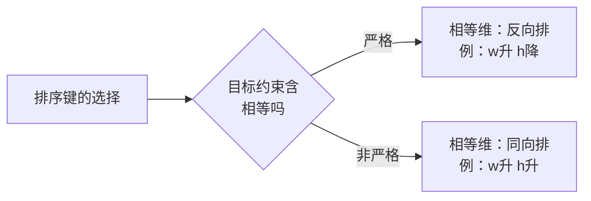
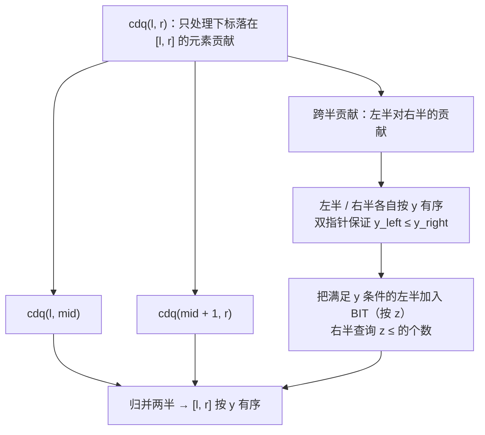
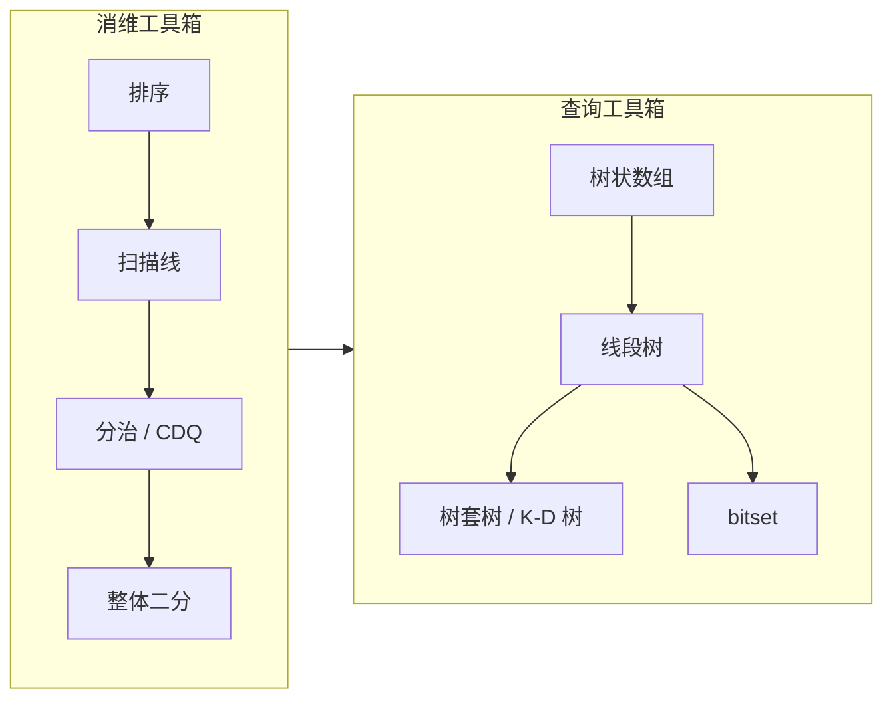
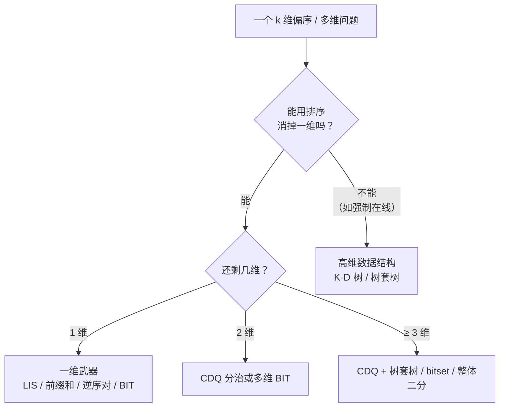

# 维度问题：一维算法的升维，与高维偏序

> 本文回答一个问题：**把一维算法推广到二维、三维，本质发生了什么变化？该怎么解决？**
>
> 起点是俄罗斯套娃信封（[LeetCode 354](https://leetcode.cn/problems/russian-doll-envelopes/)），但目标不止于这一题，而是把「维度」当成一条贯穿数据结构与算法的主线。

关联阅读：

- [动态规划/题目.md](../动态规划/题目.md) —— LIS 的状态设计，本文的二维版从这里长出来
- [总览/1.算法思想与技巧.md](../总览/1.算法思想与技巧.md) —— 「枚举 / 去冗余」的总纲，本文是它在「维度」上的专门化
- [总览/2.分治算法.md](../总览/2.分治算法.md) —— CDQ 分治是分治思想的高维形态

---

## 0. 先回答问题：偏序意义下的「大于」

> 把「点 A 大于点 B」定义为「A.x > B.x 且 A.y > B.y」，本质是在找最长严格递增子序列吗？

**方向对，但要加一个限定词：这是「偏序」意义下的大于，不是「全序」意义下的大于。**

一维里的「大于」是全序：任意两个数一定比得出大小。二维里「A.x > B.x 且 A.y > B.y」是**偏序**：很多点对根本比不出大小。

```text
   y ↑
   4 |  A(2,4)                        B(6,4)
   3 |              C(3,3)    D(5,3)
   2 |  E(2,2)
     +--------------------------------------→ x
        2        3        5        6
```

- `E(2,2) < C(3,3) < B(6,4)`：可比，连成一条**链**。
- `A(2,4)` 与 `C(3,3)`：A 的 x 更小、但 y 更大 → **不可比**，谁也不算大于谁。

「不可比」这件事，正是升维之后一切复杂度的根源。一维里你可以「排序后从左到右扫」，是因为全序给了你一条唯一的线；二维里没有这条线，于是我们要么**人为造一条线（排序）**，要么**用数据结构/分治把缺失的那一维补回来**。

---

## 1. 一句话本质

**维度问题 = 在偏序上做「链」或「统计」。**

- 一维算法之所以简单，是因为全序 = 天然的一条扫描线；
- 升维之后，多出来的每一维都要求「同时满足一个不等式约束」；
- 解决维度问题的全部技巧，可以压缩成一句：**要么用排序消掉一维，要么用数据结构（BIT / 线段树 / K-D 树）或分治（CDQ / 整体二分）替你把剩下的维「查」出来。**

---

## 2. 数学地基：序、可比、链与反链

深入算法会不可避免地碰到数学。这一节把后面反复用到的词一次讲清。

### 2.1 偏序（partial order）

集合 `S` 上的关系 `≤`，若满足三条：

| 性质 | 含义 |
|---|---|
| 自反 | `a ≤ a` |
| 反对称 | `a ≤ b` 且 `b ≤ a` ⟹ `a = b` |
| 传递 | `a ≤ b` 且 `b ≤ c` ⟹ `a ≤ c` |

就称 `(S, ≤)` 为一个**偏序集**（poset）。

- 如果再加一条「任意两个元素都可比较」，就是**全序**（total order）。一维数值的大小、按字典序排好的字符串，都是全序。
- 信封的「严格支配」`A ≺ B ⟺ A.x < B.x 且 A.y < B.y` 是**严格偏序**（反自反 + 反对称 + 传递），后面统一叫偏序。

### 2.2 可比、不可比

- **可比**：`a ≤ b` 或 `b ≤ a` 至少有一个成立。
- **不可比**：两个都不成立。二维里就是 `(x1-x2)` 与 `(y1-y2)` 异号。

### 2.3 链与反链

| 概念 | 定义 | 在套娃信封里对应 |
|---|---|---|
| **链**（chain） | 子集中任意两个元素都**可比** | 一条合法的嵌套序列 |
| **反链**（antichain） | 子集中任意两个元素都**不可比** | 一批互相套不进去的信封 |

于是：

> **LIS 的本质 = 偏序集上的最长链。**
> 一维 LIS 只是「全序偏序集」这个特例。

### 2.4 Dilworth 定理与 Mirsky 定理

这两个定理把「链」和「反链」用**对偶**的方式绑在一起：

| 定理 | 内容 |
|---|---|
| **Dilworth** | 最大反链大小 = 覆盖全集合所需的最少链数 |
| **Mirsky** | 最长链长度 = 覆盖全集合所需的最少反链数 |

对 LIS 的用处：求「最长链」等价于求「最少用几条不上升子序列能把所有元素覆盖掉」，也等价于「最少分成几组互不可比的集合」。这是 LIS 与贪心/覆盖问题之间的桥。它不直接给算法，但解释了**为什么很多看起来不像 LIS 的题，其实是 LIS**。

> 一句话：**链是最长嵌套，反链是「谁也比不过谁」。** 遇到「最多能选多少个互不冲突」「最少分几组」这类问法，先想想它是不是 Dilworth / Mirsky 的对偶形式。

### 2.5 一维、二维、三维的对照

| | 一维 | 二维 | 三维 |
|---|---|---|---|
| 偏序 | `a ≤ b`（全序） | `a.x≤b.x 且 a.y≤b.y` | 再加 `a.z≤b.z` |
| 最长链 = | LIS | 套娃信封 | 三维 LIS |
| 经典算法 | 贪心 + 二分 / DP | 排序 + LIS | CDQ 分治 |
| 代表题 | [300](https://leetcode.cn/problems/longest-increasing-subsequence/) | [354](https://leetcode.cn/problems/russian-doll-envelopes/) / [646](https://leetcode.cn/problems/maximum-length-of-pair-chain/) | [洛谷 P3810](https://www.luogu.com.cn/problem/P3810) |

---

## 3. 核心武器：排序 = 免费的降维

### 3.1 为什么排序能消掉一维

```
把第 1 维排序后从左往右扫：
    对于扫描到的元素 i，所有「在它右边」的元素天然满足 第1维 ≥ 第1维_i。
    于是第 1 维的约束被"顺序"自动满足，只剩第 2 维需要额外处理。
```

数字化地说：**排序把一个「约束维度」转化成了一个「时间维度」。** 约束是空间性的（要同时比两维），扫描是时间性的（一维有序），而一维有序恰好能被 LIS / BIT 这类工具吃掉。

> 这是「排序 + 一维算法」能解决大量二维问题的根本原因。

### 3.2 严格 vs 非严格：tie-break 是命门

以套娃信封为例，规则是**两维都必须严格大**。做法：

1. 宽 `w` **升序**；
2. `w` 相同时，高 `h` **降序**。

为什么同宽要降序？因为宽度相等时两封信封不可能嵌套，但排序后它们会挨在一起；把 h 降序排列，同一宽度组内的 h 单调递减，于是**任何严格递增的 h 子序列最多只能从同一宽度组里取一个**，自动排除了「同宽也算嵌套」的非法情况。

反例 `[[4,5],[4,6],[6,7]]`：

| 排序键 | 高度序列 | LIS | 结果 |
|---|---|---|:---:|
| w 升、h **升** | `5, 6, 7` | 3 | ❌（把两个 w=4 的信封也算进链了） |
| w 升、h **降** | `6, 5, 7` | 2 | ✅ |



**通用口诀**：要严格，就把「相等的另一维」反向排；要非严格，就同向排。

### 3.3 套娃信封的完整解法

```js
// LeetCode 354：排序消掉宽度这一维，剩下高度求严格递增 LIS
function maxEnvelopes(envelopes) {
  envelopes.sort((a, b) => a[0] - b[0] || b[1] - a[1]); // 宽升序；同宽高降序

  const tails = []; // 耐心排序：tails[k] = 长度 k+1 的递增子序列的最小结尾
  for (const [, h] of envelopes) {
    let lo = 0, hi = tails.length;
    while (lo < hi) {
      const mid = (lo + hi) >> 1;
      if (tails[mid] < h) lo = mid + 1;
      else hi = mid;
    }
    tails[lo] = h;
  }
  return tails.length;
}
```

复杂度由 LIS 决定：`O(n log n)`。

> 注意：一维 LIS 出于「必须严格递增」的要求，等价于二维问题的严格性。当你把 `tails[mid] < h` 改成 `<=`，就从「严格递增」变成了「非严格递增」——**同一段代码，改一个符号就是另一个偏序。**

---

## 4. 第一层：一维 → 二元的常见推广

一维算法升到二维，大多遵循同一个套路：**排序消一维 + 原算法处理另一维**。下面是几张常用对照表。

| 一维问题 | 二维推广 | 降维方式 | 剩余部分交给谁 |
|---|---|---|---|
| LIS | 二维 LIS（套娃信封） | 按第一维排序 | 一维 LIS |
| 逆序对 | 二维数点（矩形内点数） | 按 x 排序 | BIT 统计 y |
| 前缀和 | 二维前缀和 | —— | 容斥 |
| 区间最值 | 二维区间最值 | —— | 二维线段树 / 树套树 |
| 区间计数 | 二维偏序计数 | 扫描线 / CDQ | BIT |

### 4.1 二维数点

问题：平面上若干点，多次询问「以 `(x, y)` 为右上角、包含多少点」。

- 离线把询问按 `x` 排序；
- 用扫描线从左到右，把点按 x 加入；
- 查询「y ≤ Y 的点数」→ 一维权值 BIT。

这就是**扫描线**：把二维的「矩形区域」拆成两个一维的时间点，用一次扫描 + 一次数据结构查询完成。

### 4.2 从 LIS 到「最长数对链」（LeetCode 646）

`pairs[i] = [left, right]`，若 `b < c` 则 `[a,b]` 可接 `[c,d]`。同样先按 `left` 排序（相等时按 `right` 升序，因为这里允许相等处理不同），再对 `right` 求 LIS。**同一套模板，换个排序键就是新题。**

---

## 5. 第二层：二维问题需要的数据结构

当「排序 + 朴素一维算法」不够快时（例如 `O(n²)` 的 LIS DP），就要用数据结构把内层查询降到 `O(log n)`。

### 5.1 用权值树状数组把 LIS 优化到 O(n log n)

一维 LIS 的转移是：

```text
dp[i] = 1 + max{ dp[j] : j < i 且 nums[j] < nums[i] }
```

把「值」当作下标建一棵**最大值树状数组**，转移就变成「查询小于 `nums[i]` 的最大 dp」。

```js
class MaxBIT {
  constructor(n) { this.n = n; this.t = new Array(n + 1).fill(0); }
  update(i, v) { for (; i <= this.n; i += i & -i) this.t[i] = Math.max(this.t[i], v); }
  query(i) { let r = 0; for (; i > 0; i -= i & -i) r = Math.max(r, this.t[i]); return r; }
}

function lengthOfLIS(nums) {
  const sorted = [...new Set(nums)].sort((a, b) => a - b); // 坐标压缩
  const rank = new Map(sorted.map((v, i) => [v, i + 1]));
  const bit = new MaxBIT(sorted.length);
  let ans = 0;
  for (const x of nums) {
    const r = rank.get(x);
    const best = bit.query(r - 1); // 严格小于 x
    bit.update(r, best + 1);
    ans = Math.max(ans, best + 1);
  }
  return ans;
}
```

> 耐心排序（第 3.3 节）和权值 BIT 是 LIS 的两条 `O(n log n)` 路线：前者只求长度、常数小；后者能顺便做「计数」「带权」等推广。

### 5.2 二维数据结构

| 结构 | 支持 | 空间 | 单次操作 | 备注 |
|---|---|---|:---:|---|
| 二维前缀和 | 静态矩形和 | `O(nm)` | `O(1)` | 不允许修改 |
| 二维 BIT | 矩形加 / 矩形和 | `O(nm)` | `O(log²)` | 修改有代价 |
| 线段树（动态开点） | 区间最值/和 | `O(n log n)` | `O(log n)` | 支持值域大 |
| 树套树 | 二维区间操作 | 大 | `O(log²)` | 常数大、难写 |
| K-D 树 | 高维正交查询 | `O(n)` | 平均 `O(n^(1-1/d))` | 见第 7 节 |

**关键判断**：二维 BIT 的空间是 `O(nm)`，值域一大就爆炸。这就是为什么「三维及以上」不能靠简单堆维度，而要走**分治**。

---

## 6. 第三层：升到三维 —— CDQ 分治

### 6.1 为什么排序不够了

二维时：排序消一维 → 剩一维交给 LIS/BIT。
三维时：排序消一维 → **还剩下两维**，没有「一维 LIS」这种现成工具了。

这时候需要**分治**：用「分治」再消掉一维，用「BIT」消掉最后一维。

### 6.2 CDQ 分治的三步

以经典三维偏序（[洛谷 P3810](https://www.luogu.com.cn/problem/P3810)）为例：对每个点，统计有多少点在各维都不大于它。



三步走：

1. **排序 + 分治**：先按 `x` 排序，再对下标区间 `[l, r]` 二分。因为已按 x 排序，**左半所有元素的 x 一定不大于右半**——x 这一维被「分治结构」自动满足。
2. **跨半贡献**：左半和右半各自按 `y` 有序，用双指针「左边 y ≤ 右边 y 的才加入 BIT」；BIT 以 `z` 为下标统计数量。于是 `y`、`z` 两维也处理完了。
3. **归并**：把两半按 `y` 归并，维持「区间按 y 有序」的不变式，供上一层使用。

每一层处理的元素总数是 `O(n)`，BIT 每次操作 `O(log n)`，递归 `log n` 层，总复杂度 **`O(n log² n)`**。

### 6.3 完整实现（已对拍验证）

```js
class SumBIT {
  constructor(n) { this.n = n; this.t = new Array(n + 1).fill(0); }
  add(i, v) { for (; i <= this.n; i += i & -i) this.t[i] += v; }
  sum(i) { let s = 0; for (; i > 0; i -= i & -i) s += this.t[i]; return s; }
}

// 对每个点 i，求 #{ j : x_j<=x_i 且 y_j<=y_i 且 z_j<=z_i }（j 含 i 自身）
function level3D(points) {
  const n = points.length;
  const arr = points.map((p, id) => ({ x: p[0], y: p[1], z: p[2], id }));
  arr.sort((a, b) => a.x - b.x || a.y - b.y || a.z - b.z);

  // 步骤 0：去重！完全相同的点必须合并成一组
  const pts = [];
  for (const p of arr) {
    const last = pts[pts.length - 1];
    if (last && last.x === p.x && last.y === p.y && last.z === p.z) {
      last.cnt++; last.ids.push(p.id);
    } else {
      pts.push({ x: p.x, y: p.y, z: p.z, cnt: 1, ids: [p.id], res: 0 });
    }
  }
  const m = pts.length;

  // z 坐标压缩
  const zs = [...new Set(pts.map(p => p.z))].sort((a, b) => a - b);
  const zrank = new Map(zs.map((v, i) => [v, i + 1]));
  const bit = new SumBIT(zs.length);

  function cdq(l, r) {
    if (l === r) return;
    const mid = (l + r) >> 1;
    cdq(l, mid);
    cdq(mid + 1, r);

    // 跨半贡献：左半按 y 有序（不变式），右边查 BIT
    let i = l;
    for (let j = mid + 1; j <= r; j++) {
      while (i <= mid && pts[i].y <= pts[j].y) {
        bit.add(zrank.get(pts[i].z), pts[i].cnt);
        i++;
      }
      pts[j].res += bit.sum(zrank.get(pts[j].z)); // 结果挂在"组"上，不能按下标存
    }
    for (let t = l; t < i; t++) bit.add(zrank.get(pts[t].z), -pts[t].cnt); // 撤销 BIT

    // 归并排序 [l, r] by y，维持不变式
    const buf = [];
    let p = l, q = mid + 1;
    while (p <= mid && q <= r) buf.push(pts[p].y <= pts[q].y ? pts[p++] : pts[q++]);
    while (p <= mid) buf.push(pts[p++]);
    while (q <= r) buf.push(pts[q++]);
    for (let t = 0; t < buf.length; t++) pts[l + t] = buf[t];
  }
  cdq(0, m - 1);

  const out = new Array(n);
  for (let g = 0; g < m; g++) {
    const level = pts[g].res + pts[g].cnt; // 支配它的点数（含自身）
    for (const id of pts[g].ids) out[id] = level;
  }
  return out;
}
```

### 6.4 两个必须记住的坑

| 坑 | 后果 | 处理 |
|---|---|---|
| **忘记去重** | 完全相同的点会被算漏或算错 | 相同 `(x,y,z)` 合并成一组，携带 `cnt` |
| **结果按下标存** | 归并会打乱下标，结果串位 | 结果必须挂在「组对象」上，而不是数组下标上 |

第 2 条是很多人手写 CDQ 时最隐蔽的 bug：数组下标会随归并移动，而「组」是稳定的。

---

## 7. 第四层：更高维与其它范式

三维之后，维度继续上涨，手段也随之变化。

| 范式 | 适用场景 | 复杂度 | 说明 |
|---|---|---|---|
| **CDQ 分治** | 离线三维偏序（计数 / 带权 / 求最长链） | `O(n log² n)` | 最常用，前面已讲 |
| **整体二分** | 离线「带修改区间第 k 小」等判定性问题 | `O((n+q) log n log V)` | 把「二分答案」整体并行 |
| **树套树** | 强制在线的二维区间操作 | `O(log² n)` | 码量大、常数大 |
| **K-D 树** | 高维正交范围查询（可达 5~6 维） | 平均 `O(n^(1-1/d))` | 理论最坏差，但实际好用 |
| **bitset** | 布尔型偏序 / 传递闭包 | `O(n² / 64)` | 把「比大小」压成位运算 |
| **扫描线** | 二维几何 / 区间问题 | 视配套结构 | 「把区域变成时间」 |



### 7.1 一句话理解每个工具

- **排序 / 扫描线**：把一维「约束」变成一维「时间」。
- **CDQ 分治**：分治再消一维，剩下的用 BIT。
- **整体二分**：一堆询问需要各自二分，合成一次分治一起做。
- **树套树**：两个一维结构嵌套，代价是 `log²` 和码量。
- **K-D 树**：把点按维度轮流切，做成「会剪枝的平衡树」。
- **bitset**：把所有「是否 ≤」的布尔关系塞进 64 位字，按位并行。

---

## 8. 方法论：升维四问

拿到任何「多维」问题，按这个顺序自问：



然后逐条核对：

| 问题 | 要确认什么 |
|---|---|
| ① 这是偏序吗？ | 把「只能如何嵌套/比较」写成不等式约束 |
| ② 要严格还是非严格？ | 决定排序键（反向 or 同向）与 BIT 查询边界 |
| ③ 能排序消一维吗？ | 能，就用「排序 + 一维算法」 |
| ④ 剩下几维、怎么查？ | 1 维 LIS/BIT；2 维 CDQ；≥3 维见第 7 节 |

**核心心智模型**：

```text
升维 = 每多一维，就多一个"同时满足的不等式"
      → 必须有一件工具负责满足它：
        排序（变成顺序）、数据结构（查出来）、分治（拆开算）
     当工具不够用时，就组合工具（CDQ = 分治 + 排序 + BIT）。
```

---

## 9. 循序渐进的学习路线

按这个顺序练，每一阶段只加一个新工具。

### 阶段一：一维基本功

| 题目 | 要点 |
|---|---|
| [LeetCode 300 最长递增子序列](https://leetcode.cn/problems/longest-increasing-subsequence/) | `O(n²)` DP → 耐心排序 `O(n log n)` |
| [LeetCode 493 翻转对](https://leetcode.cn/problems/reverse-pairs/) | 逆序对家族，准备进入 BIT |
| [洛谷 P1908 逆序对](https://www.luogu.com.cn/problem/P1908) | 树状数组 / 归并排序两种写法 |

### 阶段二：排序消一维（二维）

| 题目 | 要点 |
|---|---|
| [LeetCode 646 最长数对链](https://leetcode.cn/problems/maximum-length-of-pair-chain/) | 二维 LIS 的最简版 |
| [LeetCode 354 俄罗斯套娃信封](https://leetcode.cn/problems/russian-doll-envelopes/) | **严格**约束下的排序键设计 |
| [LeetCode 面试题 08.13 堆箱子](https://leetcode.cn/problems/pile-box-lcci/) | 三维可旋转 → 排序 + LIS |
| [LeetCode 315 计算右侧小于当前元素的个数](https://leetcode.cn/problems/count-of-smaller-numbers-after-self/) | BIT 统计「后缀里更小的数」 |

### 阶段三：二维数据结构

| 题目 | 要点 |
|---|---|
| [LeetCode 327 区间和的个数](https://leetcode.cn/problems/count-of-range-sum/) | 前缀和 → 二维偏序 |
| [洛谷 P3368 【模板】树状数组 2](https://www.luogu.com.cn/problem/P3368) | 差分 + BIT |
| [LeetCode 304 二维区域和检索](https://leetcode.cn/problems/range-sum-query-2d-immutable/) | 二维前缀和 |

### 阶段四：三维 CDQ

| 题目 | 要点 |
|---|---|
| [洛谷 P3810 【模板】三维偏序（陌上花开）](https://www.luogu.com.cn/problem/P3810) | 本文第 6 节的完整实现 |
| CDQ 求「三维 LIS」 | 把 `max` 汇总改成 BIT 上的最值 |

### 阶段五：更高维（可延后）

| 方向 | 入口 |
|---|---|
| 整体二分 | [洛谷 P1527 矩阵乘法](https://www.luogu.com.cn/problem/P1527) |
| K-D 树 | [洛谷 P4148 简单题](https://www.luogu.com.cn/problem/P4148) |
| 树套树 | [洛谷 P3380 二逼平衡树](https://www.luogu.com.cn/problem/P3380) |

---

## 10. 一句话总结

- **维度问题的本质**：在一维全序上，算法可以「排序后线性扫」；升一维，就多一个不能自动满足的不等式。
- **偏序 vs 全序**：二维的「大于」（严格支配）是偏序，存在不可比的点对——这就是复杂度的来源。
- **LIS 的升维**：一维 LIS 是「全序上的最长链」，套娃信封是「偏序上的最长链」；LIS 与套娃信封是同一个问题在不同序上的样子。
- **解决方式**：**排序消一维**是最便宜的降维；剩下的维靠**数据结构**（BIT / 线段树 / K-D 树）或**分治**（CDQ / 整体二分）补齐。
- **CDQ 分治**：分治再消一维 + BIT 消最后一维，`O(n log² n)`；两个坑是**必须去重**和**结果挂在组上而非下标上**。

---

## 参考

- [LeetCode 354 俄罗斯套娃信封](https://leetcode.cn/problems/russian-doll-envelopes/)
- [LeetCode 300 最长递增子序列](https://leetcode.cn/problems/longest-increasing-subsequence/)
- [洛谷 P3810 【模板】三维偏序（陌上花开）](https://www.luogu.com.cn/problem/P3810)
- [OI Wiki：树状数组](https://oi-wiki.org/ds/fenwick/)
- [OI Wiki：CDQ 分治](https://oi-wiki.org/misc/cdq-divide/)
- [OI Wiki：序理论（偏序 / Dilworth）](https://oi-wiki.org/math/order-theory/)
- [labuladong：算法总结篇](https://labuladong.online/zh/algo/essential-technique/algorithm-summary/)
