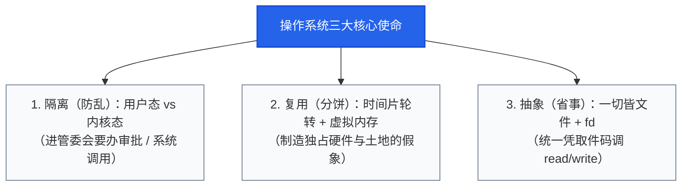

# 操作系统与后端架构 · 总起

> **学习目标**：面向零基础与前端转型后端的同学，用最直白的方式建立一套操作系统的底层心智模型，搞清楚「操作系统到底在帮后端服务干什么」，以及「高并发场景下后端代码如何与操作系统打交道」。

---

## 一、心智模型：科技园与园区管委会

如果直接看教科书，操作系统的定义往往是：*“管理计算机硬件与软件资源的系统软件，为用户提供交互接口……”* 这类定义准确但抽象。

对于后端开发来说，一个**极度好理解且能贯穿始终的比喻**是：

| 实体 | 科技园比喻 | 现实世界对应的计算机实体 |
| :--- | :--- | :--- |
| **服务器硬件** | **科技园区硬件资产** | CPU（发电站/计算核心）、内存（园区土地）、硬盘（物资仓库）、网卡（物流出入口） |
| **操作系统（OS）** | **园区管委会** | Linux / Windows / macOS，制定规则、分配资源、审批进出 |
| **进程（Process）** | **入驻科技园的一家家公司** | 你的 Node.js Web 进程、MySQL 数据库进程、Python AI 训练脚本 |
| **线程（Thread）** | **公司里的打工人** | 真正干活的执行流，多个人共享这一家公司的工位与资产 |
| **协程（Coroutine）** | **打工人的多任务分身（如 Go Goroutine）** | 用户态轻量级线程，公司内部自己调配精力，管委会根本感知不到 |

---

## 二、人类为什么必须发明“操作系统（园区管委会）”？

想象一下，如果**没有操作系统**（没有园区管委会），让几十家入驻公司（Node.js 服务、MySQL、Python 训练脚本）直接去抢园区的土地（内存）、发电站（CPU）和物流大门（网卡/硬盘），会发生什么灾难？

1. **流氓公司霸占全场**：A 公司写了个 `while(true)` 死循环，直接把所有 CPU 算力占满；或者疯狂申请空间把整片内存全圈走，导致其他正常业务公司全部饿死。
2. **互相偷窥与破坏**：B 公司代码里指针算错了，不小心改写了 C 公司（比如核心银行数据库）内存里的余额数据；甚至直接把主板供电总闸拉了，全机蓝屏死机。
3. **造轮子累死业务方**：每家公司想向外发一个 HTTP 数据包，程序员都得自己去研究不同品牌网卡芯片的高低电平协议；想存个文件，还要自己算磁道和扇区。

人类为了解决这三类问题，给操作系统（园区管委会）赋予了**三大核心职能（简记为：防乱、分饼、省事）**：

### 1. 隔离（防乱）：划定“用户态”与“内核态”
* **用户态（User Space）**：管委会规定，所有入驻公司（普通进程）只能在自己的办公室隔间内活动。普通公司**绝无权限**直接触碰园区的配电总闸、物理硬盘底层或网卡物理引脚。
* **内核态（Kernel Space）**：管委会的核心办公室。拥有最高权限，可以直接操控底层硬件。
* **系统调用（System Call）**：只要你的公司想做“出格”的事（例如读取硬盘文件、发起 TCP 网络请求），就必须向管委会提交正式申请单。CPU 会触发一次模式切换（从用户态切进内核态），由管委会核实权限、代为操作，再把结果递回给你。

### 2. 复用（分饼）：让有限的硬件“看起来像无限的”
* 园区实际只有 4 个发电机核心（4 核 CPU）和 16GB 土地（物理内存），却入驻了 200 家公司（200 个并发进程）。
* 管委会通过**时间片轮转（CPU 分时复用）**，每家公司轮流用几毫秒，由于切换极快，每家公司都觉得 CPU 是一直为自己服务的。
* 管委会通过**虚拟内存（Virtual Memory）**机制，给每家入驻公司画了一张“你独占整块连续地址空间（比如 64 位下 128TB）”的巨大图纸。你真正要放东西时，管委会才在后台偷偷切一小块物理内存给你（分页机制）。

### 3. 抽象（省事）：把复杂多样的硬件包装成统一的“文件”
* 在 Linux 系统中，有一条著名的设计哲学：**“一切皆文件（Everything is a file）”**。
* 无论是读磁盘上的 JSON 配置文件、向终端打印 log、还是通过网卡与前端建立的 TCP/HTTP 连接，在操作系统眼里都是一个统一编号的**取件码——文件描述符（File Descriptor，简称 `fd`）**。
* 后端开发只需要调用统一的 `read(fd)` / `write(fd)`，底层插的是英特尔网卡、三星 SSD 还是光纤交换机，管委会全替你抹平了。

---

## 三、后端开发者真正需要掌握的 4 大 OS 核心板块

日常业务代码写的是业务逻辑，但**一旦遭遇高并发、海量数据吞吐或系统抖动崩溃时**，本质都是你的后端服务在和“园区管委会”打交道的方式出了问题。

后端工程师（特别是涉及高吞吐、AI 任务调度与模型推理平台）必须透彻理解以下 4 块操作系统抽象：

| 操作系统核心板块 | 科技园管委会比喻 | 核心底层机制与高频考点 | 真实后端场景（Node.js / Go / 工业 AI 平台） |
| :--- | :--- | :--- | :--- |
| **1. 并发与锁机制** | **公章争夺管理** —— 同一家公司 10 个打工人同时抢公司公章，怎么防盖错章、怎么防互相卡死？ | 临界区、互斥锁（Mutex）、自旋锁、乐观锁（CAS）、**死锁四大必要条件** | Go 多协程更新“AI 训练任务状态表”；高并发下扣减用户调用额度；避免死锁导致服务僵死。 |
| **2. 虚拟内存与 OOM** | **空头支票与破产强拆** —— 管委会给每家画大饼，土地真用光了，管委会怎么把闲置货物挪走，或者把谁强制清退？ | 虚拟地址空间、页表（Page Table）、缺页中断、Swap 交换分区、**OOM Killer** | 为什么 Node.js/Go 进程在加载数 GB 工业图像或模型权重时突然无故退出（`Killed`）？排查内核 OOM 日志。 |
| **3. I/O 模型与收发室** | **快递收发室通知机制** —— 数万个客户发来 HTTP 请求，派打工人在门口死等，还是收发室装智能大屏亮灯通知？ | 阻塞/非阻塞 I/O、**I/O 多路复用（`select` / `poll` / `epoll`）**、**零拷贝（Zero-Copy）** | **后端面试压轴考点**：Node.js Event Loop 底层（libuv / epoll）为何能以单线程抗万级长连接；文件大流传输的性能优化。 |
| **4. 进程间通信（IPC）** | **跨公司物资移交** —— 两家公司办公室物理隔断（内存不相通），A 公司怎么把任务图纸高速送达 B 公司？ | 匿名管道、命名管道（FIFO）、**共享内存（Shared Memory）**、Unix Domain Socket、网络 Socket | 工业 AI 平台中，Node/Go Web 后端通过 Socket 给 Python 发模型推理指令，通过**共享内存**零延迟传递数百兆高清检测大图。 |

---

## 四、用这套模型回答后端的 3 个“灵魂拷问”

### 拷问 1：同一家公司的打工人抢公章怎么办？（并发与锁）

* **Node.js 视角的解答**：
  Node.js 的 JavaScript 逻辑**默认运行在一个主线程（1 个打工人）上**。因为办公室内只有这 1 个人在处理你的 JS 代码，所以你根本不用在 JS 里写互斥锁，天生不存在“两个打工人在同一毫秒改写内存中同一个全局对象”的脏写风险。
* **多线程 / Go 语言视角的解答**：
  在 Go / Java 等原生支持多线程/多协程的语言中，成百上千个打工人（Goroutine）在同一个内存空间里狂奔。如果同时修改同一个 `map`，程序会直接 crash。此时必须用**互斥锁（`sync.Mutex`）**把临界区锁起来；或者践行经典哲学：
  > *“不要通过共享内存来通信，而要通过通信（Channel 传送带）来共享内存。”*
  打工人 A 把处理完的数据放到传送带推给打工人 B，避免两人同时抢同一块物理纸张。

### 拷问 2：上万个 HTTP 请求打过来，收发室怎么不瘫痪？（I/O 多路复用 `epoll`）

* **传统死等模式（阻塞 I/O）**：
  网络数据传输比 CPU 慢数十万倍。如果每来一个客户端连接，公司就招一个打工人（开辟一个线程，消耗几 MB 栈内存）死守在网卡口等数据，10,000 个连接就会创建 10,000 个线程，服务器光是线程切换和内存开销就能把机器拖垮。
* **现代收发室模式（`epoll` 多路复用）**：
  Linux 园区管委会在收发室装了一个叫 **`epoll`** 的超级系统：
  1. **登记花名册（红黑树）**：Node.js 或 Go 把关心的上万个连接 `fd` 一次性登记在管委会内核的红黑树中。
  2. **打工人回去干别的事**：不用在门口傻等。
  3. **就绪亮灯（就绪链表）**：一旦外部网卡真的收到了某 3 个连接的 TCP 数据包，管委会只把这 3 个有货的 `fd` 放入就绪队列，并通知打工人。
  4. **精确取件**：Node.js 事件循环主线程（或 Go 网络轮询器）跑过去，直接拿到这 3 个有数据的包裹开始处理。
  
  **结论**：这就是为什么 **1 个打工人（Node.js 单线程）也能轻松调度几万个并发网络连接**的物理真相。

### 拷问 3：工业 AI 平台传动辄几百 MB 的高清图纸，怎么少搬运几次？（零拷贝 Zero-Copy）

* **传统搬运路径（4 次拷贝 + 4 次上下文切换）**：
  前端请求下载模型文件或大图时，传统 `read()` + `write()` 流程：
  1. 硬盘数据由 DMA 拷贝到管委会内核缓冲区；
  2. CPU 把数据从管委会内核区搬运进你公司的办公室（用户态内存）；
  3. 打工人看都不看，又用 `write()` 把数据从办公室搬运进管委会 Socket 发送缓冲区；
  4. DMA 再把数据从 Socket 缓冲区推入网卡。
  *来回折腾了 4 次拷贝，且进出办公室必须经历 4 次系统调用上下文切换。*
* **零拷贝方案（`sendfile` / `splice`）**：
  后端直接向管委会下达系统调用：`sendfile(out_fd, in_fd, ...)`。
  告诉管委会：*“把仓库里的这批货物直接通过物流大门网卡发出去，不要搬进我办公室了！”*
  全程省去进入用户态内存的无意义搬运，CPU 占用率和内存带宽消耗呈断崖式下降。

---

## 五、本模块后续章节路线

基于以上全景抽象，本系列将紧扣后端实战与面试高频，逐篇击破：

1. **[01-进程与线程](./01-进程与线程.md)**：进程上下文切换成本、Node.js 多进程架构（Cluster / PM2）、Go 协程为什么轻量。
2. **[02-内存管理与OOM](./02-内存管理与OOM.md)**：虚拟内存、页表、内存泄漏定位、Linux OOM Killer 触发逻辑与防暴毙实战。
3. **[03-IO模型与epoll](./03-IO模型与epoll.md)**：从 BIO、NIO 到 epoll 源码级设计，Node.js libuv 架构与 Reactor 模式全拆解。
4. **[04-进程间通信IPC](./04-进程间通信IPC.md)**：管道、Unix Domain Socket、共享内存实战，工业 AI 平台中 Web 接入层与算法推理层的通信选型。
5. **[05-并发与锁机制](./05-并发与锁机制.md)**：悲观锁、乐观锁（CAS）、分布式锁心智模型，死锁排查套路。
