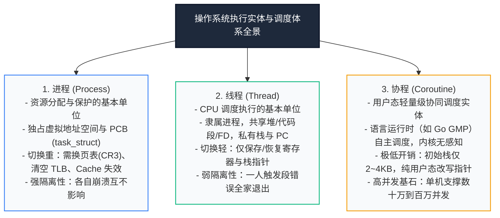
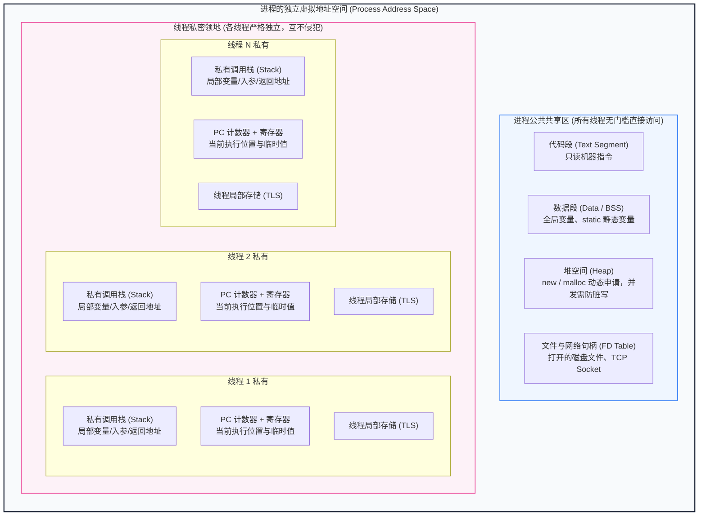
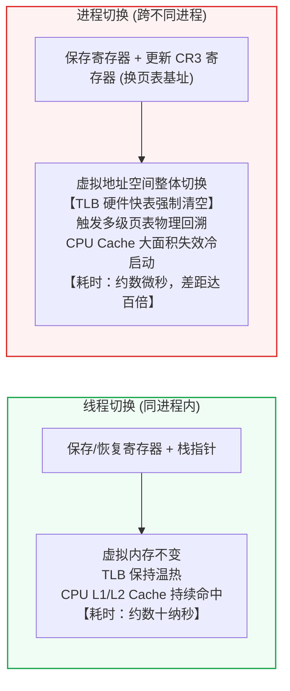
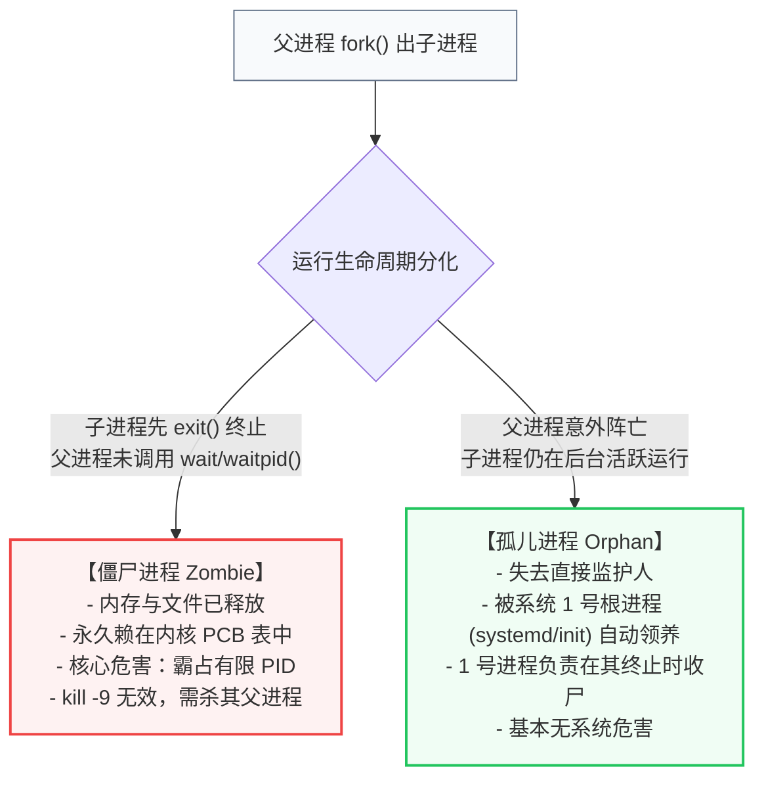

# 01 · 进程、线程与协程：从执行模型到底层开销

> **学习目标**：深入理解操作系统中「执行流」与「资源分配」的核心机制，建立进程、线程与协程的立体认知体系；既掌握精确严谨的学术/内核定义，又能借助直观工程心智模型穿透底层，搞懂上下文切换成本、异常传播规律、生命周期缺陷（孤儿/僵尸进程）以及高并发服务架构（Node.js / Go / 工业 AI 平台）的底层取舍。

---

## 知识全景脑图



---

## 一、标准定义与核心模型：进程 vs 线程

在技术面试与学术标准中，有两句话必须能一字不差地精准表述：

> 1. **进程（Process）**：是操作系统进行**资源分配和保护的基本单位**，是一个具有独立功能的程序关于某个数据集合的一次运行活动。
> 2. **线程（Thread）**：是操作系统进行**CPU 调度和执行的基本单位**，是进程中的一个实体，是 CPU 能够独立运行的最小单元。

### 1.1 经典比喻：科技园、公司与打工人

为了彻底扫清概念模糊，我们对照上一章的心智模型建立如下映射：

* **进程 = 入驻科技园区的一家独立公司**：
  拥有独立的营业执照（**PID**）、独立的园区注册地皮与办公室门禁（**独立虚拟地址空间**）、独立的公司资产库（**打开的文件描述符表 `fd table`、网络套接字**）。不同公司之间隔着厚重的水泥实体墙，任何一家公司都无法直接翻墙去改动别家公司的资产。
* **线程 = 这家公司里雇佣的一名名具体打工人**：
  打工人没有属于自己的独立办公室房产证，所有打工人共同坐在同一个开敞办公室中办公。他们随时能直接伸手抓取公共茶水间和白板上的数据（**共享堆内存 Heap、全局静态变量 Data 段、代码段 Text**）。但是，每个打工人干活时手里都必须有一张属于自己的草稿纸和正在读的段落书签（**私有的执行栈 Stack、程序计数器 PC、寄存器集合**）。

---

## 二、深潜内存结构：独占与共享的边界

面试中最高频的追问之一是：**“一个进程内的多个线程，到底哪些资源是共享的，哪些资源是绝对私有的？”**

### 2.1 内存空间划分示意图



### 2.2 权威拆解表

| 资源类别 | 具体项目 | 属于进程还是属于线程？ | 为什么必须这样设计？（设计动机） |
| :--- | :--- | :--- | :--- |
| **共享资源** | **代码段（Text）** | **进程所有，线程共享** | 多线程执行的是同一份程序的逻辑代码，无需在内存中存多份副本。 |
| **共享资源** | **全局变量 / 静态区（Data/BSS）** | **进程所有，线程共享** | 用于线程间自然传递共享状态（但也因此带来了并发数据竞争与加锁需求）。 |
| **共享资源** | **堆内存（Heap）** | **进程所有，线程共享** | 任何线程 `malloc` 或 `new` 出来的对象指针，传给其他线程均可直接读取。 |
| **共享资源** | **系统资源凭证（FD、信号处理器）** | **进程所有，线程共享** | 打开的文件、网络连接是操作系统分配给进程的，所有打工人都能用。 |
| **私有资源** | **程序计数器（PC / IP 寄存器）** | **线程绝对私有** | 必须记住每个线程当前正在执行哪一条指令，否则切走再切回来就不知道该干什么了。 |
| **私有资源** | **通用寄存器（Registers）** | **线程绝对私有** | 线程计算过程中的临时数值、计算标志位是当前执行逻辑的私有上下文。 |
| **私有资源** | **调用栈（Stack）** | **线程绝对私有** | 记录当前线程的函数调用层次、入参、局部变量及函数返回地址，多线程共用栈会导致栈帧错乱踩踏。 |
| **私有资源** | **线程局部存储（TLS, Thread Local Storage）**| **线程私有** | 业务上需要绑定在线程生命周期内的变量（例如链路追踪 TraceID、单线程缓存）。 |

> **内核数据结构定义提示**：
> 在 Linux 内核中，进程由 `task_struct`（即 **PCB, Process Control Block 进程控制块**）统一描述。令人惊讶的是：**在 Linux 内核眼里，并没有真正独立存在的“线程数据结构”！**
> Linux 里的线程在底层被称为轻量级进程（LWP, Light Weight Process），也是用 `task_struct` 表示；通过 `clone()` 系统调用创建时，如果传入了 `CLONE_VM`、`CLONE_FS`、`CLONE_FILES` 等标志位，子任务就会直接指向父任务的内存描述符、文件表，从而在内核视角形成了“线程共享进程资源”的特征。

---

## 三、性能核心：上下文切换（Context Switch）的真正代价

面试官常问：*“都说进程切换比线程切换开销大很多，到底大在哪里？是不是仅仅是保存几个寄存器的差别？”*

答案是：**寄存器的存取开销在现代 CPU 下微不足道，真正昂贵的是“地址空间切换”引发的硬件连带惩罚！**

### 3.1 线程上下文切换（同进程内部）

当 CPU 从同进程的“线程 A”切到“线程 B”时，发生的操作：
1. 保存线程 A 的 CPU 通用寄存器状态、程序计数器（PC）、栈指针（SP）到线程 A 的 TCB（Thread Control Block）；
2. 加载线程 B 的通用寄存器、PC 和 SP；
3. CPU 继续跳转执行线程 B 的代码。

*这一过程全程在**同一块虚拟内存**下进行，开销通常仅在**几十纳秒（ns）**量级。*

### 3.2 进程上下文切换（跨不同进程）

当 CPU 从“进程 X”切到“进程 Y”时，代价发生质的跃迁：
1. **保存与恢复寄存器**：类似于线程切换。
2. **切换页目录与虚拟地址空间**：操作系统修改 CPU 控制寄存器（如 x86 的 **CR3 寄存器**），将页目录物理基地址指向进程 Y 的页表。
3. **致命惩罚 1：硬件 TLB（快表）被强行清空/失效**
   * TLB（Translation Lookaside Buffer）是 CPU 内部专门用于加速“虚拟地址到物理地址转换”的高速硬件缓存。
   * 一旦换了 CR3 寄存器，所有进程 X 缓存的虚拟地址映射立刻作废。CPU 接下来读取任何指令和内存，都会遭遇连续的 **TLB Miss**，必须去物理内存中逐级回溯 4 级/5 级页表（耗时动辄几百个时钟周期）。
4. **致命惩罚 2：CPU L1/L2/L3 数据与指令缓存大面积失效**
   * 进程 Y 的代码和数据跟进程 X 截然不同，原本驻留在 CPU Cache 里的热数据瞬间变为冷数据，触发一连串的 **CPU Cache Miss**。



---

## 四、为什么还需要“协程（Coroutine）”？

既然线程切换已经比进程轻量不少，为什么在现代高并发服务端（以 Go 为代表，以及 Node.js 的异步任务编排）中，“协程”成为了当红主角？

这是因为面对 **C10K 乃至 C1000K（单机十万/百万并发）** 时，操作系统的“内核级线程”碰到了物理天花板：

1. **内存占用过大**：
   Linux 系统下一个操作系统线程默认分配的栈空间一般为 **2MB ~ 8MB**。如果一个服务端想要维持 10 万个并发网络连接，单单为每个连接分配一个线程，就需要：
   $$100,000 	imes 2	ext{MB} approx 200	ext{GB 内存}$$
   服务器会在任何业务代码运行之前，因物理内存耗尽而直接崩溃。
2. **内核态调度成本依然无法忽略**：
   线程的调度由操作系统内核负责，每次调度触发时钟中断，CPU 都要在用户态与内核态之间穿梭（陷入内核）。

### 4.1 协程的破局之道

* **概念定义**：**协程（Coroutine）是一种运行在用户态的轻量级调度实体**。它由程序语言的运行时（Runtime）或应用程序自身负责调度，操作系统完全感知不到协程的存在。
* **极小内存开销**：Go 语言中的 Goroutine（协程）初始栈大小**仅有 2KB ~ 4KB**，且随着函数调用链的伸长自适应扩容，十万个协程仅占 200MB ~ 400MB 内存。
* **零内核态切换**：协程由于由用户代码自己（或 Go 调度器）主动让出执行权（例如遇到网络等待），调度逻辑纯粹在用户态改写栈指针，单次切换耗时只需**几纳秒**。

### 4.2 进程、线程、协程三维终极对比表

| 维度 | 进程（Process） | 线程（Thread） | 协程（Coroutine） |
| :--- | :--- | :--- | :--- |
| **调度主导者** | 操作系统内核（CPU 分配） | 操作系统内核（CPU 调度） | **用户态应用程序/语言运行时** |
| **内存占用** | 几十 MB 起步（独立页表、环境） | 默认 **2MB ~ 8MB** | **2KB ~ 4KB 起步（自适应扩容）** |
| **拥有独立地址空间？** | **是**（严格物理隔离） | **否**（与同进程线程共享） | **否**（运行在当前线程空间内） |
| **切换成本** | 微秒（$mu s$）级，损耗 TLB 与 Cache | 几十到几百纳秒（$ns$），陷入内核 | **几纳秒（$ns$），纯用户态寄存器切换** |
| **通信机制** | 复杂且重（IPC 管道、套接字、共享内存） | 简单直接（共享变量、需注意并发安全） | 语言级原生通道（如 Go Channel）或函数闭包 |
| **并发容量上限** | 单机几百到几千（受 PID 和内存限制） | 单机几千（受内存栈大小限制） | **单机几十万到上百万** |

---

## 五、进程的生命周期缺陷：孤儿进程与僵尸进程

在 Linux 运维排障与后端架构中，父子进程的生命周期管理至关重要。子进程由父进程通过 `fork()` 系统调用衍生。但如果双方没有善始善终，就会产生两类特殊的进程：



### 5.1 孤儿进程（Orphan Process）
* **成因**：父进程因为意外挂掉或者提前执行完毕退出了，而它的子进程还在继续运转。
* **操作系统接管机制**：操作系统绝不允许任何进程在没有监护人的状态下无序运行。Linux 内核会自动将这批孤儿进程的“父进程 ID（PPID）”过户给**系统 1 号根进程**（早期的 `init`，现代 Linux 发行版中的 `systemd`）。
* **危害性评价**：**基本无害**。1 号进程极尽负责，每当有孤儿进程执行完毕，1 号进程都会积极调用系统调用为其收尸并释放资源。

### 5.2 僵尸进程（Zombie Process）
* **成因**：子进程已经调用 `exit()` 彻底终结了自身的生命，释放了绝大部分内存与打开的文件；但**它的父进程没有调用 `wait()` 或 `waitpid()` 收集子进程的退出状态**。
* **物理残留**：操作系统为了让父进程有机会了解“子进程到底是正常完工还是抛错崩溃”，在内核的进程控制表（Process Table）中为子进程保留了一条元数据记录，记录包含：**进程 PID、退出状态码、退出信号、CPU 运行时间统计**。此时该进程在 `ps` 命令下状态标识为 **`Z`（Zombie / defunct）**。
* **致命危害**：
  僵尸进程本身几乎不占内存，**但它永久占有着一个系统进程号（PID）！**
  32 位 Linux 系统的最大 PID 默认仅为 32768（可通过 `/proc/sys/kernel/pid_max` 查看）。如果代码中存在循环派生子进程却不回收的 Bug，系统可用 PID 将很快被消耗殆尽。**一旦 PID 耗尽，即使机器还有 90% 的物理内存和 CPU 空闲，也无法再创建任何新进程！** 此时执行任何 bash 命令都会直接报错：`fork: retry: Resource temporarily unavailable`。

### 5.3 僵尸进程的根治与清除手段
1. **为什么 `kill -9 [僵尸进程PID]` 毫无作用？**
   因为僵尸进程在逻辑上**已经是一个死人（已执行完 exit）**，没有任何正在运行的代码可以接收并响应 `SIGKILL` 信号。
2. **唯一正确解法**：
   找到僵尸进程的**父进程 PID（PPID）**，向父进程发出警告，促使其执行 `wait()`；或者直接将失职的父进程杀掉（`kill -9 [父进程PPID]`）。父进程死亡后，这些残留的僵尸进程立刻变为“孤儿”，1 号进程接收后会瞬间调 `wait()` 将它们彻底从系统中销毁清空。

---

## 六、后端工程实战与经典问题

### 6.1 异常传播规律：一个线程崩溃，整个进程会死吗？

在技术面试中，面试官经常挖坑：*“我在 Node.js 或 Java 服务里起了一个子线程，这个子线程如果发生未捕获异常或访问空指针段错误，整个进程会退出吗？”*

* **答案是：绝大多数情况下，整个进程会立刻全部死掉！**
* **底层原理剖析**：
  1. 如果子线程触发了诸如空指针引用、越界读写内存等致命错误，CPU 硬件在进行虚实地址转换或访问权限检查时会直接触发**硬件异常**。
  2. 操作系统内核捕获这个硬件异常后，会向产生故障的进程发送一个致命信号（例如 `SIGSEGV` 段错误信号，或 `SIGABRT` 中断信号）。
  3. **操作系统发送信号的实体是“进程”**，尽管错误是由某一个线程引发的，但信号是投递给整个进程的！
  4. 如果进程没有为该信号注册特定的安全恢复逻辑，操作系统的默认行为就是**终止整个进程（Terminated）**，该进程内部的所有其他正常线程瞬间被一网打尽。

### 6.2 工业 AI 平台架构：Web 接入层与模型计算层为何坚决进程隔离？

在工业视觉检测、缺陷识别等工业 AI 平台中，通常会包含：
* 基于 Node.js 或 Go 开发的 Web 业务管理后台（处理任务下发、用户鉴权、状态轮询）；
* 基于 Python / C++ 开发的深度学习推理与训练流水线（调用 TensorRT、PyTorch、OpenCV）。

**架构设计军规：绝不能将这两套东西做在同一个进程里通过内存线程直接挂载，必须拆分为独立的多进程架构（通过 HTTP、gRPC 或 Unix Domain Socket 通信）**。

其核心原因正是基于**进程的物理隔离保障**：
1. **防止 C++ 底层显存溢出与崩溃拉垮全站**：Python 底层驱动 GPU 时极易遭遇 CUDA Out Of Memory、C++ 动态链接库段错误。如果在一个进程里，推理报错一次，整个 Web 管理后台立刻全部瘫痪失联。
2. **独立的资源限制（Cgroups）**：操作系统可以精准限制 AI 计算进程的 CPU 核心数、内存用量，防止模型训练把机器算力吃光导致 Web 端口无响应。
3. **独立的热升级与生命周期**：模型升级重载耗时几分钟，Web 接入层无需重启，依然可以向前端展示“模型加载中，请稍候”的友好反馈。

### 6.3 生产排查兵法：CPU 突发 100% 怎么定位到具体行？

当线上的 Node.js / Java / Go 服务突然触发报警，服务器某个核被占满 100%，请按以下教科书级三步法排查：

```bash
# 第一步：找出是哪个进程在吃 CPU
top
# 记录下 CPU 占用最高的进程 PID（假设为 10240）

# 第二步：下钻到该进程内部，看是哪一个线程在狂飙
top -H -p 10240
# 参数 -H 代表以线程模式（Threads-mode）展示，找到最卡脖子的线程 TID（假设为 10255）

# 第三步：将十进制线程号转为十六进制，并在进程堆栈中搜索
printf "%x
" 10255
# 得到十六进制编号 0x280f
# 接着导出对应语言的堆栈（如 Java jstack，Node.js 性能剖析 profile），全局搜索 0x280f
# 瞬间直接定位到死循环发生的代码文件与行号！
```

---

## 七、高频八股核心考点与生产实战场景题（深度打通版）

抛开纯概念背诵，现代后端面试极度偏爱**“结合操作系统底层原理考察架构选型与故障排查”**。以下整理了 6 道具备高区分度的核心八股与真实场景题，按高频实战逻辑组织：

### 场景题 1：Redis 的 `bgsave` 生成 RDB 快照时，为什么主进程几乎不阻塞？但在高并发写入时为什么可能触发 OOM 崩溃？
* **底层原理考察**：`fork()` 系统调用、写时复制（COW, Copy-On-Write）、虚拟内存页表。
* **参考资料与延伸阅读**：
  * [深入剖析 Linux 内核 fork 机制：写时复制 (COW) 原理与应用实践](https://yunpan.plus/t/23158-1-1)
  * [通过优化 bgsave 触发频率与内存分配策略解决 Redis 阻塞与写时复制内存激增](https://m.php.cn/faq/2691912.html)
* **标准深度回答**：
  1. **不阻塞的原因（写时复制 COW）**：Redis 执行 `bgsave` 时，通过 `fork()` 创建子进程。操作系统**并不会立即把父进程的全部物理内存完整拷贝一份**，而只是复制了父进程的**虚拟内存页表**，并将所有内存物理页全部标记为**只读（Read-Only）**。此时父子进程指向同一批物理内存，因此 `fork()` 耗时极短（仅受页表大小影响），主进程得以快速恢复对外提供服务。
  2. **高并发写入导致 OOM 的成因**：在子进程慢慢把数据落盘期间，如果客户端有大量写请求打入，主进程修改某个内存页时，CPU 硬件会触发**写保护缺页中断**。内核会在此时为该页单独分配一个**新的物理页副本**并修改映射关系（发生真正的局部物理内存拷贝）。如果此时产生海量写流量，大量内存页被触发拷贝，**Redis 实际消耗的物理内存可能会逼近峰值的 2 倍**！如果机器没有留足预留内存，就会直接触发系统的 OOM Killer 将 Redis 进程静默杀死。

---

### 场景题 2：后端服务的线程池大小到底怎么配？配 1000 还是 10？
* **底层原理考察**：CPU 上下文切换开销、CPU 密集型 vs I/O 密集型任务模型、阿姆达尔定律。
* **参考资料与延伸阅读**：
  * [从浅到深，了解线程与线程池配置模型 - CSDN](https://blog.csdn.net/txj520lml/article/details/154956841)
  * [线程池核心参数与动态调优场景实战](https://www.cnblogs.com/heyanfeng/p/archive/2024/04/18)
* **标准深度回答**：
  不能凭感觉拍脑袋，必须依据任务的计算特性与系统瓶颈来推导：
  1. **CPU 密集型任务（如工业图像编解码、加密解密、复杂矩阵计算）**：
     * **核心公式**：`线程数 = CPU 核心数 N + 1`（或 `N`）。
     * **底层逻辑**：由于每个线程都在持续榨干 CPU 时钟周期，线程数超过核心数只会引发无意义的**内核级线程上下文切换**，导致大量的 CPU 时间浪费在保存/恢复寄存器和刷新 Cache 上，反而降低整体吞吐。额外 `+1` 仅用于防止某个线程偶尔缺页中断停顿时 CPU 跑不满。
  2. **I/O 密集型任务（如 Web API 业务、读写 MySQL、RPC/HTTP 远程调用）**：
     * **经验公式**：`线程数 = CPU 核心数 N * (1 + 等待时间 WT / 计算时间 CT)`，或者粗估 `2N ~ 4N`。
     * **底层逻辑**：线程大部分时间都在等待数据库网络响应（处于阻塞挂起状态），不会霸占 CPU。此时需要配置更多线程来轮流使用 CPU 算力。
  3. **生产实战终极解法**：公式只能作为**基准压测的起点**。线上生产环境最佳实践是**结合业务监控指标（CPU 负载、请求 P99 延迟、队列排队深度）实施动态线程池**，避免盲目拉大线程池导致数据库连接池被挤爆。

---

### 场景题 3：线上服务偶发所有请求均超时卡死，CPU 使用率却接近 0%，该如何排查？
* **底层原理考察**：死锁（Deadlock）、线程状态流转（BLOCKED / WAITING）、Linux 诊断工具链。
* **参考资料与延伸阅读**：
  * [死锁问题的定位与排查（pstack + gdb）- CSDN](https://m.blog.csdn.net/bamboo_tt/article/details/153473894)
  * [死锁排查实战：JVM 唯一会自动报案的问题（jstack 尸检报告分析）](https://jishuzhan.net/article/2092948199619874818)
  * [线上 Java / C++ 死锁与线程栈排查定位 - PHP 中文网](https://m.php.cn/faq/3125066.html)
* **标准深度回答**：
  CPU 接近 0% 但请求全面卡死，几乎可以立刻断定：**主干工作线程全部陷入了阻塞等待（死锁或连接池资源耗尽）**。排查步骤如下：
  1. **排查线程死锁（以 Java / Go / C++ 为例）**：
     * **Java**：使用 `jstack [PID] > dump.txt` 导出线程栈，直接翻到文件末尾查看 `Found one Java-level deadlock:`，JVM 会自动找出互相持锁并等待对方释放的线程 TID 和具体代码行号。
     * **Go**：通过 `pprof/goroutine` 导出协程栈，查看是否有大量 goroutine 长期卡在 `sync.Mutex.Lock` 或 channel 发送等待上。
     * **C/C++**：使用 `pstack [PID]` 或 `gdb -p [PID]` 打印所有线程回溯栈（`thread apply all bt`），检查是否交叉等待锁（如 `pthread_mutex_lock`）。
  2. **排查外部依赖连接池打满**：检查数据库连接池（如 HikariCP / Prisma Connection Pool）或 HTTP 连接池，是否因慢 SQL 或长事务导致连接借出后未归还，导致新线程全部卡在“等待空闲连接”状态。

---

### 场景题 4：为什么多进程架构天生比多线程健壮？现代后端在什么场景下坚决选多进程？
* **底层原理考察**：进程虚拟内存物理隔离、故障爆炸半径、信号隔离。
* **参考资料与延伸阅读**：
  * [多线程、多进程、协程到底怎么选？适用场景深度解析 - CSDN](https://m.blog.csdn.net/weixin_41943766/article/details/165316718)
  * [Python 多线程与多进程性能对比及高可用架构场景选择 - 阿里云开发者社区](https://developer.aliyun.com/article/1709916/)
* **标准深度回答**：
  1. **健壮性底层根因**：多进程各自拥有独立的虚拟地址空间与页表。一个进程发生非法内存访问（空指针、数组越界）触发硬件异常时，操作系统向其发送 `SIGSEGV` 信号，**只会终止该故障进程本身**，物理上无法污染其他进程的内存，故障爆炸半径被严格限制在单一进程内。而多线程共享地址空间，任何一个线程发生段错误，操作系统信号会立刻杀死整个宿主进程。
  2. **坚决选多进程的 3 大后端场景**：
     * **场景 A：Web 接入层与底层算法/C++ 扩展隔离**（如工业 AI 平台中 Node.js Web 与 Python/TensorRT 推理引擎分离），防止底层驱动或 C 扩展崩溃拖垮业务 Web 门户；
     * **场景 B：利用多核单机横向扩容**（如 Node.js Cluster / Python Gunicorn / PM2），通过多进程绕过语言自身的单线程或 GIL 限制，充分利用服务器所有 CPU 核心；
     * **场景 C：不受信任的第三方脚本/沙箱执行**，必须以独立子进程运行并结合 Linux Cgroups 与 Namespace（容器化技术底层）限制其内存用量和系统调用权限。

---

### 场景题 5：多线程写同一个全局变量，不加锁到底会发生什么？从汇编层面如何解释？
* **底层原理考察**：原子性（Atomicity）、CPU 乱序执行、内存可见性与缓存一致性（MESI 协议）。
* **参考资料与延伸阅读**：
  * [Java JUC 常见八股面试题：线程安全、原子性与锁机制 - 掘金](https://juejin.cn/post/7643084582724190259)
  * [操作系统与底层并发：从汇编指令看数据竞争与竞态条件](https://m.blog.csdn.net/Tyyccc_/article/details/160747478)
* **标准深度回答**：
  以看似只有一行的 `count++` 为例，在 CPU 汇编视角实际由 **3 条微指令** 组成：
  1. `MOV EAX, [count]`（将内存中 count 的值读取到 CPU 核心的寄存器中）
  2. `ADD EAX, 1`（在寄存器中执行自增运算）
  3. `MOV [count], EAX`（将寄存器的结果写回物理内存或 L1 缓存）
  
  **竞态危害**：如果线程 1 执行完第 1 步，时钟中断强制触发上下文切换；线程 2 获得 CPU，完整跑完了 1、2、3 步将 count 改成了 1；接着线程 1 被重新唤醒恢复现场，它手里的 EAX 寄存器依然拿着旧值 0，继续执行 2、3 步并写回内存。最终两次并发自增，内存里的结果依然是 1，产生**数据更新丢失（脏写）**。必须通过互斥锁（Mutex）或硬件级原子指令（如 x86 的 `LOCK CMPXCHG` 实现 CAS）保障原子性。

---

### 场景题 6：什么是协程的“函数染色性”（Function Coloring）？为什么它在工程中常被诟病？
* **底层原理考察**：无栈协程（Stackless）状态机实现缺陷、API 传染性与调用栈重构成本。
* **参考资料与延伸阅读**：
  * [Go 面试指南：协程与线程的区别与联系（有栈 vs 无栈调度模型）](https://m.blog.csdn.net/qq_33665793/article/details/151037770)
  * [Node.js 多进程与多线程：Cluster 与 Worker Threads 及异步调用链演进 - 掘金](https://juejin.cn/post/7556852841468526602)
* **标准深度回答**：
  1. **定义**：在无栈协程（如 JavaScript、Python asyncio、Rust）中，函数被编译器分为两类：“普通同步函数”（蓝色函数）与“异步协程函数”（红色函数，带 `async` 标记）。
  2. **染色传染性**：一个普通同步函数内部**无法直接调用并等待一个异步协程函数**的执行结果。如果最底层的一个工具函数需要改成异步调远程接口（染红为 async），那么从调用它的上层业务函数、中间件，一路到顶层的控制器函数，**整条调用链上的所有函数都必须全部被染红加上 `async` 并补上 `await`**。
  3. **架构选型权衡**：
     * **无栈协程（JS / Python）**：心智简单、极致轻量（几十字节状态机），但存在代码染色传播和库生态割裂问题；
     * **有栈协程（Go Goroutine）**：底层拥有独立调用栈，任何普通函数内部均可直接启动或挂起 goroutine，在语言层面彻底消除了函数染色问题，工程改造成本极低。
