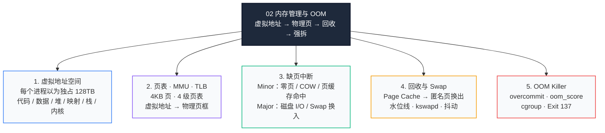
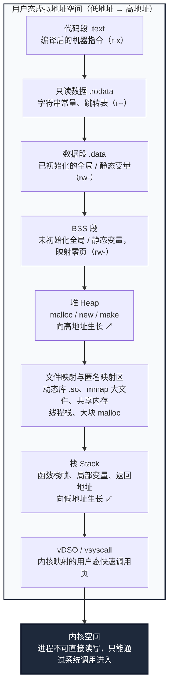
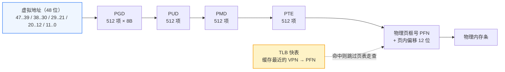
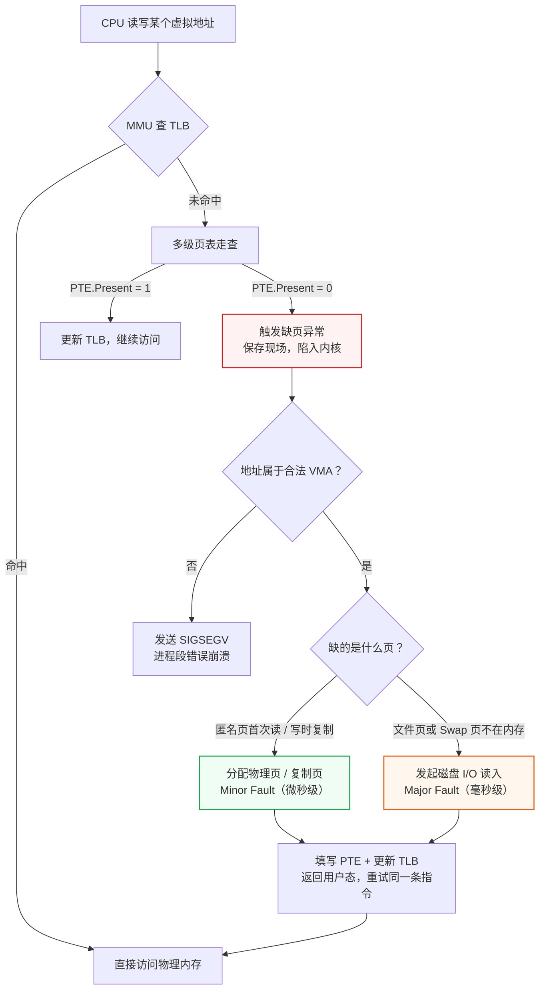
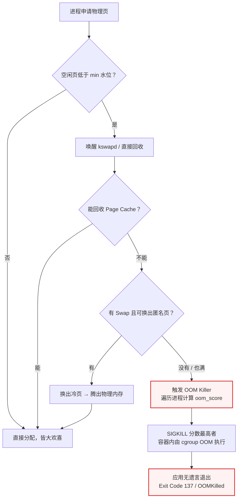

# 02 · 内存管理与 OOM：虚拟内存、页表、缺页与内核强拆

> **学习目标**：把“内存”从一个模糊的容量数字，拆成三层可观测的现实——进程以为自己独占的**虚拟地址空间**、内核按需兑现的**物理页**、以及物理页耗尽后触发的**回收与 OOM**。读完后，你应当能解释一行 `new Object()` 或 `Buffer.alloc()` 背后发生了什么，能看懂 `top` 里的 VIRT / RSS，能在服务“无遗言消失”时用 `dmesg` 和 cgroup 事件破案，并知道如何在 Node.js / Go 服务里提前布防。
>
> 上一篇 [01-进程与线程](./01-进程与线程.md) 解决的是“谁在跑”（执行流、调度与切换成本）；这一篇解决的是“跑在哪”（地址空间、物理页与内存耗尽）。**进程之间物理隔离的底座，就是每个进程一套独立的页表。**

---

## 零、为什么后端开发者必须死磕内存管理？

> 语言自带 GC，不等于你可以不懂内存。C/C++ 要手动 `malloc/free`，而 Node.js / Go 由运行时托管；但**运行时只管“对象”，不管“地址空间、物理页、容器边界”**。真正让服务暴毙的，往往是下面三件事。

| 场景 | 真实惨案 | 底层真相 |
| :--- | :--- | :--- |
| **防暴毙** | Node.js / Go 服务在批量上传大文件、或 Python 进程加载几 GB 模型权重时，控制台只留一句 `Killed`，容器退出码 137；应用层 `try...catch` 什么都没抓到，业务日志一片空白。 | Linux **OOM Killer** 发出 SIGKILL。不理解虚拟内存与物理内存的映射，就不会去查 `dmesg`，也不知道如何配置内存水位线与容器限额。 |
| **破幻象** | 刚启动一个空 Go / Node 进程，`top` 里 VIRT 高达几十 GB；反过来，JS 堆监控只用了 500MB，容器却因为突破 2GB 被杀。 | VIRT 只是“图纸”，RSS 才是“地”；Node 还有不归 V8 管的**堆外内存**（`Buffer`、原生插件、WASM）。 |
| **保吞吐** | 服务器没报错也没死机，接口 P99 从 10ms 恶化到 5000ms，CPU `iowait` 飙升。 | 物理内存不够，内核在内存与 **Swap** 之间疯狂搬运（抖动 Thrashing），每次访问都变成磁盘 I/O。 |

这三个问题，正好对应本文的三条主线：**地址空间与页表（为什么 VIRT 不吓人）→ 缺页与 Swap（为什么延迟会雪崩）→ OOM 与容器边界（为什么服务会无遗言消失）**。

---

## 知识全景脑图



## 本章要回答的 5 个问题（面试雷达）

| 题号 | 高频母题 | 面试官真正想听什么 | 本文位置 |
| :--- | :--- | :--- | :--- |
| **Q1** | 为什么要有虚拟内存？直接操作物理内存不行吗？ | 进程隔离（安全）、突破物理内存限制（Swap / 按需分页）、连续地址假象（解决碎片） | 第二节 |
| **Q2** | 64 位系统每个进程都有上百 TB 虚拟空间，物理内存才 16GB，怎么装得下？ | 页表（Page Table）、MMU 硬件转换、TLB 快表、按需分配与 overcommit，`malloc` 只开空头支票 | 第三、四节 |
| **Q3** | 什么是缺页中断？软缺页和硬缺页有什么区别？ | 真正读写（Touch）时才兑现物理页；Minor 不碰磁盘、Major 要读盘，延迟差几个数量级 | 第五节 |
| **Q4** | 进程虚拟地址空间长什么样？堆和栈有什么区别？ | 代码段 / 数据段 / 堆 / 文件映射区 / 栈 / 内核区；栈自动分配极快，堆动态分配靠 GC、易碎片化 | 第三节 |
| **Q5** | Linux 什么时候触发 OOM Killer？按什么规则决定杀谁？ | Overcommit 超售、oom_score 打分、cgroup / 容器 OOM、Exit Code 137 与“无遗言”特征 | 第六节 |

---

## 一、心智模型：空头支票、产权登记表与破产强拆

在 [0-总起](./0-总起.md) 里，我们把物理内存比作科技园区的真实土地。到了 02 模块，把这个比喻往深处推一层：

| 计算机内存概念 | 科技园管委会比喻 | 底层实质与后端体感 |
| :--- | :--- | :--- |
| **物理内存（Physical RAM）** | 园区真实存在的 16 亩熟地 | 插在主板上的内存条（如 16GB），寸土寸金，用完即止。 |
| **虚拟内存（Virtual Memory）** | 管委会给每家公司画的“128 万亩专属规划图纸” | 每个进程都以为自己独占一整块连续的超大地址空间，互不干扰。 |
| **页（Page，通常 4KB）** | 标准化的土地网格（每格 4 平米） | OS 管理内存的最小单位；图纸和真实土地都按页对齐。 |
| **页表（Page Table）** | 管委会的产权映射账本 | 记录“某公司图纸上的第 3 号格，对应园区真实土地的第 982 号格”。 |
| **MMU** | 自动查账员 | CPU 内部的硬件单元，负责把虚拟地址翻译成物理地址。 |
| **TLB（快表）** | 查账员口袋里的速记卡 | 缓存最近用过的映射，避免每次都翻整本账。 |
| **缺页中断（Page Fault）** | 拿空头支票去现场施工，临时逼管委会批地 | 申请时只拿图纸编号；真正写入时才触发异常，让内核现场分配物理页。 |
| **Swap 交换分区** | 郊区廉价的临时铁皮仓库 | 真地不够用时，把长期不动的冷内存页连夜写到硬盘上腾地方。 |
| **OOM Killer** | 管委会的破产强拆执法队 | 真地和郊区仓库全爆满，为保园区不瘫痪，直接挑一家最占地的公司强制击毙。 |

> **一句话版本**：**申请内存只是拿到图纸编号（VIRT），真正读写才兑现土地（RSS），兑现不了就先回收缓存、再搬去 Swap，最后回收不了就派 OOM Killer 强拆。**

---

## 二、虚拟内存机制：管委会的“画大饼”艺术（对应 Q1）

### 2.1 如果让进程直接操作物理内存，会发生四场灾难

假设没有虚拟内存，Node.js 拿到的就是物理内存的真实地址（比如 `0x00001000`），会发生什么？

1. **安全灾难：越界即改写别人**。Node.js 里一个 C++ 插件指针写歪了，直接把隔壁 MySQL 正在缓存的账单数据覆盖掉；更糟的是，恶意进程可以扫一遍内存，把别人的密钥、Token、用户数据全部读走。
2. **碎片灾难：总量够，连续块不够**。几十个进程反复启动退出，把物理内存切得像筛子。此时你想申请一块连续的 500MB 加载 AI 模型，明明总剩余内存还有 2GB，却因为找不到“连续的 500MB”而直接失败。
3. **重定位灾难：程序编译时不知道未来住哪**。程序里的跳转地址、全局变量地址在编译期就写死了；如果直接使用物理地址，每次启动、每台机器、每个进程都得重新计算并改写指令，多实例部署几乎不可能。
4. **隔离与限额灾难：一个进程可以饿死所有人**。没有地址空间边界，就无法按进程统计内存、无法设上限、无法在进程崩溃时只杀它一个。容器和 Cgroup 的“按进程记账”也就无从谈起。

### 2.2 虚拟内存到底给了什么

虚拟内存不是“凭空多出来的内存”，而是一套**地址翻译 + 权限检查 + 按需分配**的机制。它一次性解决了四个问题：

| 现实问题 | 虚拟内存的解法 | 后端体现 |
| :--- | :--- | :--- |
| 进程互相踩内存 | 每个进程独立页表，虚拟地址互不相通 | 一个 Node 进程崩溃不会改坏 MySQL 的 Buffer Pool |
| 没有连续大块 | 虚拟地址连续，物理页可以离散 | `malloc(500MB)` 拿到连续虚拟区间（glibc 默认约 128KB 以上走 `mmap`），背后是散落的物理页 |
| 物理内存不够 | 按需分页 + Swap + 文件映射 | 16GB 机器能跑总虚拟内存远超 16GB 的一堆进程 |
| 无法共享与保护 | 页表项可标只读 / 共享 / 不可执行 | 动态库一份物理内存映射给所有进程；W^X 防注入 |

> **关键认知**：物理内存是“地”，虚拟地址是“门牌号”，页表是“门牌号 → 地块”的登记簿。**门牌号可以随便发，地块必须真有了才能住人。**

---

## 三、进程虚拟地址空间长什么样（对应 Q4）

### 3.1 一张图看懂进程内存布局

以 x86-64 Linux（4 级页表、48 位虚拟地址）为例，每个进程都拿到一张一模一样的“图纸”，从低地址到高地址依次是：



### 3.2 每个区域到底装了什么

| 区域 | 装什么 | 权限 | 生命周期 | 后端体感 |
| :--- | :--- | :--- | :--- | :--- |
| **代码段 .text** | 编译后的机器指令 | 只读 + 可执行 | 随进程 | 多个进程可共享同一份物理代码页 |
| **只读数据 .rodata** | 字符串字面量、常量表 | 只读 | 随进程 | 常量池、错误码表 |
| **数据段 .data** | 已初始化的全局 / 静态变量 | 读写 | 随进程 | 全局缓存、连接池、单例 |
| **BSS** | 未初始化的全局 / 静态变量 | 读写 | 随进程 | 启动时映射共享零页，按需分配 |
| **堆 Heap** | `malloc` / `new` 出来的对象 | 读写 | 动态 | GC 主战场；泄漏与碎片高发区 |
| **文件映射区** | 动态库、`mmap` 文件、共享内存、线程栈、大块 `malloc` | 按映射而定 | 动态 | VIRT 的大头；零拷贝与跨进程共享的入口 |
| **栈 Stack** | 函数栈帧、局部变量、返回地址 | 读写 | 随线程 | 默认 8MB 上限，递归过深会溢出 |
| **vDSO** | 内核提供的用户态快速调用页 | 只读 + 可执行 | 随进程 | `gettimeofday` 等不必陷入内核 |
| **内核空间** | 内核代码、内核数据结构、页表等 | 用户态不可访问 | 随系统 | 系统调用时 CPU 切到内核态执行 |

### 3.3 高频面试题：堆和栈到底有什么区别？

| 维度 | 栈（Stack） | 堆（Heap） |
| :--- | :--- | :--- |
| **管理方式** | 编译器 / CPU 自动管理，函数进栈分配、出栈即抹除 | 程序员或语言运行时（V8 / Go Runtime）动态申请，靠 GC 回收 |
| **分配速度** | 只移动栈指针 SP，纳秒级 | 分配器找空闲块 + 可能触发缺页 + GC 扫描，慢得多 |
| **空间大小** | 很小，Linux 默认 8MB（`ulimit -s`） | 很大，受物理内存、Swap 与运行时上限共同约束 |
| **增长方向** | 向低地址生长 | 向高地址生长（`brk`）/ 独立映射（`mmap`） |
| **碎片问题** | 没有碎片，后进先出天然紧凑 | 有外部碎片与内部碎片，长期运行会“越用越碎” |
| **存什么** | 局部变量、函数参数、返回地址、寄存器现场 | 对象、数组、Buffer、缓存、长生命周期数据 |
| **越界后果** | 栈溢出（`Maximum call stack size exceeded`）或 SIGSEGV | 堆破坏、内存泄漏，最终 OOM |
| **线程关系** | **每个线程私有**，切换线程要换栈 | **进程内共享**，多线程访问要加锁 |

### 3.4 三个必须建立的后端体感

**体感一：栈很小，递归和深拷贝会直接撞墙。**

Node.js 的 JS 调用栈默认只有约 1MB（V8 的栈限制），Go 协程初始栈只有 2KB（可动态增长，但上限通常 1GB）。一段“递归解析嵌套 JSON”或“递归遍历超深树”的代码，很容易触发：

```text
RangeError: Maximum call stack size exceeded
```

如果递归发生在 C++ 插件或原生扩展里，就不会有这么体面的报错了——通常直接 SIGSEGV，整个进程消失。**深递归改迭代，是后端代码的基本修养。**

**体感二：线程栈会计入 VIRT，但通常不计入 RSS。**

Linux 下创建一个 pthread，默认会 `mmap` 出约 8MB 的栈空间（受 `ulimit -s` 影响），外加一个保护页。也就是说：

- 1000 个线程 ≈ 8GB 虚拟地址空间（VIRT）；
- 但只有真正被写过的栈页才计入 RSS，所以 RSS 可能只涨了几十 MB。

这就是为什么一个“空跑”的 Node.js 或 Go 进程，VIRT 可能高达几十 GB，而 RSS 只有几百 MB。**VIRT 吓人不等于内存泄漏。**

**体感三：大文件、共享内存、动态库都在文件映射区。**

工业 AI 平台里，Node/Go 接入层要把几百 MB 的高清检测图交给 Python 推理进程，常见做法不是 `read()` 到 Buffer 再发，而是：

- `mmap` 一个共享内存文件，两个进程映射同一份物理页，零拷贝传递；
- 或者用 `sendfile` / `splice` 让数据不经过用户态。

这些能力都建立在“文件映射区”上。它也是 VIRT 的重要来源：每映射一个动态库、每个线程栈、每次大块 `malloc`，都会在 `/proc/[pid]/maps` 里多出一条 VMA（虚拟内存区域）。

### 3.5 用 `/proc/[pid]/maps` 看真实的“图纸”

```text
# cat /proc/[pid]/maps（节选，已简化）
55d4c2a00000-55d4c2a84000 r-xp 00000000 08:01 131072  /usr/local/bin/node   # 代码段
55d4c3c00000-55d4c3c21000 rw-p 00000000 08:01 131072  /usr/local/bin/node   # 数据段
55d4c4b00000-55d4c5a00000 rw-p 00000000 00:00 0       [heap]                # 堆
7f2a90000000-7f2a94000000 rw-p 00000000 00:00 0                             # 匿名 mmap（运行时/arena）
7f2a9c000000-7f2a9c021000 r-xp 00000000 08:01 262145  /lib/x86_64-linux-gnu/libc.so.6
7ffd3a7f0000-7ffd3a811000 rw-p 00000000 00:00 0       [stack]               # 主线程栈
7ffd3a9f0000-7ffd3a9f4000 r-xp 00000000 00:00 0       [vdso]
```

每一行就是一条 VMA。内核用 `vm_area_struct` 描述它：起始地址、结束地址、权限、是否文件映射、对应哪个文件。**VMA 是“承诺”，页表项是“兑现”，物理页才是“地”。** 三者缺一不可。

> 小坑：映射数量过多会撞上 `vm.max_map_count`（默认 65530）。大量线程、大量 `mmap`、Elasticsearch 这类应用都可能需要调大它。

### 3.6 用户态和内核态是怎么分的？

| 架构 | 虚拟地址总位数 | 用户态 | 内核态 | 说明 |
| :--- | :--- | :--- | :--- | :--- |
| 32 位 x86 | 32 位 | 3GB | 1GB | 经典的 3G/1G 划分 |
| 64 位 x86（4 级页表） | 48 位 | 128TB | 128TB | 用户态最高到 `0x00007fffffffffff` |
| 64 位 x86（5 级页表） | 57 位 | 64PB 级 | 64PB 级 | 需要 CPU 与内核同时开启 LA57 |

内核空间通常映射在进程的页表里，但页表项标记为内核态专用；开启 KPTI 后，用户态页表只保留极少量入口，完整内核映射放在独立页表中。用户态代码没有权限直接读写内核页，想读文件、发网络包、申请内存，都必须通过**系统调用**切换进内核态，由内核代劳。

---

## 四、从图纸到真地：页表、MMU 与 TLB（对应 Q2）

### 4.1 页到底是什么？一个内存的单元吗？

> **极简定义**：
> **页（Page，全称虚拟页 / Virtual Page）是操作系统与 CPU 硬件在管理虚拟内存时，进行空间划分、地址映射、保护权限控制和换入换出的「最小固定基本单位」。**
> 对应在**物理内存**上的同等大小格子，被称为**页框（Page Frame，或物理页）**。

#### 1. 它是内存的最小硬件单元吗？
**不是**。
* **物理芯片级别**：内存硬件（DRAM 芯片）寻址的最小寻址单元是**字节（Byte，8 位）**或**字（Word，64 位系统下通常为 8 字节）**。你的代码依然可以精确读写内存里的某一个字节（如 `char c = 'a'`）。
* **操作系统与 MMU 级别**：如果操作系统以“字节”为单位来记账管理（比如记录这 1 个字节属于微信、下 1 个字节属于 Node.js），那么记录这些映射关系所消耗的元数据本身就会把内存撑爆！
* 因此，操作系统拉着 CPU 的硬件内存管理单元（MMU）达成了一个默契协议：**把一望无际的连续字节，按固定尺寸（在 x86/ARM64 下通常为 4KB，即 4096 字节）整整齐齐地“切成一块块积木”**。这一块积木，就叫做**一个页（Page）**。

#### 2. 生活形象比喻：字节、页与物理内存的关系
* **字节（Byte）** = 字典里的**某一个汉字**（你可以单独读写这一个字）。
* **页（Page）** = 字典里的**一整页纸（4096 个字）**。
* **物理页框（Page Frame）** = 图书馆书架上**刚好能插进一页纸的固定卡槽**。

当你向系统申请内存或访问数据时：
操作系统**绝不会一页一页地只撕几个字借给你**，而是**整页整页地借给你（一次至少批 4KB 的土地）**。哪怕你的变量只占 1 个字节，操作系统分给你的也是一整个 4KB 的页；只要你访问了这个字所在的页，整个 4KB 的页都会被映射到物理内存的卡槽中。

#### 3. 为什么必须是 4KB？为什么不能是 1MB 或 64 字节？
4KB 是计算机先辈在**硬件开销**与**碎片浪费**之间反复博弈权衡出的黄金折中：
* **如果页定得太小（比如 64 字节）**：
  4GB 内存就会被切出 67,000,000 多个页。管理这些页的“目录索引表（页表）”本身可能就要吃掉几百兆内存，且 CPU 快表（TLB）根本记不住几个页，系统直接卡死在频繁查表上。
* **如果页定得太大（比如 10MB）**：
  你的程序就想存一个 10 字节的用户 ID，系统直接批给你 10MB，剩下 9.999MB 全被浪费掉了，这叫做严重的**内部碎片（Internal Fragmentation）**。
* **4KB（$2^{12}$ 字节）的精妙数学特性**：
  4096 刚好等于 $2^{12}$。这意味着任何一个 64 位虚拟地址，其**最低的 12 位（Bit 0 ~ 11）恰好对应页内的字节偏移量（Offset）**！
  在进行硬件地址翻译时，低 12 位甚至**完全不需要计算、原样直接照抄**，CPU 只需要把高位地址的“虚拟页号 VPN”替换为物理内存的“页框号 PFN”即可，极度契合二进制硬件的高速并行处理。

```text
虚拟地址 (64 位): [ 高位：虚拟页号 VPN ] + [ 低 12 位：页内偏移 Offset (0~4095) ]
                             │                                 │
                     (查页表替换为物理页框号)                  │ (完全原样照搬)
                             ▼                                 ▼
物理地址 (64 位): [ 高位：物理页框号 PFN ] + [ 低 12 位：页内偏移 Offset (0~4095) ]
```

> **补充演进（大页 Huge Page）**：
> 在现代高吞吐后端（如 Redis 内存数据库、MySQL、大语言模型 AI 推理/训练）场景中，数以百 GB 计的数据如果全拆成 4KB 小页，TLB 缓存命中率会急剧下降。因此操作系统演进出了 **2MB（透明大页 THP / Huge Page）乃至 1GB 的超大页**，用来用更少的页表项覆盖海量内存，大幅减少 CPU 硬件查表开销。

### 4.2 多级页表：把一本电话簿拆成四级目录

48 位虚拟地址、4KB 页，意味着每个进程理论上有 2^36 个虚拟页。如果给每个页都存一个 8 字节页表项，一张“平铺页表”就要：

```text
2^36 × 8B = 512GB（整个 48 位空间）
仅用户态一半（128TB）：2^35 × 8B = 256GB
```

显然不可能。于是硬件和 OS 把页表拆成四级目录，每级 512 项，每张表正好 4KB：

| 层级 | 取虚拟地址的哪几位 | 每张表项数 | 单个表项覆盖范围 | 表大小 |
| :--- | :--- | :--- | :--- | :--- |
| **PGD**（页全局目录） | 47..39 | 512 | 512GB | 4KB |
| **PUD**（页上级目录） | 38..30 | 512 | 1GB | 4KB |
| **PMD**（页中间目录） | 29..21 | 512 | 2MB | 4KB |
| **PTE**（页表） | 20..12 | 512 | 4KB | 4KB |
| **页内偏移** | 11..0 | — | 4KB | — |



**多级页表真正的价值是“稀疏”。** 一个进程通常只用了地址空间里极小的一块，没用到的那 512GB 区域，连 PUD / PMD 表都不用建。注意一个容易被误解的点：

> 多级页表并不会让“全量映射”的理论开销变小——最坏情况下末级 PTE 仍然要 256GB 左右。它省的是**没有用到的区域**：不建中间层表，也不建末级表。实际进程的页表通常只有几 MB 到几十 MB（可在 `/proc/[pid]/status` 的 `VmPTE` 字段看到）。

按 4KB 页、每个页表项 8 字节算，页表开销约占已映射内存的 **0.2%**：映射 8GB，页表大约 16MB。这也是一笔要算进容器内存账本的钱。

### 4.3 MMU：地址翻译是硬件干的，不是内核函数

CPU 里有一个专门做地址翻译的硬件单元叫 **MMU（Memory Management Unit）**。每次访问内存，MMU 都会：

1. 拿虚拟地址的高位去查 **TLB**（快表）；
2. TLB 命中 → 直接拿到 PFN，拼出物理地址；
3. TLB 未命中 → 硬件自动走多级页表（4 级页表最坏要 4 次额外访存，第 5 次才访问数据）；
4. 如果页表项里 `Present = 0`，MMU 触发**缺页异常**，CPU 陷入内核，由内核处理。

所以，**地址翻译的主路径完全在硬件里，内核只在“页不在内存”或“权限不对”时才会被叫醒。** 这也是虚拟内存性能可接受的根本原因。

### 4.4 TLB：为什么大页能显著提速

TLB 是 CPU 内部的“地址翻译缓存”，容量很小：

- L1 dTLB 常见几十项；
- L2 STLB 常见 1024 ~ 2048 项；
- 按 4KB 页算，2048 项最多覆盖约 8MB 工作集；
- 换成 2MB 大页，同样的项数可以覆盖约 4GB。

当工作集超过 TLB 覆盖范围，就会出现大量 TLB Miss，每次都要走页表，性能明显下降。现代 CPU 还用 **PCID / ASID** 给 TLB 项打上进程标签，减少进程切换时的全量刷新；但 `mprotect` / `munmap` 跨核失效（TLB shootdown）仍然有成本。

> 这就是为什么“频繁 `mmap` / `munmap` 大块内存”的多线程程序会变慢：不只是系统调用本身，还有跨核 TLB 失效的连锁反应。

### 4.5 大页（Huge Page）：用 2MB 换更少的页表和 TLB 压力

Linux 支持透明大页（THP，Transparent Huge Pages），把连续的 4KB 页合并成 2MB 大页：

- **好处**：页表项减少 512 倍，TLB 覆盖扩大 512 倍，缺页次数下降；
- **坏处**：内存膨胀（分配 2MB 起）、后台 `khugepaged` 合并带来延迟抖动、COW 粒度变大；
- **实践**：Redis 官方建议关闭 THP；数据库、延迟敏感服务通常也关；AI 训练这类大块连续内存场景可以按需开启。

```bash
# 查看 / 关闭透明大页（生产变更需评估）
cat /sys/kernel/mm/transparent_hugepage/enabled
echo never > /sys/kernel/mm/transparent_hugepage/enabled
```

### 4.6 页表项里到底记了什么

一个 64 位页表项（PTE）除了物理页框号，还塞了一堆标志位：

| 标志 | 名称 | 作用 | 后端意义 |
| :--- | :--- | :--- | :--- |
| **P** | Present | 该页当前是否在物理内存中 | 0 → 触发缺页异常 |
| **R/W** | Read/Write | 只读还是可写 | 写保护页是 COW 的基础 |
| **U/S** | User/Supervisor | 用户态能否访问 | 防止用户代码碰内核页 |
| **A** | Accessed | 是否被访问过 | 内核选择“冷页”回收的依据 |
| **D** | Dirty | 是否被写过 | 换出前必须先写回磁盘 |
| **NX** | No-eXecute | 禁止执行 | W^X 安全策略，防注入 |
| **COW** | 软件位 | 写时复制标记 | `fork` / Redis `bgsave` 的核心 |

---

## 五、缺页中断：空头支票兑现的那一刻（对应 Q3）

### 5.1 一次缺页的完整流程

> 严格说，缺页是 CPU 的**异常（fault）**，不是外部设备中断；面试里说“缺页中断”或“缺页异常”都可以。



几个容易忽略的细节：

- x86 会把出错的虚拟地址放在 **CR2 寄存器**里，内核据此判断是哪个地址缺页；
- 内核先查 VMA：地址不在任何 VMA 内、权限不符 → `SIGSEGV`；文件映射越界 → `SIGBUS`；
- 内核里对应的处理函数大致是 `handle_mm_fault` → `do_anonymous_page` / `do_fault` / `do_wp_page` / `do_swap_page`；
- 处理完成后，CPU 会**重新执行**刚才那条指令，而不是从下一条开始。这也是 fault 与 trap 的区别。

### 5.2 软缺页（Minor）vs 硬缺页（Major）

| 维度 | 软缺页 / 次要缺页（Minor） | 硬缺页 / 主要缺页（Major） |
| :--- | :--- | :--- |
| **典型场景** | 匿名页首次写（映射零页）、COW 复制、页缓存命中、Swap 缓存命中 | Swap 换入、文件页不在页缓存、`mmap` 文件首次读 |
| **是否碰磁盘** | 否 | 是（可能还要等待 I/O 调度） |
| **耗时量级** | 亚微秒到几微秒 | 几十微秒到几毫秒（HDD 更慢） |
| **后端体感** | 服务启动、对象首次分配时的正常开销 | 接口延迟突然飙升、CPU iowait 上升 |
| **观测方式** | `/proc/vmstat` 的 `pgfault` | `pgmajfault`、`pswpin`、`perf` 的 `major-faults` |

> **COW（写时复制）属于 Minor Fault。** 上一篇 [01-进程与线程](./01-进程与线程.md) 里 Redis `bgsave` 的例子就是典型：`fork` 后父子进程共享只读物理页，父进程一写，触发写保护缺页，内核复制出一份新页。它不读磁盘，但会消耗物理内存和 CPU——高写入时 Redis 内存可能接近翻倍。

### 5.3 缺页也用于“懒加载”

程序启动时，内核并不会把整个 ELF 文件读进内存，而是只建立 VMA 映射；代码页、数据页真正被访问时才按需加载。这带来两个结果：

- **启动快**：Node.js / Go 进程刚启动时只加载了实际执行到的代码页；
- **首次请求慢**：冷启动后第一批请求会触发大量缺页，把代码页、页缓存、连接池逐层“焐热”。

所以性能测试一定要区分**冷启动**与**预热后**。第一次跑 benchmark 的数字，往往混进了缺页与页缓存未命中的成本。

### 5.4 缺页的性能优化手段

| 手段 | 原理 | 适用场景 |
| :--- | :--- | :--- |
| 预热（warmup） | 提前 touch 关键内存 / 跑几轮请求 | Web 服务、JIT 语言 |
| `MAP_POPULATE` | 建立映射时就把页填好，减少后续缺页 | 确定会立刻使用的大块映射 |
| `madvise(MADV_WILLNEED)` | 告诉内核“这些页马上要用”，触发预读 | 大文件顺序读、模型加载 |
| 大页（THP / HugeTLB） | 减少页表项与 TLB Miss | 大块连续内存、数据库、AI 推理 |
| 对象池 / Buffer 复用 | 避免频繁 `mmap` / `munmap` 与重复缺页 | 高并发短生命周期大对象 |
| 避免频繁 `malloc` 大块 | `mmap` 阈值以上每次都可能新建 VMA | Node Buffer 频繁分配 |

---

## 六、物理内存耗尽之后：回收、Swap 与 OOM Killer（对应 Q5）

### 6.1 内核不是等内存“用完”才动手

Linux 给每个内存管理区（zone）设置了三道水位线（watermark）：

| 水位 | 含义 | 内核动作 |
| :--- | :--- | :--- |
| **high** | 空闲页充足 | 什么都不做，`kswapd` 继续睡 |
| **low** | 空闲页偏少 | 唤醒 `kswapd` 在后台回收，应用基本无感 |
| **min** | 空闲页告急 | 分配路径直接触发**直接回收（direct reclaim）**，应用开始卡顿 |
| 低于 min 且回收失败 | 无页可分配 | 触发 **OOM Killer** |

`kswapd` 是每个内存节点一个的后台回收线程：低于 low 被唤醒，回到 high 就继续睡。真正危险的是**直接回收**——申请内存的进程自己停下来，同步去回收页缓存、写回脏页，延迟会直接打到业务上。`/proc/vmstat` 里的 `allocstall` 就是“直接回收卡住”的计数。水位线的大小由内核按内存规模估算，可用 `vm.min_free_kbytes` 调整最低水位；调得太大浪费可用内存，调得太小则更容易触发直接回收。

### 6.2 三道防线：缓存 → Swap → 强拆



#### 第一道防线：回收 Page Cache

Linux 平时会把空闲物理内存借来当磁盘文件缓存（`buff/cache`）。内存吃紧时，内核先回收这部分：

- **干净页**：直接丢掉，下次读文件再从磁盘加载；
- **脏页**：必须先写回磁盘（writeback），回收速度受 `vm.dirty_ratio` 等参数影响；
- 回收的是**内核页缓存**，不是进程的匿名内存。

这就是为什么 `free` 显示只剩 300MB 不用慌——真正要看的是 `available`，它估算了“可回收缓存 + 可分配内存”。

```text
$ free -h
              total        used        free      shared  buff/cache   available
Mem:           15Gi       9.0Gi       300Mi       1.0Gi       6.2Gi       5.4Gi
Swap:         2.0Gi       1.2Gi       800Mi
```

#### 第二道防线：Swap 换出

如果缓存回收完还不够，内核会把**匿名页**（堆、栈、Buffer 这些没有文件背书的页）写到 Swap 分区，把物理页腾出来。被换出的页在页表里标记为“不在内存”，下次访问触发 **Major Fault** 再读回来。

问题在于：**磁盘比内存慢几个数量级。** 一旦系统频繁在内存和 Swap 之间来回搬运，就进入**内存抖动（Thrashing）**：

- `vmstat 1` 里 `si` / `so` 持续非零；
- Major Fault 暴涨，CPU `iowait` 飙升；
- 接口 P99 从 10ms 涨到几秒，但业务日志没有任何错误。

另外，物理内存紧张还会让 V8 / Go 的 GC 更频繁触发，GC 停顿同样会推高 P99。排查延迟抖动时，Swap 指标和 GC 指标要放在一起看。

所以 Redis、Elasticsearch、延迟敏感的 Node/Go Web 服务，生产环境通常直接关闭 Swap（或至少把 `vm.swappiness` 调到很低）。代价是：**没有 Swap 兜底，OOM 会来得更快**。这是一个明确的取舍，不是“关了就一定好”。

> Kubernetes 从 1.28 起才以 alpha 形式支持节点 Swap，默认仍是关闭思路。多数集群节点仍然把 Swap 视为“延迟杀手”。

#### 第三道防线：OOM Killer

如果缓存回收完、Swap 也满了（或者根本没开 Swap），而进程还在不停要物理页，内核就进入 OOM 路径。

### 6.3 Overcommit：为什么内核敢开“空头支票”

Linux 默认允许进程申请的虚拟内存总和**超过**物理内存 + Swap，这叫**内存超售（Overcommit）**。策略由 `vm.overcommit_memory` 控制：

| 值 | 策略 | 行为 | 适用 |
| :--- | :--- | :--- | :--- |
| **0** | 启发式（默认） | 明显离谱的申请会被拒绝，大多数申请放行 | 通用服务器 |
| **1** | 永远允许 | 几乎所有申请都成功，兑现时再说 | Redis（`bgsave` 依赖 `fork`，社区建议设为 1）、机器学习任务 |
| **2** | 严格不超售 | `CommitLimit = Swap + RAM × overcommit_ratio`，超过就拒绝 | 对确定性要求极高的环境 |

`/proc/meminfo` 里的 `CommitLimit` 和 `Committed_AS` 可以看到当前“承诺额度”和“已承诺量”。

> 注意：即使 `overcommit_memory=1`，**缺页时仍然可能分配不到物理页**，最终还是会 OOM。超售只是把失败从“申请时”推迟到了“兑现时”。

### 6.4 OOM Killer 按什么规则挑人

当内核确认“回收失败、无法满足分配”时，会遍历进程，计算每个进程的“可牺牲分数”：

```text
badness ≈ (RSS + Swap 占用 + 页表占用) × oom_score_adj 系数
```

最终体现在两个文件里：

- `/proc/[pid]/oom_score`：0 ~ 1000，分数越高越容易被杀；
- `/proc/[pid]/oom_score_adj`：-1000 ~ 1000，用来人为调整（-1000 表示禁止被 OOM 杀死）。

核心规则：

1. **谁占的物理内存（RSS + Swap）多，谁分数高**；
2. `oom_score_adj` 会放大或缩小分数；Kubernetes 会根据 QoS 自动设置；
3. 历史上对拥有 `CAP_SYS_ADMIN` 的进程有约 3% 的减免，属于启发式，不要依赖；
4. 默认 `oom_kill_allocating_task=0`，内核不是杀“触发分配的那个进程”，而是杀**分数最高的**；
5. 如果开了 `panic_on_oom=1`，内核会直接 panic 而不是杀进程（生产环境一般不开）。

> 关于“刚启动的年轻进程更容易被杀”：内核的 badness 公式里并没有“运行时间”这一项，它主要看 `RSS + Swap + 页表`，再叠加 `oom_score_adj`。所谓“年轻进程更容易死”更多是经验说法（新进程尚未被调低 adj，或在 cgroup 里没有保护），不要当规则背。**真正可控的是 `oom_score_adj` 与 cgroup 资源边界。**

### 6.5 容器里的 OOM：Cgroup 是另一套“管委会”

在 Docker / Kubernetes 里，内存限制由 **Cgroup** 实现。以 cgroup v2 为例：

```bash
# 容器内通常可以直接读到自己的限制
cat /sys/fs/cgroup/memory.max        # 硬上限，比如 2147483648（2GiB）
cat /sys/fs/cgroup/memory.current    # 当前用量（含 page cache）
cat /sys/fs/cgroup/memory.events     # oom / oom_kill 计数
cat /sys/fs/cgroup/memory.stat       # anon / file / kernel / slab 明细
```

> 如果容器开了 cgroup namespace，路径可能是 `/sys/fs/cgroup/[容器自己的 cgroup]/memory.max`；在 K8s Pod 里可先从 `/proc/self/cgroup` 找到自己的相对路径。

几个关键点：

- `memory.max` 是硬上限；`memory.high` 是“节流线”，超过会限制分配速度而不是直接杀；
- `memory.current` **包含 page cache**，所以“容器内存 1.9GB 但 Node heap 只有 500MB”并不矛盾；
- `memory.events` 里的 `oom_kill` 计数是容器被 OOM 的直接证据；
- 若开启 `memory.oom.group=1`，整个 cgroup 会被一起杀，而不是只杀一个进程；
- cgroup OOM 和全局 OOM 的打分逻辑相似，但**只在当前 cgroup 内挑人**。

Kubernetes 的 QoS 会直接影响 `oom_score_adj`：

| QoS 级别 | oom_score_adj | 含义 |
| :--- | :--- | :--- |
| **Guaranteed** | -997 | requests = limits，最不容易被杀 |
| **Burstable** | 2 ~ 999 | 按 request / limit 比例计算 |
| **BestEffort** | 1000 | 没有资源声明，最先被牺牲 |

> 注意区分两套机制：**kubelet 驱逐（eviction）**看节点 `memory.available`（默认阈值约 100Mi），达到阈值会驱逐 Pod；**cgroup OOM** 看容器 `memory.max`，由内核直接杀进程。两者都会让 Pod 消失，但证据链不同。

### 6.6 运行时先“自裁”：V8 与 Go 的自我保护

在惊动内核之前，语言运行时通常先设一道栅栏。这是排查时非常有用的分水岭：**有遗言 = 运行时自裁；无遗言 = 内核强杀。**

| 运行时 | 触发方式 | 日志特征 | 退出码 |
| :--- | :--- | :--- | :--- |
| **Node.js / V8** | 老生代堆达到上限，GC 回收不动 | `FATAL ERROR: Ineffective mark-compacts near heap limit Allocation failed - JavaScript heap out of memory` | **134**（SIGABRT） |
| **Go** | 运行时向 OS 申请内存失败 | `fatal error: runtime: out of memory` + goroutine 栈 | **2** |
| **JVM** | 堆 / 元空间 / 直接内存耗尽 | `java.lang.OutOfMemoryError` | 通常 1（可用参数调整） |
| **任意进程（内核 OOM）** | Cgroup 或全局内存耗尽 | dmesg 的 `Killed process` / K8s `OOMKilled` | **137**（SIGKILL） |

Node.js 在 64 位机器上的默认老生代上限通常在 **1.4GB ~ 4GB** 之间（取决于 Node/V8 版本与物理内存），可以用下面的代码查看：

```js
const v8 = require('node:v8');
console.log('heap limit:', v8.getHeapStatistics().heap_size_limit / 1024 / 1024, 'MB');
```

如果 JS 代码里写了个无限增长的全局数组，堆触顶时会看到上面那条完整的 FATAL ERROR——**这是体面的自裁，还没来得及惊动操作系统**。但如果内存花在 V8 管不到的地方（`Buffer`、原生插件、`ArrayBuffer`、WASM 内存），V8 的栅栏就形同虚设，进程会直接被容器或内核以 137 干掉。

Go 1.19+ 提供 **`GOMEMLIMIT`**（软内存上限），让 GC 在接近上限时更积极：

```bash
GOMEMLIMIT=1500MiB ./server
```

它只约束 Go 运行时管理的内存，不包含 cgo、`mmap` 文件、页缓存；如果存活堆本身就超过上限，GC 会陷入“越回收越忙”的抖动，最终还是 OOM。

### 6.7 GC 回收了内存，为什么 RSS 不降？

这是线上最常见、也最容易被误判为“泄漏”的现象。三种运行时的行为不同：

| 运行时 | 归还机制 | 观测指标 | 主动归还 |
| :--- | :--- | :--- | :--- |
| **V8 / Node** | 释放的对象进入空闲链表，页不一定还给 OS；大块可能 `munmap` | `heapUsed` 下降，`heapTotal` / `rss` 不一定降 | 通常交给 V8；重启最直接 |
| **Go** | `scavenger` 后台逐步把空闲 span 归还 OS（`madvise`） | `HeapReleased`、`Sys`、RSS | `debug.FreeOSMemory()` |
| **glibc** | `free` 后内存留在 arena，供后续复用 | RSS 不降，但 `smaps` 可见空闲 | `malloc_trim(0)`、`MALLOC_ARENA_MAX` |

结论：**“RSS 高”不等于“泄漏”，“heapUsed 低”也不等于“内存没被占”。** 判断泄漏要看“GC 之后存活对象是否持续增长”，而不是看 RSS 的绝对值。

---

## 七、后端工程实战：OOM 排查三板斧

### 7.1 第一板斧：验尸，确认是不是内核干的

应用日志里什么都没有，是因为进程被 SIGKILL 时没有机会执行任何清理逻辑。直接查内核执法记录：

```bash
# 1. 内核日志（需要权限；容器内可能看不到宿主机 dmesg）
dmesg -T | grep -i -E "out of memory|killed process|oom-killer"
journalctl -k --since "1 hour ago" | grep -i oom
grep -i "killed process" /var/log/kern.log

# 2. 容器 cgroup 证据
cat /sys/fs/cgroup/memory.events
cat /sys/fs/cgroup/memory.max
cat /sys/fs/cgroup/memory.current

# 3. 如果进程还活着，看它的内存现场
ps -eo pid,rss,vsz,comm --sort=-rss | head
cat /proc/[pid]/status | grep -E "VmRSS|VmHWM|VmSwap|VmPTE"
cat /proc/[pid]/smaps_rollup
```

典型的 OOM 日志长这样：

```text
[Mon Nov  2 14:20:01 2026] Out of memory: Killed process 18492 (node)
total-vm:12451840kB, anon-rss:7892412kB, file-rss:0kB, shmem-rss:0kB,
UID:1000 pgtables:15432kB oom_score_adj:0
```

逐字段解读：

| 字段 | 含义 | 排查价值 |
| :--- | :--- | :--- |
| `total-vm` | 进程虚拟地址空间总量（VIRT） | 只说明“开了多少空头支票”，参考意义有限 |
| `anon-rss` | 匿名页占用的物理内存 | **最关键**：堆、栈、Buffer 等真实占地 |
| `file-rss` | 文件映射页 | 通常可回收，但 `mmap` 大文件时会很高 |
| `shmem-rss` | 共享内存页 | 多进程共享大图 / 共享缓存时关注 |
| `pgtables` | 页表占用的内存 | 映射极多时不可忽略 |
| `oom_score_adj` | 被杀进程的 OOM 调整值 | 判断是否被 K8s QoS 或人为调过 |

容器 / Kubernetes 场景：

```bash
# Docker：OOMKilled 标记
docker inspect -f '{{.State.OOMKilled}} {{.State.ExitCode}}' [container]

# Kubernetes：看上一次终止原因
kubectl describe pod [pod] | grep -A6 "Last State"
kubectl get pod [pod] -o jsonpath='{.status.containerStatuses[*].lastState.terminated.reason}'
```

看到这些信号，基本可以定案：

```text
Last State:     Terminated
  Reason:       OOMKilled
  Exit Code:    137
```

> **Exit Code 137 只说明“被 SIGKILL”**，OOM 是最常见原因，但不是唯一原因：`docker stop` 超时、`kubectl delete` 超过 grace period、节点驱逐，都会留下 137。必须结合 `OOMKilled`、`memory.events`、`dmesg` 三者交叉验证。

### 7.2 第二板斧：看懂指标，别再被 VIRT 吓到

| 指标 | 来源 | 含义 | 排查意义 |
| :--- | :--- | :--- | :--- |
| **VIRT / VSZ** | `top` / `ps` | 虚拟地址空间总量 | **几乎没有报警意义**，Go / V8 / glibc 都会预留大块 |
| **RSS / RES** | `top` / `ps` | 常驻物理页（匿名 + 文件 + 共享） | **核心生死线**，OOM 打分与容器限制都看它 |
| **SHR** | `top` | 共享页（动态库、共享内存） | 辅助判断共享内存占用 |
| **anon-rss** | `smaps` / dmesg | 匿名页（堆、栈、Buffer） | OOM 计分主体，最该盯 |
| **file-rss** | `smaps` | 文件映射页 | 通常可回收，但 `mmap` 大文件时会高 |
| **VmHWM** | `/proc/pid/status` | 历史 RSS 峰值 | **容量规划的金标准** |
| **heapUsed** | Node | V8 存活对象 | 判断真泄漏 |
| **heapTotal** | Node | V8 已向 OS 申请的堆 | GC 后是否回落 |
| **external** | Node | C++ 层 / 原生对象内存 | Buffer、原生插件 |
| **arrayBuffers** | Node | `ArrayBuffer` / `Buffer` 内存 | 大文件、大图 |
| **HeapReleased** | Go | 已归还 OS 的堆内存 | 判断 scavenger 是否跟上 |
| **container_memory_working_set_bytes** | cAdvisor | 容器用量减去 inactive file | **K8s 驱逐依据**，比 RSS 更贴近容器账本 |

> `RSS` 会把共享页在每个进程里各算一遍；更精确的进程内存看 `smaps_rollup` 里的 `PSS`。容器核算则看 cgroup 的 `memory.current` 与 working set。

### 7.3 第三板斧：先分类，再定位

内存问题至少分六类，用错了工具会南辕北辙：

| 类型 | 特征 | 典型原因 | 定位手段 |
| :--- | :--- | :--- | :--- |
| **真泄漏** | GC 后 `heapUsed` 阶梯上升，最终触顶 | 全局缓存、闭包、事件监听未移除、定时器 | 堆快照对比 |
| **容量膨胀** | 对象都合法，但数量无上限 | 本地缓存没有 LRU / TTL、并发大对象 | 压测 + 容量上限 |
| **堆外内存** | RSS 涨，`heapUsed` 平 | `Buffer`、原生插件、WASM、cgo | `external` / `arrayBuffers` / `smaps` |
| **分配器滞留** | 释放后 RSS 不降 | glibc arena、Go scavenger 滞后 | `malloc_trim`、`FreeOSMemory` |
| **碎片** | RSS 高，有效对象少 | 大小混杂、长期运行 | jemalloc / tcmalloc、定期重启 |
| **容器账本** | cgroup 高，进程 RSS 低 | page cache、kernel memory、socket buffer | `memory.stat`、working set |

### 7.4 语言侧观测：Node.js 与 Go

**Node.js**：`process.memoryUsage()` 返回五个字段，分别对应不同层：

```js
function mb(n) {
  return (n / 1024 / 1024).toFixed(1) + ' MB';
}

function snapshot(label) {
  const m = process.memoryUsage();
  console.log(label, {
    rss: mb(m.rss),
    heapTotal: mb(m.heapTotal),
    heapUsed: mb(m.heapUsed),
    external: mb(m.external),
    arrayBuffers: mb(m.arrayBuffers),
  });
}

snapshot('start');

// 256MB 的 Buffer 走堆外内存，不占 V8 堆
const buf = Buffer.alloc(256 * 1024 * 1024, 1);

snapshot('after Buffer');
console.log('buffer length:', buf.length);
```

你会看到：`heapUsed` 几乎不变，而 `external`、`arrayBuffers` 和 `rss` 直接涨了约 256MB。**这就是“堆内存监控正常，容器却被 OOM 杀掉”的标准剧本。**

> `Buffer.alloc` 会零填充，立即 touch 物理页；`Buffer.allocUnsafe` 可能复用已分配的内存池，RSS 上涨不一定那么即时，但风险一样。

**Go**：看 `runtime.MemStats` 里的几个关键字段：

```go
var m runtime.MemStats
runtime.ReadMemStats(&m)

fmt.Printf("HeapAlloc=%d MiB HeapInuse=%d MiB HeapReleased=%d MiB Sys=%d MiB\n",
    m.HeapAlloc>>20, m.HeapInuse>>20, m.HeapReleased>>20, m.Sys>>20)
```

- `HeapAlloc`：存活对象占用（最接近“真实业务内存”）；
- `HeapInuse`：已向 OS 申请、正在使用的 span；
- `HeapReleased`：已归还 OS 的部分；
- `Sys`：Go 运行时向 OS 申请的总量（通常大于 HeapInuse，也常大于 RSS）。

### 7.5 泄漏定位工具链

| 运行时 | 工具 | 用法 |
| :--- | :--- | :--- |
| **Node.js** | Chrome DevTools Memory | `node --inspect` 连接，抓取多份 Heap Snapshot 做 diff |
| **Node.js** | `--heapsnapshot-near-heap-limit` | 接近堆上限时自动落快照，适合偶发 OOM |
| **Node.js** | `clinic` / `0x` | 火焰图 + 堆剖析，定位热点分配 |
| **Go** | `pprof` heap | `go tool pprof -http=:8080 http://localhost:6060/debug/pprof/heap` |
| **Go** | `GODEBUG=gctrace=1` | 观察 GC 频率、堆大小、暂停时间 |
| **Linux** | `smem` / `pmap` / `smaps_rollup` | 看真实物理页分布 |
| **C/C++** | `heaptrack` / `valgrind` | 原生扩展、插件内存泄漏 |

Node.js 的堆快照对比要点：**至少抓三份**（稳定态、上涨中、接近上限），在 DevTools 的 Comparison 视图里看“只增不减”的构造函数，再顺着 Retainers 找到持有链。只看一份快照，很难判断谁是泄漏源。

---

## 八、防御：高并发与大文件场景的保命铁律

### 8.1 铁律一：严禁一次性把大文件读进内存

```js
// ❌ 500MB 文件直接进内存，RSS 瞬间 +500MB，并发几个就 OOM
const data = await fs.promises.readFile('big.zip');

// ✅ 流式处理，内存里只有几十 KB 的缓冲区
import { createReadStream, createWriteStream } from 'node:fs';
import { pipeline } from 'node:stream/promises';
import { createGzip } from 'node:zlib';

await pipeline(
  createReadStream('big.log', { highWaterMark: 64 * 1024 }),
  createGzip(),
  createWriteStream('big.log.gz'),
);
```

同样的原则适用于：

- 上传：用 `busboy` / `multer` 的流式模式直接落盘或转对象存储，不要先 `Buffer` 再处理；
- CSV / 日志解析：`readline` 逐行读，或流式解析器；
- Excel 导出：流式写入（如 `exceljs` 的 streaming writer），不要先在内存里拼一个百万行数组；
- 图片 / 视频：`sharp` 流式管线、`ffmpeg` 管道，避免整段解码进内存。

### 8.2 铁律二：任何进程内缓存都必须有上限

```js
// ❌ 无界缓存，等于慢性泄漏
const cache = new Map();
cache.set(key, value);

// ✅ 有上限 + 淘汰策略
class LruCache {
  #map = new Map();

  constructor(max) {
    this.max = max;
  }

  get(key) {
    if (!this.#map.has(key)) return undefined;
    const value = this.#map.get(key);
    this.#map.delete(key);
    this.#map.set(key, value);
    return value;
  }

  set(key, value) {
    if (this.#map.has(key)) this.#map.delete(key);
    this.#map.set(key, value);
    if (this.#map.size > this.max) {
      this.#map.delete(this.#map.keys().next().value);
    }
  }
}
```

工程上更推荐直接用 `lru-cache` 这类成熟库，并同时配置 `max`（条目数或总字节数）与 `ttl`。**缓存的第一原则不是“命中率”，而是“上限”。**

### 8.3 铁律三：容器边界必须和运行时上限对齐

容器被限制在 2GB，而 Node.js 仍按宿主机的 16GB 估算默认堆上限（可能到 4GB）。V8 觉得离上限还远，GC 并不着急；容器却先撞到 2GB 的 `memory.max`，被 cgroup 一枪崩了。正确做法是**显式告诉运行时真实上限，并留出余量**：

```yaml
resources:
  requests:
    memory: "512Mi"
  limits:
    memory: "1Gi"
env:
  - name: NODE_OPTIONS
    value: "--max-old-space-size=768"
```

| 容器 limit | Node.js `--max-old-space-size` | Go `GOMEMLIMIT` | JVM `MaxRAMPercentage` |
| :--- | :--- | :--- | :--- |
| 512Mi | 384 | 450MiB | 75% |
| 1Gi | 768 | 900MiB | 75% |
| 2Gi | 1536 | 1700MiB | 75% |

为什么 Node 只给到 75% 左右？因为 RSS 还包含：

- V8 堆之外的原生内存、代码段、JIT 代码；
- `Buffer` / `ArrayBuffer` / 原生插件；
- 线程栈（每个 Worker 默认约 4MB）；
- glibc arena 与碎片；
- 页表、socket buffer、文件映射。

Go 的 `GOMEMLIMIT` 可以更贴近上限，因为它只约束 Go 运行时内存；但如果用了 cgo、大量 `mmap`，仍然要留余量。

**Node 集群模式要特别注意**：`--max-old-space-size` 是**每个进程**的限制。4 个 Worker 各 1.5GB，总堆上限就是 6GB，不是 1.5GB。容器里跑 cluster 时，要按“进程数 × 单进程上限 + 非堆内存”来核算。

较新的 Node 可以读取 cgroup 限制：

```js
const limit = process.constrainedMemory(); // 字节；0 表示无约束
if (limit) {
  console.log('cgroup memory limit:', (limit / 1024 / 1024).toFixed(0), 'MB');
}
```

但它只提供信息，不会自动帮你设置堆上限。

### 8.4 铁律四：重任务隔离，别和 Web 进程共命运

- 大文件转码、图片处理、模型推理等内存波动大的任务，放到独立进程 / 独立容器；
- Node.js 用 `worker_threads` 时，给 Worker 设置 `resourceLimits`：

```js
import { Worker } from 'node:worker_threads';

const worker = new Worker('./image-worker.js', {
  resourceLimits: {
    maxOldGenerationSizeMb: 256,
    stackSizeMb: 4,
  },
});
```

- 工业 AI 平台中，Web 接入层与 Python 推理层必须进程隔离（上一篇已经详细拆过原因），各自设置 cgroup 限额；
- 用 cgroup 给不同服务划边界，避免“一个批处理任务把整台机器打爆”。

### 8.5 铁律五：监控要盯“会杀人的指标”

| 监控项 | 为什么重要 | 建议 |
| :--- | :--- | :--- |
| RSS / working set | OOM 与驱逐的直接依据 | 按容器维度采集，设 80% 预警 |
| cgroup `memory.events` 的 `oom_kill` | 最直接证明“被内核杀”的计数器 | 变化即告警 |
| Major Fault / `si` `so` | Swap 抖动与 I/O 卡顿的先行指标 | 持续非零要查 |
| PSI `/proc/pressure/memory` | 内存压力导致的全员停顿 | `full avg10` 上升即预警 |
| GC 暂停时间 / 频率 | 堆接近上限的征兆 | 与 RSS 曲线一起看 |
| `VmHWM` | 历史峰值，容量规划依据 | 按峰值 + 30% 设 limit |

```bash
# 内存压力（PSI）：some 表示有任务在等内存，full 表示所有任务都被拖住
cat /proc/pressure/memory

# 交换活动：si/so 持续非零说明在抖
vmstat 1
```

### 8.6 铁律六：容量规划要用真实负载压测

不要用“空跑内存”去定 limit。用真实的大文件、真实并发、真实图片尺寸跑 24 小时 soak test，观察：

- RSS 曲线是否收敛（收敛 = 正常；持续上升 = 泄漏）；
- `VmHWM` 峰值；
- GC 后 `heapUsed` 是否回落到基线；
- Major Fault 与 Swap 活动。

最终 limit 建议按“实测峰值 × 1.3”设置，并给节点留出系统与 page cache 的空间。

### 8.7 附：Swap 到底关不关？

| 场景 | 建议 | 原因 |
| :--- | :--- | :--- |
| Redis / Elasticsearch / 延迟敏感 API | **关闭**（或极低 swappiness） | 一次 Swap 就可能让 P99 爆炸；Redis 还涉及 fork COW |
| 通用 Web 服务 | 可保留少量 Swap | 防止偶发峰值直接 OOM，但要监控抖动 |
| 批处理 / AI 训练 | 视任务而定 | 长任务不希望被杀，但 Swap 会拖慢整体 |
| Kubernetes 节点 | 默认关闭思路 | 1.28 起才逐步支持 Swap，生态仍在演进 |

---

## 九、高频八股与场景题（深度打通版）

### 考点 1：64 位系统每个进程都有上百 TB 虚拟空间，物理内存才 16GB，怎么装得下？

* **考察点**：虚拟地址空间、页表按需分配、overcommit、VMA。
* **标准回答**：
  1. **虚拟地址空间只是编号范围，不是物理承诺。** x86-64 4 级页表是 48 位，总空间 256TB，Linux 把用户态和内核态各分一半，所以用户态是 128TB。这个数字描述的是“可用的门牌号上限”，不是“已经占了 128TB 地”。
  2. **进程启动时只建立少量 VMA。** 代码、数据、堆、栈、动态库各占一小段，`/proc/[pid]/maps` 里通常只有几十到几百条映射，实际用到的地址远小于 128TB。
  3. **页表按需建、物理页按需给。** 没访问过的区域连页表项都没有；第一次读写触发缺页，内核才分配 4KB 物理页。
  4. **Overcommit 允许“承诺总量”超过物理内存。** 内核先记账，兑现时再回收缓存 / 换出 / 杀进程。
  5. **所以不是“装下”，而是“先发图纸、后兑现”。** 真正要盯的是 RSS / working set，不是 VIRT。
* **追问**：页表本身也要内存吗？——要，但多级页表只给用到的区域建表，实际通常几 MB 到几十 MB；大页可以进一步减少页表与 TLB 压力。
* **八股真题与面经出处**：
  - [牛客网 - 操作系统高频题：32位与64位系统虚拟内存与物理内存映射机制讨论](https://www.nowcoder.com/discuss/353154093894017024)
  - [小林coding - 操作系统面试真题：为什么要有虚拟内存？4GB 物理内存能申请 8GB 吗？](https://www.xiaolincoding.com/interview/os.html)
  - [掘金 - 后端面试八股文（120+题·深入解析版）：程序大于物理内存如何通过分页运行？](https://juejin.cn/post/7617679439415099428)

### 考点 2：`malloc(1GB)` 返回成功，一写入却被杀了，为什么？

* **考察点**：`brk` / `mmap`、overcommit、缺页、OOM。
* **标准回答**：
  1. `malloc` 大块内存时，glibc 通常绕过 `brk`，直接用 `mmap` 建一条匿名 VMA。内核只返回虚拟地址，**不分配物理页**。
  2. 在 `vm.overcommit_memory=0/1` 下，这个申请通常会被放行；所以 `malloc` 返回非 NULL，不代表物理内存已经到手。
  3. 真正写入时触发缺页，内核逐页分配物理页；如果空闲页不足、回收也失败，就触发 OOM Killer，进程被 SIGKILL。
  4. 如果 `vm.overcommit_memory=2` 或设了 `ulimit -v`，`malloc` 可能直接返回 NULL——这反而是“早失败”，应用必须检查返回值。
  5. 区分：匿名内存不足 → OOM；`mmap` 文件越界访问 → SIGBUS；地址非法 → SIGSEGV。
* **结论**：申请成功 ≠ 物理内存到手；容量规划看 RSS / working set，不看 VIRT。
* **八股真题与面经出处**：
  - [小林coding - 操作系统面试真题：malloc 申请成功，就一定分配了物理内存吗？](https://www.xiaolincoding.com/interview/os.html#malloc-%E7%94%B3%E8%AF%B7%E6%88%90%E5%8A%9F-%E5%B0%B1%E4%B8%80%E5%AE%9A%E5%88%86%E9%85%8D%E4%BA%86%E7%89%A9%E7%90%86%E5%86%85%E5%AD%98%E5%90%97)
  - [腾讯云开发者社区 / 小林coding - 争议很大的一道面试题：在 4GB 机器上 malloc 申请 8GB 内存会怎么样？](https://developer.cloud.tencent.com/article/2141575)
  - [牛客网 - 堆内存分配机制与 malloc 延迟绑定物理页讨论](https://www.nowcoder.com/discuss/559726104701956096)

### 考点 3：什么是缺页中断？软缺页和硬缺页有什么区别？

* **考察点**：MMU、页表 Present 位、Minor / Major Fault。
* **标准回答**：
  1. CPU 访问虚拟地址，MMU 查页表发现 `Present=0`，触发缺页异常；CPU 陷入内核，内核检查 VMA 合法性。
  2. 合法则分配物理页（匿名页）、复制页（COW）、从页缓存取页（文件页）或从 Swap 读回（换入），填写 PTE，返回用户态重新执行指令。
  3. **Minor Fault**：不需要磁盘 I/O，包括零页首次写、COW、页缓存命中、Swap 缓存命中；耗时亚微秒到几微秒。
  4. **Major Fault**：需要磁盘 I/O，包括 Swap 换入、文件页不在缓存；耗时几十微秒到几毫秒，高频发生时延迟直接爆炸。
  5. 观测：`/proc/vmstat` 的 `pgfault` / `pgmajfault`，`perf stat -e major-faults`，`vmstat` 的 `si` / `so`。
* **优化**：预热、`MAP_POPULATE`、`MADV_WILLNEED`、大页、对象池，避免频繁 `mmap` / `munmap`。
* **八股真题与面经出处**：
  - [牛客网 - C++校招面试题目合集：请你说一说操作系统中的缺页中断](https://www.nowcoder.com/ta/review-c/review?page=36)
  - [牛客网 - 小鹏汽车嵌入式软件二面面经：软缺页异常（Minor）与硬缺页异常区别及处理过程](https://www.nowcoder.com/discuss/859061053869600768)
  - [JavaGuide - 操作系统高频面试题总结：主缺页（Major）与次缺页（Minor）的核心差异](https://javaguide.cn/cs-basics/operating-system/operating-system-basic-questions-02.html)

### 考点 4：`heapUsed` 只有 500MB，RSS 却 2GB，容器还被杀了，钱花哪了？

* **考察点**：V8 堆与 RSS 的差异、堆外内存、容器账本。
* **标准回答**：
  1. **RSS 不等于 V8 堆。** RSS 还包含：`external` / `arrayBuffers`（Buffer、原生对象）、代码段与 JIT 代码、线程栈、glibc arena 与碎片、页表、文件映射、共享库。
  2. **Buffer 是典型堆外内存。** 用 `Buffer.alloc(200MB)` 接一张大图，`heapUsed` 几乎不动，但 `external` / `arrayBuffers` 和 RSS 会直接上涨。
  3. **Node 的堆上限不封顶 RSS。** `--max-old-space-size` 只管 V8 老生代；容器 limit 也不会自动传给 V8（新版本可用 `process.constrainedMemory()` 读取，但不会自动应用）。
  4. **容器账本还包含 page cache。** `memory.current` 统计 anon + file + kernel，文件读写多时 page cache 也会把容器顶到 limit；K8s 的 working set 会扣掉 inactive file。
  5. **诊断顺序**：先看 `process.memoryUsage()` 五字段，再看 `smaps_rollup` 的 anon / file，最后看 cgroup `memory.stat`。
* **修复**：流式处理大文件、限制并发、给堆留 25% ~ 30% 余量、必要时设 `MALLOC_ARENA_MAX=2`、Worker 设 `resourceLimits`。
* **八股真题与面经出处**：
  - [SegmentFault - 热点面试题：Node.js 中的垃圾回收机制与 process.memoryUsage 解析](https://segmentfault.com/a/1190000043289925)
  - [知乎专栏 - Node.js 应用 RSS 内存泄漏排查实战：heapUsed 正常但 RSS 飙升引发 OOM](https://zhuanlan.zhihu.com/p/675317993)
  - [GitHub - Nodejs-Roadmap 高频面试题：堆内存与堆外内存（Buffer/C++ Addon）的区别](https://github.com/qufei1993/Nodejs-Roadmap/blob/master/docs/nodejs/memory.md)

### 考点 5：OOM 为什么 `try...catch` 抓不到？Exit Code 137 怎么确认？

* **考察点**：SIGKILL 语义、退出码、容器证据链。
* **标准回答**：
  1. OOM Killer 发送的是 **SIGKILL（9 号信号）**，它不能被捕获、忽略或阻塞；进程没有机会执行 `catch`、`finally`、`defer`、`process.on('exit')`。
  2. 退出码 `137 = 128 + 9`，表示被 SIGKILL；`143 = 128 + 15` 表示被 SIGTERM（优雅退出失败 / 超时）。
  3. 137 不一定等于 OOM：`docker stop` 超时、`kubectl delete` 超过 grace period、节点驱逐也会产生 137。
  4. 确认三件套：`dmesg` 的 `Killed process`、cgroup `memory.events` 的 `oom_kill`、K8s 的 `OOMKilled` 状态。
  5. 对比“有遗言”的自裁：Node 堆 OOM 是 `FATAL ERROR` + 134；Go 是 `fatal error: runtime: out of memory` + 2。**有日志 = 运行时自裁；无日志 + 137 = 内核/容器强杀。**
* **八股真题与面经出处**：
  - [牛客网 - 揭秘 Kubernetes 中的 OOM Killer：容器 Exit Code 137 与 SIGKILL 追踪](https://www.nowcoder.com/discuss/522595237236080640)
  - [牛客网 - 实习秋招百轮面试总结：进程在接到 kill 指令之后会做什么？能不能被捕获？](https://www.nowcoder.com/discuss/353159035593629696)
  - [Kubernetes Discuss 经典真题 - Subprocess Killed with a 137 error (Signal 9 / SIGKILL 原理分析)](https://discuss.kubernetes.io/t/subprocess-killed-with-a-137-error/22058)

### 考点 6：OOM Killer 按什么规则决定杀哪个进程？容器里呢？

* **考察点**：overcommit、oom_score、oom_score_adj、cgroup。
* **标准回答**：
  1. 触发条件：内核回收 Page Cache、换出匿名页之后仍无法满足分配，进入 OOM 路径。
  2. 打分：近似按 `RSS + Swap + 页表占用` 计算 badness，再叠加 `oom_score_adj`；分数最高者被杀。
  3. `oom_score_adj` 范围 -1000 ~ 1000；-1000 表示禁止被 OOM 杀死（慎用）；K8s 按 QoS 设置：Guaranteed -997、Burstable 2 ~ 999、BestEffort 1000。
  4. 容器内由 cgroup OOM 在 cgroup 范围内挑人；若 `memory.oom.group=1`，整个 cgroup 一起被杀。
  5. 可以用 `choom -p [pid] -n -500` 或 systemd 的 `OOMScoreAdjust` 调整，但**不要依赖“我不会被杀”**，要从资源限制和容量规划上解决。
* **加分**：区分 kubelet eviction（看节点 `memory.available`）与 cgroup OOM（看 `memory.max`）。
* **八股真题与面经出处**：
  - [掘金 - 大厂面试题：Linux 内核 OOM Killer 机制、select_bad_process 与 oom_badness 打分规则](https://juejin.cn/post/6844903878178111502)
  - [牛客网 - 云原生与运维面试：系统 OOM 计分规则、oom_score_adj 与 Pod 优先级调度](https://www.nowcoder.com/discuss/490141453822251008)
  - [掘金 - 记一次线上 OOM Killer 问题排查实录：无日志宕机如何用 dmesg 破案](https://juejin.cn/post/6940559531483070477)

### 考点 7：`free` 显示只剩 300MB，`available` 却有 5GB，正常吗？Swap 该开吗？

* **考察点**：Page Cache、水位线、Swap 抖动。
* **标准回答**：
  1. 正常。`buff/cache` 是可回收的页缓存；`available` 估算“回收缓存后还能分配多少”，比 `free` 更有参考价值。
  2. 内核用 min / low / high 水位线管理回收：低于 low 唤醒 `kswapd`，低于 min 触发直接回收，回收失败才 OOM。
  3. Swap 把匿名冷页换到磁盘；频繁 `si` / `so`、Major Fault 暴涨、`iowait` / PSI 上升，就是抖动。
  4. 延迟敏感服务（Redis、ES、API）通常关 Swap；没有 Swap 时 OOM 来得更快，有 Swap 时可能“慢死”。按 SLA 取舍。
  5. Redis 还建议关 THP，避免 COW 粒度变大与延迟抖动。
* **八股真题与面经出处**：
  - [知乎 - Linux 运维与后端高频题：free 命令里的 6 个神秘数字（free 与 available 区别）](https://zhuanlan.zhihu.com/p/1952127874950759189)
  - [牛客网 - 转专业后端/运维开发面试真题：free 命令 buffer 和 cache 的区别](https://www.nowcoder.com/discuss/645429)
  - [ServerFault - 经典问答：Meaning of the buffers/cache and available fields in free](https://serverfault.com/questions/85470/meaning-of-the-buffers-cache-line-in-the-output-of-free)

### 考点 8：线上内存泄漏怎么定位？

* **考察点**：泄漏分类、Node / Go 工具链、证据链。
* **标准回答**：
  1. **先分类**：真泄漏（GC 后存活对象持续增长）、容量膨胀（缓存无上限）、堆外（RSS 涨但 `heapUsed` 平）、分配器滞留（释放后 RSS 不降）、碎片、容器 page cache。
  2. **Node**：定期打印 `memoryUsage()`；用 `--heapsnapshot-near-heap-limit` 或 DevTools 抓 3 份堆快照做 diff；顺着 Retainers 找持有链；`clinic` / `0x` 看分配热点。
  3. **Go**：`pprof` heap 对比 `inuse_space` 与 `alloc_space`；`GODEBUG=gctrace=1` 看 GC 后堆是否回落；同时查 goroutine 泄漏（`/debug/pprof/goroutine`）。
  4. **通用**：看 24 小时 RSS 曲线斜率、压测复现、二分回滚；重点排查全局 Map、事件监听、定时器、闭包、无界缓存、大 Buffer 持有。
  5. 重启只是止血，不是修复。
* **八股真题与面经出处**：
  - [牛客网 - 大厂经典面试问答：堆内存和栈内存有什么区别？内存泄漏怎么排查？](https://www.nowcoder.com/discuss/559726104701956096)
  - [牛客网 - 前端/全栈实战面经：使用 Chrome DevTools 堆快照精准定位内存泄漏](https://www.nowcoder.com/discuss/595278079887511552)
  - [掘金 - 大厂高频场景题：服务端线上故障排查、内存泄漏定位与性能监控实战](https://juejin.cn/post/7086038306177155103)
  - [GitHub - 0voice: Linux 线上内存泄漏排查（top/pmap/gcore 组合拳实操题）](https://github.com/0voice/kernel_memory_management/blob/main/%E2%9C%8D%20%E6%96%87%E7%AB%A0/%E5%86%85%E5%AD%98%E6%B3%84%E6%BC%8F%E7%9A%84%E5%9C%A8%E7%BA%BF%E6%8E%92%E6%9F%A5.md)

---

## 十、本节核心记忆锚点

> 进程申请内存时，管委会先用虚拟内存（VIRT）开一张连续的空头支票；等代码真正读写时，触发缺页中断（Page Fault）去兑现 4KB 的真实物理土地（RSS）并登记在页表上；一旦所有公司同时兑现导致物理土地与郊区仓库（Swap）双双爆仓，管委会就会派出 OOM Killer，挑占用 RSS 最大的倒霉蛋直接 `kill -9` 强拆。

如果只记三句话：

1. **VIRT 是图纸，RSS 是地。** 监控报警看 RSS / working set，不看 VIRT。
2. **缺页是兑现，Minor 快、Major 慢。** 高频 Major Fault 就是延迟雪崩的先行指标。
3. **OOM 是回收失败后的 SIGKILL。** 137 无遗言；要防就限堆、留余量、盯 cgroup 事件。

---

## 下一篇

下一篇 [03-IO模型与epoll](./03-IO模型与epoll.md) 会把视角从“内存”切到“I/O”：阻塞 / 非阻塞、I/O 多路复用、红黑树与就绪链表，以及 Node.js libuv 与 Go netpoller 如何用单线程（或少线程）扛住万级连接。

> 与本章的衔接：`epoll` 的事件就绪队列、`sendfile` 的零拷贝、`mmap` 的共享内存，本质上都在和同一套“虚拟内存 + 页缓存”打交道。理解了页与页表，03 章才不会变成纯背 API。
