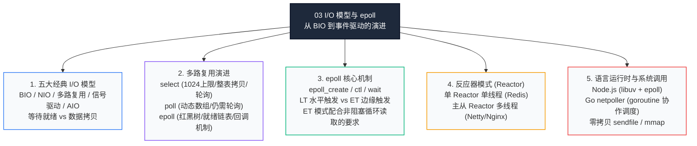
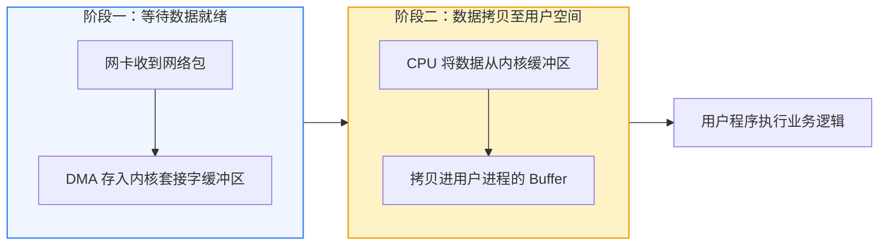
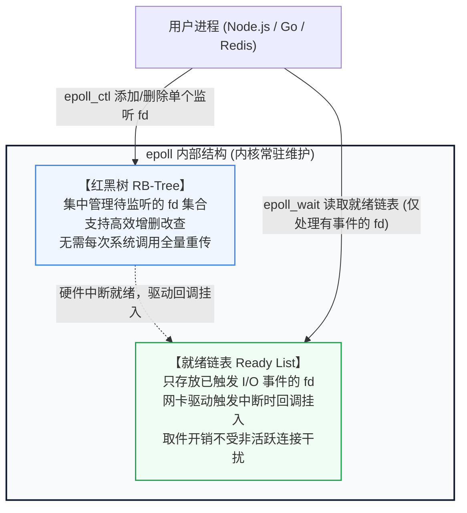
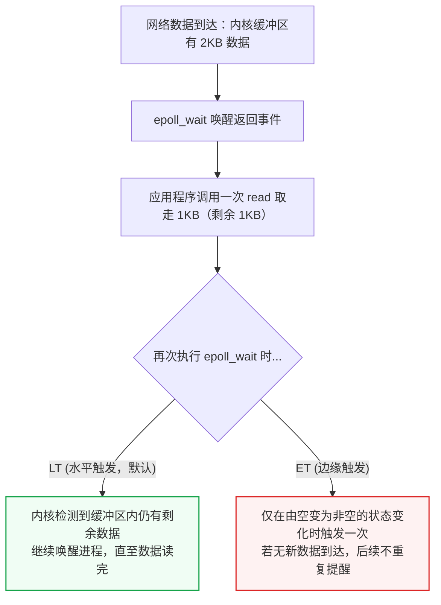
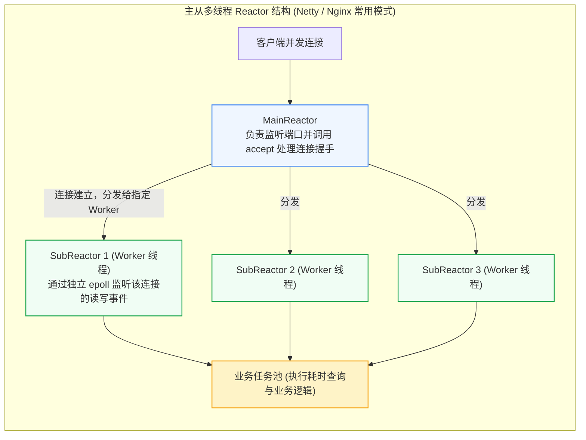
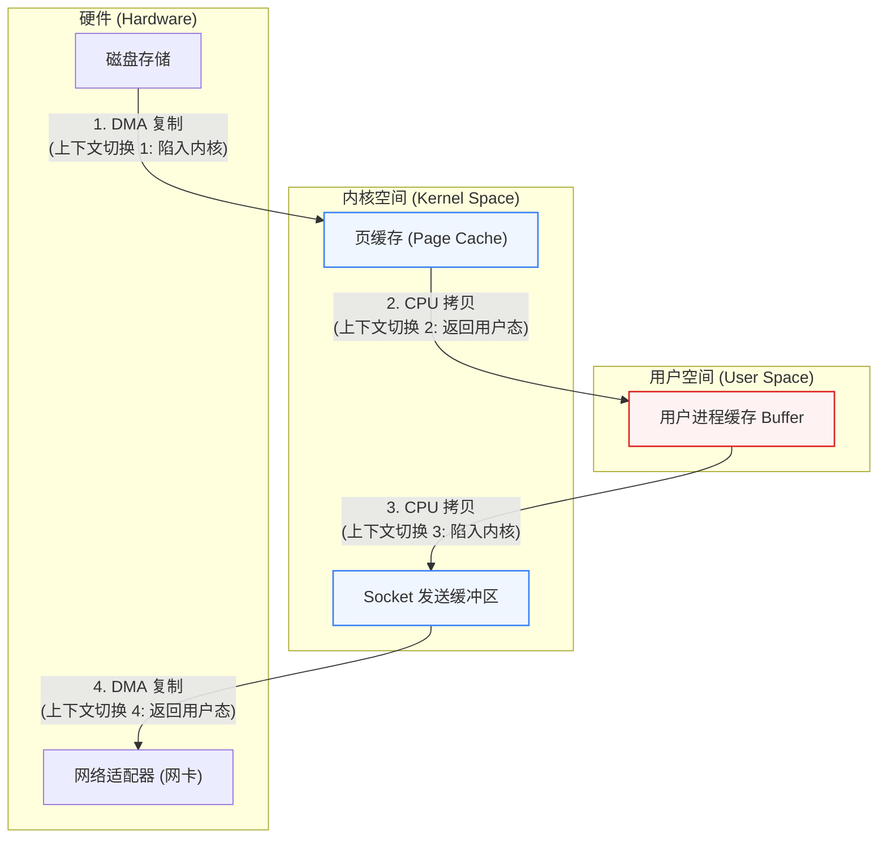

# 03 · I/O 模型与 epoll：从单连接阻塞到高并发事件驱动

> **学习目标**：面向从前端或全栈进阶后端的读者，梳理网络通信的底层机制。弄清为什么阻塞 I/O 在连接数增多时会遇到瓶颈，Linux 内核如何从 `select`、`poll` 逐步演进到 `epoll`；理解水平触发（LT）与边缘触发（ET）的区别与编写规范，并搞懂 Redis、Node.js（libuv）、Go（netpoller）及 Netty 等运行时和中间件处理并发请求的基本思路。

---

## 零、为什么需要理解 I/O 模型？（三个常见线上问题）

> 在日常业务开发中，框架（如 Express、NestJS、Gin、Spring Boot）常把网络读写封装为简洁的路由函数。但在高并发或调用链出现毛刺时，如果不清楚底层的网络 I/O 运行机制，排查问题就会无从下手。

| 场景 | 典型表现 | 底层机制分析 |
| :--- | :--- | :--- |
| **高并发长连接资源耗尽** | 即时通讯或推送服务上线后，上万客户端长连接刚建立，机器内存便被占满，CPU 在调度队列上居高不下，无法处理新请求。 | 采用传统的**阻塞 I/O + 独立线程模型**（BIO），每个连接都占用一个操作系统线程（默认栈约 8MB，即使仅部分使用也有开销）。大量线程共存导致内存占用升高，CPU 频繁做线程上下文切换。 |
| **下游抖动引发级联阻塞** | 某个第三方接口或下游服务延迟从几十毫秒偶尔升至数秒，网关的其他独立轻量接口随即陆续超时报错，重启后仍被压垮。 | 阻塞模型下，工作线程池中的线程在等待网卡返回时处于挂起状态。短时间内并发请求占满整个线程池，导致后续所有请求无法获取可用线程，出现**级联等待**。 |
| **大文件传输吞吐受限** | 静态资源、视频切片或大文件下载服务中，带宽占用不高但 CPU 负载偏高，处理速率上不去。 | 传统 `read()` 与 `write()` 链路中经历了 **4 次上下文切换和 4 次内存拷贝**。数据需经由用户态中转，未利用**零拷贝（Zero-Copy）**机制减少开销。 |

---

## 知识全景脑图



## 本章要回答的 5 个问题（面试雷达）

| 题号 | 高频母题 | 面试考察重点 | 本文位置 |
| :--- | :--- | :--- | :--- |
| **Q1** | 阻塞/非阻塞、同步/异步如何区分？ | 关注划分的两阶段：第一阶段“内核等待数据就绪”，第二阶段“数据从内核复制到用户空间”。只要第二阶段由调用者主动等待拷贝完成，即属于同步。 | 第二节 |
| **Q2** | `select`、`poll`、`epoll` 的区别是什么？为什么 `epoll` 性能不随连接总数线性衰减？ | 连接数上限（1024 限制与突破）、拷贝开销（每次调用传全量 vs 内核红黑树持久保存）、查找方式（O(n) 轮询集合 vs 仅返回就绪事件链表）。 | 第三节 |
| **Q3** | epoll 的水平触发（LT）与边缘触发（ET）有何区别？为什么 ET 模式必须搭配非阻塞 I/O？ | LT 在有剩余未读数据时会持续提醒；ET 仅在状态翻转时通知一次。ET 漏读易造成连接停滞，因此需配合非阻塞 I/O 循环读取直至 `EAGAIN`。 | 第四节 |
| **Q4** | Redis 为什么以单主线程为基础仍能保持高吞吐？Node.js 如何支持高并发？ | 纯内存读写 + I/O 多路复用（Reactor 模式）+ 避免线程上下文切换与锁争用。主线程负责调度与核心执行，耗时任务移交后台线程或线程池。 | 第五、六节 |
| **Q5** | 什么是零拷贝（Zero-Copy）？它如何提升数据传输吞吐量？ | 分析传统传输的 4 次拷贝与切换过程；说明 `mmap` 减少用户态拷贝，以及 `sendfile` 结合硬件 DMA 达成内核直发网卡的原理。 | 第七节 |

---

## 一、心智模型：从餐厅点单理解 I/O 模式

结合 [0-总起](./0-总起.md) 中的“收发室收件”，我们用**餐厅服务员与客人点餐**的过程，来梳理不同 I/O 模型的行为特征：

| I/O 模型 | 对应点餐场景 | 底层对应机制 | 资源与性能表现 |
| :--- | :--- | :--- | :--- |
| **阻塞 I/O (BIO)** | 每桌客人由一名专属服务员照看。客人看菜单思考 5 分钟，服务员就**在桌旁原地等待 5 分钟**，期间无法协助其他桌。 | 每个 Socket 连接分配一个独立线程。线程在调用 `read()` 时被挂起，等待数据到达。 | 连接数增加时线程数同步膨胀，引发内存占用上升和高频线程调度切换。适合连接少且请求处理时间稳定的场景。 |
| **非阻塞 I/O (NIO)** | 服务员隔几秒便向客人询问一次“是否点好”。若客人表示还在看，服务员先离开片刻再来问。 | 设置 `fcntl(fd, O_NONBLOCK)`。调用 `read()` 暂无数据时立即返回 `EAGAIN`，不阻塞当前线程。 | 线程不会持续挂起，但若应用层采用空循环频繁轮询，易导致 CPU 空转和资源消耗。 |
| **多路复用 (`select` / `poll`)** | 餐厅安排一名大堂经理。经理在大厅询问“哪桌客人点好了”，当有人示意时，经理**从第一桌逐一走到最后一桌核对具体是哪桌准备就绪**。 | 由单个线程监听一组 fd。当有数据到达时系统调用返回，但**应用层需遍历全部被监听集合**以确认是哪些连接触发。 | 每次调用均需向内核传递完整监听清单；当连接基数大而活跃连接极少时，遍历产生明显额外开销。 |
| **epoll 事件通知** | 餐厅设置智能大屏与呼叫器：客人点餐需求在服务台登记（红黑树维护）；后厨或客人有新变动时，大屏幕精准列出就绪桌号（就绪队列）。 | 内核在网卡数据就绪时通过中断回调将对应 fd 挂入就绪链表，`epoll_wait` 返回的**均为产生事件的活跃连接**，检索时间不受闲置连接影响。 | 支撑海量并发连接的核心机制。连接总数较高时，只要实际产生收发的活跃连接比例有限，调度处理开销就保持平稳。 |

---

## 二、五大经典 I/O 模型标准拆解（对应 Q1）

在操作系统中，一次网络读操作通常划分为**两个独立的阶段**：

1. **阶段一：等待数据在内核就绪**（网卡收到网络包，通过 DMA 存入内核套接字接收缓冲区 `socket receive buffer`）；
2. **阶段二：将数据从内核空间拷贝至用户进程空间**（从内核缓冲区复制到用户程序的 Buffer 中，如 Node.js `Buffer` 或 Go 字节切片）。

不同 I/O 模型在两个阶段上的行为特征各不相同：



### 2.1 五大模型行为对照表

| 模型 | 阶段一：等待数据就绪 | 阶段二：拷贝到用户空间 | 阻塞与同步属性 | 特点与代价 |
| :--- | :--- | :--- | :--- | :--- |
| **阻塞 I/O (Blocking I/O)** | 进程挂起等待，CPU 调度切换 | 进程继续等待，直到数据拷贝完成 | **阻塞 + 同步** | 逻辑直观，但连接数随业务增加时，线程栈消耗和上下文切换开销显著升高。 |
| **非阻塞 I/O (Non-blocking I/O)** | 无数据时立即返回 `EAGAIN`，不挂起 | 数据就绪时，进程等待数据拷贝到用户态 | **非阻塞 + 同步** | 阶段一不会阻塞，但需要应用层轮询检测，无序轮询会占用 CPU。 |
| **I/O 多路复用 (Multiplexing)** | 进程阻塞在 `select/epoll` 调用，由内核监听多个 fd | 任意 fd 就绪后系统调用返回，由进程调用 `read` 拷贝数据 | **事件阻塞 + 同步** | 单个线程可管理多个连接；数据复制阶段仍需应用层主动调用 `read` 同步完成。 |
| **信号驱动 I/O (Signal-driven)** | 进程注册 `SIGIO` 信号处理函数后返回；数据就绪时由内核发送信号 | 收到信号后，进程主动调用 `read` 完成数据拷贝 | **阶段一非阻塞 + 同步** | 复杂多连接场景下信号排队与处理逻辑较为繁琐，现代业务开发中较少直接采用。 |
| **异步 I/O (Asynchronous / AIO)** | 进程发起 `aio_read` 后立即返回并继续其他任务 | **内核自动将数据拷贝进用户 Buffer**，完成后通过信号或回调通知 | **非阻塞 + 异步** | 两个阶段调用者均不处于阻塞等待状态。Linux 历史上 POSIX AIO 多用于文件操作，现代环境通过 **io_uring** 正在扩展其能力。 |

> **辨析核心依据**：
> - **阻塞与非阻塞**：以**阶段一**为基准——在数据未到达时，当前线程是被操作系统挂起让出执行权，还是立即返回状态码继续往下走？
> - **同步与异步**：以**阶段二**为基准——在数据从内核向用户空间搬运时，是由**应用程序自己调用 `read()` 等待拷贝结束**，还是由**操作系统内核代为拷贝完毕后通知结果**？
> - 因此，**I/O 多路复用（`select/poll/epoll`）在分类上属于同步 I/O**，因为在就绪通知到达后，读取数据的过程仍需应用程序调用系统调用完成。

---

## 三、I/O 多路复用演进史：从 select、poll 到 epoll（对应 Q2）

为了解决“每个连接分配一个线程”的资源问题，操作系统的多路复用方案经历了三次主要迭代。

### 3.1 `select`：引入多路监听机制与历史局限

`select` 是早期 Unix 提供的接口，其工作方式是将一组待监听的 fd 放入位图结构 `fd_set` 后传入内核：

```c
// select 系统调用签名
int select(int maxfdp1, fd_set *readset, fd_set *writeset, fd_set *exceptset, struct timeval *timeout);
```

`select` 使得单线程可以管理多个连接，但设计上有三个工程限制：

1. **数量受限于默认上限**：`fd_set` 在内核中由定长位图实现，受头文件宏定义 `FD_SETSIZE` 约束，在 Linux 上默认通常为 **1024**。监听连接若超出这一容量，常规方式无法直接容纳。
2. **每次调用需往返拷贝监听集**：每次执行 `select`，均需将整个 `fd_set` 位图由用户空间复制到内核空间；函数返回时又需将带状态的位图拷贝回用户空间。
3. **返回后需遍历查找就绪事件**：内核返回的是就绪的文件描述符总数，但不会直接给出是哪几个就绪。应用程序需写循环遍历 0 到 1024 的描述符，依次用 `FD_ISSET()` 判断状态。连接总数大而活跃连接少时，该循环存在重复开销。

### 3.2 `poll`：链表结构解除数量上限

`poll` 将定长位图调整为结构体数组 `struct pollfd`：

```c
struct pollfd {
    int   fd;       // 文件描述符
    short events;   // 关心的事件 (POLLIN, POLLOUT 等)
    short revents;  // 内核返回的实际发生事件
};
int poll(struct pollfd *fds, nfds_t nfds, int timeout);
```

- **改进点**：采用数组链表形式，突破了 1024 个连接的硬编码限制，容量主要受系统内存及文件句柄上限约束。
- **未解之处**：每次调用仍需把全部待监听结构复制到内核；返回后仍需通过线性遍历判断具体哪些连接产生了事件。

### 3.3 `epoll`：红黑树与就绪链表的设计优化

Linux 2.6 正式引入 `epoll`，从底层数据结构对多路监听进行了重新梳理。其思路在于：**让待监听的连接列表由内核维护，避免频繁重传，并由内核直接返回发生事件的具体连接**。

`epoll` 在内核中使用两个结构配合工作：



#### select、poll 与 epoll 关键差异

| 维度 | select | poll | epoll |
| :--- | :--- | :--- | :--- |
| **底层数据结构** | 定长位图（Bitmap） | 动态结构体数组（pollfd 数组） | **红黑树（维护监听集合）+ 双向链表（存储就绪事件）** |
| **支持的连接规模** | 默认受 `FD_SETSIZE` (1024) 限制 | 无固定上限，受系统资源限制 | **无固定上限**，主要受可用内存与系统 fd 限制 |
| **参数传递与拷贝** | 每次调用均需向内核全量传入 fd 集合 | 每次调用均需向内核全量传入数组 | 仅在变更时通过 `epoll_ctl` 传递对应条目，`epoll_wait` 无需重复传表 |
| **就绪项检索方式** | 遍历检查集合中的每一个 fd | 遍历检查数组中的每一个元素 | **直接返回就绪链表**，仅需遍历有事件发生的部分 |
| **长连接场景下吞吐** | 空闲连接增多时遍历耗时上升 | 空闲连接增多时遍历耗时上升 | **相对稳定**，主要取决于产生事件的活跃连接量 |

---

## 四、深入 epoll 内核三大调用与触发模式（对应 Q3）

### 4.1 epoll 的三个系统调用

使用 epoll 处理网络事件通常涉及以下三个 API：

```c
#include <sys/epoll.h>

// 1. 在内核中创建 epoll 实例（初始化红黑树与就绪链表），返回其文件描述符 epfd
int epoll_create(int size);

// 2. 对监听的 socket 与事件执行增、删、改操作
int epoll_ctl(int epfd, int op, int fd, struct epoll_event *event);
// op 参数可选：EPOLL_CTL_ADD (添加), EPOLL_CTL_MOD (修改), EPOLL_CTL_DEL (删除)

// 3. 阻塞等待事件到达；就绪时，内核将就绪事件拷贝至 events 数组并返回数量
int epoll_wait(int epfd, struct epoll_event *events, int maxevents, int timeout);
```

常规工作流程：
1. 服务启动时，调用一次 `epoll_create` 获得 `epfd`；
2. 监听端口接收到新连接时，通过 `epoll_ctl(EPOLL_CTL_ADD)` 把连接挂入监听集合；
3. 事件循环中反复调用 `epoll_wait` 获取已触发事件的 `events` 列表并逐个处理。

### 4.2 水平触发（LT）与边缘触发（ET）

epoll 支持两种事件通知模式：**Level-Triggered（水平触发，默认）**与 **Edge-Triggered（边缘触发）**。



#### LT 与 ET 运行特征比较

| 触发模式 | 触发逻辑 | 编码与维护注意点 | 适用场景 |
| :--- | :--- | :--- | :--- |
| **水平触发 (LT - 默认)** | 只要接收缓冲区内**仍有未读数据**（或发送缓冲区有空闲空间），每次 `epoll_wait` 都会返回该就绪事件。 | 编码简单，不易因未完全读出而丢失事件通知；但如果大段数据单次未处理完，会带来多次唤醒。 | 通用网络库和常规 RPC 服务默认广泛采用，兼容性好。 |
| **边缘触发 (ET)** | 仅在连接状态发生变动（如缓冲区从无数据到有数据）的跳变瞬间通知一次。未读完的数据若没有新包到来，不再重复触发通知。 | 减少重复唤醒带来的系统调用开销；但必须要求应用层**单次通知内读净全部数据**，否则易引发等待挂起。 | 追求极低调用开销的高性能反向代理和网关软件（如 Nginx）。 |

### 4.3 ET 模式的编写约定

采用 ET 模式时，应用层需注意以下两点约束：

#### 约束一：Socket 需设置为非阻塞（Non-blocking）
* **原因**：若 Socket 保持阻塞模式，为了读完数据连续调用 `read()`，当缓冲区所有数据读完后，下一次 `read()` 会因为无数据而使当前线程陷入挂起，影响事件循环继续处理其他连接。
* **做法**：建连后使用 `fcntl(fd, F_SETFL, O_NONBLOCK)` 显式设为非阻塞。

#### 约束二：使用循环持续读取直至返回 `EAGAIN`
* **原因**：由于 ET 模式后续不会针对当前遗留数据二次提醒，如果一次事件只读取固定长度且未完全排空缓冲区，剩余数据会滞留内核，可能导致通信双方互相等待。
* **参考实现模式**：

```c
// ET 模式下的常规读取结构
while (1) {
    ssize_t bytes_read = read(fd, buf, sizeof(buf));
    if (bytes_read > 0) {
        // 正常处理接收到的数据
        process_data(buf, bytes_read);
    } else if (bytes_read == 0) {
        // 对端正常关闭连接 (收到 FIN 包)
        close(fd);
        break;
    } else {
        if (errno == EAGAIN || errno == EWOULDBLOCK) {
            // 当前可用数据已全部读完，退出循环等待下一次事件
            break;
        } else if (errno == EINTR) {
            // 被信号中断，继续尝试读取
            continue;
        } else {
            // 处理其他网络异常
            perror("read error");
            close(fd);
            break;
        }
    }
}
```

---

## 五、并发网络架构范式：Reactor（反应器模式）（对应 Q4）

有了多路复用机制后，服务端的并发编程通常采用 **Reactor（反应器模式）** 组织代码架构。



### 常见的三种 Reactor 模式形态：

1. **单 Reactor 单线程（如 Redis 早期的基础事件循环）**：
   - 同一个线程同时负责连接监听、数据读取、协议解析以及业务执行。
   - 结构简单且无线程锁开销；但要求单次业务操作保持轻量，若某一任务耗时较长，后续事件处理会被顺延。
2. **单 Reactor 多线程**：
   - 一个 Reactor 线程统一负责接收连接与网络读写，业务数据准备就绪后抛入业务线程池并发处理。
   - 分离了网络处理与复杂业务计算；但在超大连接量下，单线程承载全部读写解析可能面临瓶颈。
3. **主从 Reactor 多线程（如 Netty、Nginx 典型模型）**：
   - **MainReactor**：专注处理服务端口监听与客户端建连（`accept`）；
   - 连接完成后将其交由后台一组 **SubReactor** 线程管理；
   - 每个 SubReactor 线程通常维护独立的 epoll 监听实例，分散网络数据读写压力；
   - 耗时计算进一步解耦到业务线程池，实现建连、I/O 传输与业务处理的层次划分。

---

## 六、常见运行时与中间件实现参考（对应 Q4）

### 6.1 Redis 的处理模型

- **核心执行流程**：Redis 核心业务逻辑（数据命令读写）以单主线程为基础运行。
- **高吞吐的基础支撑**：
  1. **全内存读写**：常规键值查询在内存中完成，耗时通常处于较低量级；
  2. **I/O 多路复用**：基于内置的事件库（Linux 环境封装 epoll），由单线程调度众多并发连接；
  3. **减少并发锁与调度成本**：单主线程执行命令避免了多线程数据共享下的互斥锁竞争；
  4. **引入 I/O 多线程**：随着网络硬件吞吐提升，Redis 6.0 引入多线程主要用于并行处理协议解包和写出数据，核心键值命令的执行仍保持单线程串行处理。

### 6.2 Node.js 的事件循环（基于 libuv）

- Node.js 运行 JavaScript 代码的主线程是单线程，但底层依赖 **libuv** 承载异步 I/O。
- **Linux 环境下的网络处理**：在 Linux 系统中，libuv 底层通过 `epoll` 管理 Socket 连接。
- **示例对应的底层动作**：
  ```js
  const server = net.createServer((socket) => {
    socket.on('data', (chunk) => { /* 处理数据 */ });
  });
  server.listen(8080);
  ```
  这段代码执行时，服务器的监听句柄以及客户端建立的连接句柄，均被加入 libuv 内核事件监听实例中。
- **与文件操作的区别**：传统 Linux 文件系统缺少通用的异步多路复用支持，libuv 处理文件读取（如 `fs.readFile`）时通常使用后台线程池（默认 4 个工作线程）模拟异步调用；而网络通信则是原生的 epoll 多路复用。

### 6.3 Go 语言的网络轮询器（netpoller）

Go 语言在网络编程中保留了顺序编写的调用方式，而底层运行时配合调度器进行了转换：

```go
// 代码表现为顺序读取
conn, _ := listener.Accept()
go func() {
    buf := make([]byte, 1024)
    n, err := conn.Read(buf) // 无数据时内部协作处理
    process(buf[:n])
}()
```

#### netpoller 的调度协作过程：
1. Go 内部将底层网络套接字设为非阻塞模式；
2. 当调用 `conn.Read()` 遇到未就绪状态（返回 `EAGAIN`）时，Go 不会阻塞物理操作系统线程，而是由 netpoller 将该网络句柄挂入 epoll 监听；
3. 运行时调用 `gopark` 暂时让出当前协程（Goroutine）的执行权，底层操作系统线程随即转去执行其他可运行的协程；
4. 当 epoll 实例监听到数据到达时，该协程被重新标记为就绪状态（`goready`），在后续调度中恢复执行。

---

## 七、数据传输吞吐优化：零拷贝（Zero-Copy）（对应 Q5）

连接管理之外，大块数据分发也是服务端的常见需求。不同数据传输路径在系统资源使用上存在明显差异。

### 7.1 传统数据读写过程分析

以从磁盘读取文件并通过网络输出为例：

```c
// 常见传统处理方式
read(file_fd, tmp_buf, len);
write(socket_fd, tmp_buf, len);
```

该过程在系统层面的流转步骤如下：



- **4 次上下文切换**：`read()` 调用产生进出内核 2 次切换，`write()` 调用同样产生 2 次切换；
- **4 次数据复制**：
  1. 磁盘到内核页缓存（Page Cache），由 DMA 硬件通道完成；
  2. 内核页缓存复制到用户缓冲区，由 CPU 搬运；
  3. 用户缓冲区复制到套接字发送缓冲区，由 CPU 搬运；
  4. 套接字缓冲区复制至网卡缓存，由 DMA 完成。

如果只是原样转发文件内容，数据在用户空间的往返便带来了不必要的复制和内存占用。

### 7.2 优化方案：`mmap + write`

借助 [02-内存管理与OOM](./02-内存管理与OOM.md) 中介绍的虚拟地址映射：

```c
buf = mmap(file_fd, len);
write(socket_fd, buf, len);
```

- **运行效果**：用户空间与内核空间共享该页缓存映射，省去了一次由内核空间向用户空间的复制；
- **资源表现**：仍存在 4 次上下文切换，数据拷贝减少为 3 次（其中 CPU 参与搬运 1 次）。

### 7.3 优化方案：`sendfile` 与硬件辅助收集

Linux 提供了专用于文件向网络传输的系统调用 `sendfile`：

```c
#include <sys/sendfile.h>
ssize_t sendfile(int out_fd, int in_fd, off_t *offset, size_t count);
```

- **执行路径**：数据流转全部在内核空间进行，绕过用户空间中转；
- **配合 SG-DMA (Scatter-Gather DMA)**：硬件支持时，内核只需将 Page Cache 中记录的物理地址与长度描述符传递给 Socket 队列，网卡即可直接读取 Page Cache 发送数据。
- **优化收益**：
  - 减少至 **2 次上下文切换**（仅一次 `sendfile` 的发起与返回）；
  - 数据复制主要由 DMA 硬件完成，避免占用过多的 CPU 内存拷贝周期。

---

## 八、高频八股与场景题（深度打通版）

### 考点 1：什么是 I/O 多路复用？“多路”和“复用”分别指什么？

* **考察点**：技术定义与要解决的根本问题。
* **回答参考**：
  1. **多路**：指**多个网络连接（多个 Socket fd）**；
  2. **复用**：指**复用同一个操作系统线程或进程**；
  3. **核心目标**：通过单个线程同时监测多个连接的读写就绪状态，在连接产生事件时再进行针对性处理，减少为每个空闲连接长期分配专属线程的资源浪费。
* **八股真题与面经出处**：
  - [牛客网 - 操作系统校招经典题：什么是 I/O 多路复用？select/poll/epoll 详解](https://www.nowcoder.com/discuss/735817010453417984)
  - [小林coding - 9.2 I/O 多路复用：select/poll/epoll 原理全景](https://www.xiaolincoding.com/os/8_network_system/selete_poll_epoll.html)

---

### 考点 2：为什么 `select` 的默认限制是 1024？是否适合监听超大连接？

* **考察点**：`fd_set` 实现方式、系统开销与退化特性。
* **回答参考**：
  1. `select` 底层采用定长位图 `fd_set`，在 Linux 的 `typesizes.h` 等头文件中受 `__FD_SETSIZE 1024` 宏约束，每个 bit 对应一个描述符，默认支持的最大编号通常为 1024。
  2. **不建议直接用于超大连接管理**。即使通过重编译内核修改宏增加位图宽度，由于每次调用都需要在用户态与内核态之间往返拷贝全量位图，且返回后必须进行 O(n) 的线性遍历，在连接规模扩大时会带来显著的处理耗时上升。
* **八股真题与面经出处**：
  - [掘金 - 后端网络通信必考：select 为什么有 1024 限制？poll 和 epoll 是怎么解的？](https://juejin.cn/post/7617679439415099428)
  - [GitHub - huanzhiyazi 技术整理：I/O 多路复用——select, poll, epoll 深度剖析](https://github.com/huanzhiyazi/articles/blob/master/%E6%8A%80%E6%9C%AF/%E6%93%8D%E4%BD%9C%E7%B3%BB%E7%BB%9F/IO%E5%A4%9A%E8%B7%AF%E5%A4%8D%E7%94%A8%E2%80%94%E2%80%94select%2Cpoll%2Cepoll/IO%E5%A4%9A%E8%B7%AF%E5%A4%8D%E7%94%A8%E2%80%94%E2%80%94select%2Cpoll%2Cepoll.md)

---

### 考点 3：epoll 的水平触发（LT）与边缘触发（ET）在遇到大包时如何处理？

* **考察点**：触发状态机、事件遗漏规避与非阻塞搭配。
* **回答参考**：
  1. **LT 模式**：如果一次读取未取尽数据（例如一次读 1KB 但缓冲区有 3KB），只要缓冲区仍处于可读状态，后续调用 `epoll_wait` 仍会返回可读事件，编写容错性较高。
  2. **ET 模式**：仅在由无数据变为有数据的跳变时刻通知一次。若未完整读取剩余数据，在没有后续新数据到达之前将不会再次得到通知。
  3. **实现要求**：因此在 ET 模式下，连接需设为**非阻塞模式**，并在事件到达时使用 **while 循环持续读取直至收到 `EAGAIN`**；写操作类似，遇到写缓冲区占满后需暂停写入，等待下一次写就绪事件。
* **八股真题与面经出处**：
  - [牛客网 - 经典面经：epoll 的水平触发与边缘触发的区别，为什么 ET 模式必须配合非阻塞？](https://www.nowcoder.com/discuss/453553008031313920)
  - [小林coding - 操作系统面试真题：epoll 触发模式 LT 与 ET 深度实测对比](https://www.xiaolincoding.com/os/8_network_system/selete_poll_epoll.html)

---

### 考点 4：Go 语言的 netpoller 底层是 epoll，为什么业务代码编写表现为顺序同步？

* **考察点**：协程协作式挂起与网络轮询器的结合。
* **回答参考**：
  1. Go 运行时在底层将网络套接字设置为非阻塞模式；
  2. 当 Goroutine 调用 `conn.Read()` 暂无数据时（收到 `EAGAIN`），Go 运行时不会阻塞当前系统级线程（M），而是将该网络文件描述符注册到底层的 epoll 实例中，并通过 `gopark` 将该协程挂起；
  3. 释放出的系统线程继续调度执行其他处于可运行状态的协程；
  4. 当网络事件到达触发后，netpoller 检查到就绪信号，通过 `goready` 重新激活并放回调度队列，恢复该协程的后续执行。
* **八股真题与面经出处**：
  - [牛客网 - 腾讯/字节 Go 语言专项面试题：Go netpoller 底层实现与同步编程体验的奥秘](https://www.nowcoder.com/discuss/453553008031313920)
  - [luozhiyun 博客 - 详解 Go 语言 I/O 多路复用 netpoller 模型与 runtime 源码调度](https://www.luozhiyun.com/archives/439)

---

### 考点 5：为什么部分文件传输与消息中间件选用 sendfile？与 read+write 相比有何区别？

* **考察点**：减少数据复制通路、绕过用户态空间与系统调用次数。
* **回答参考**：
  1. 传统的 `read + write` 通常伴随 4 次用户态与内核态的上下文切换，且数据需经由用户缓冲区中转，产生多次 CPU 参与的内存搬运。
  2. `sendfile` 允许数据在内核层直接流转并发送至网络适配器，绕过了用户态内存的中转过程。
  3. 结合网卡 DMA 的散布收集（Scatter-Gather）支持时，可进一步降低 CPU 复制参与度，提高大文件在网络通道上的持续输出速率。
* **八股真题与面经出处**：
  - [小林coding - 9.1 什么是零拷贝技术？mmap 和 sendfile 区别](https://www.xiaolincoding.com/os/8_network_system/zero_copy.html)
  - [HeapDump 性能社区 - 看一遍就理解：零拷贝与 Kafka 高吞吐底座深度剖析](https://heapdump.cn/article/3290793)

---

## 九、本节核心记忆要点

> 阻塞 I/O 在连接膨胀时面临线程开销问题；多路复用通过集中监听分流连接检测。`select` 和 `poll` 的主要成本在于监听集合的传递与线性查找；而 `epoll` 采用内核常驻红黑树管理监听目标，并配合中断回调建立就绪链表，实现了事件返回开销与空闲连接规模的解耦。在需要单次通知处理全部数据的场景下需注意边缘触发（ET）的使用约定，而对于静态文件分发，则可利用 `sendfile` 等零拷贝路径减少多余的内存拷贝。

总结为三条脉络：

1. **单线程管理多连接的关键**：多路复用将连接状态检测交由内核统一处理，活跃事件单独返回。
2. **ET 模式的编程要求**：注意非阻塞模式与循环读取至 `EAGAIN`，避免数据遗留引起等待停滞。
3. **零拷贝的优化重点**：在大数据量分发中减少数据在内核空间与用户空间之间的非必要中转。

---

## 下一篇

下一篇 [04-进程间通信IPC](./04-进程间通信IPC.md) 将探讨操作系统进程隔离背景下的通信方案：当系统拆分为独立进程（例如 Web 服务进程与后台数据分析/算法推理进程）时，管道、Unix Domain Socket、消息队列以及共享内存（Shared Memory）各自的数据通路与适用场景。
