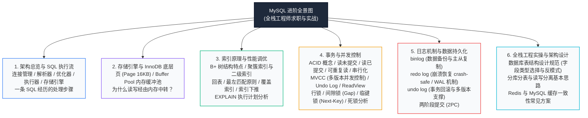

# 数据库系统 · MySQL 学习路线与总起（全栈工程师版）

> **学习目标**：面向前端进阶全栈、以及准备后端与全栈面试的读者，梳理关系型数据库的核心运行机制。围绕真实工程与面试中对 MySQL 的常见诉求（表结构设计、索引选择、慢查询排查、并发事务控制与数据可靠性），建立清晰的底层脉络，理清从业务请求发出、SQL 解析执行，到内存缓冲池与磁盘日志落盘的完整链路。

---

## 一、为什么全栈开发需要掌握 MySQL 底层机制？

在很多全栈项目中，早期通常采用“Node.js / Go + ORM（如 Prisma、TypeORM、GORM）+ MySQL”的组合。

在数据量较小（百行到千行级别）时，直接调用 ORM 的抽象方法便能满足需求：
- 比如使用 `prisma.user.findMany({ where: { status: 1 } })` 获取列表；
- 字段按需增减，关联查询直接嵌套，较少关注字段类型与底层存储成本。

**但当业务数据持续沉淀、单表达到数十万甚至百万行，或者并发读写增多时，一些常见的性能与一致性问题就会显现：**

| 常见线上现象 | 业务层表象 | 底层运行机制分析 |
| :--- | :--- | :--- |
| **查询接口延迟突然上升** | 接口原本数十毫秒返回，随着表数据增长延时上升至数秒，机器 CPU 使用率升高。 | 查询 SQL 未命中有效索引（或因隐式类型转换、模糊查询前缀 `%xxx` 导致**索引失效**），触发了**全表扫描**，存储引擎需在磁盘与内存之间逐页读取并核对全表数据。 |
| **并发扣减或领券出现数据异常** | 前端按钮已添加防重与防抖逻辑，高并发请求下依然出现库存超卖或余额为负。 | 前端限制无法约束直接发起的并发网络请求。若后端未在数据库层运用合适的事务隔离级别（MVCC）、行级锁（Record Lock）或条件乐观更新机制，并发更新容易产生数据覆盖。 |
| **单条更新引发其他读写排队** | 某条数据更新语句执行变慢，随后该表相关的其他事务陆续超时卡顿。 | 可能发生了**锁等待或锁范围扩大**。若更新条件未走索引，InnoDB 可能扩大扫描锁定范围；多个事务交替竞争多条记录锁时还可能诱发**死锁**。 |
| **突发断电后的数据恢复评估** | 业务记录提示操作成功，但实例异常重启后部分近期写入未如期出现。 | 数据库在写入时通常先更新内存 **Buffer Pool**，并在磁盘顺序写入 **预写日志（redo log）** 以兼顾吞吐。不同的 `innodb_flush_log_at_trx_commit` 刷盘策略，决定了系统故障时数据持久化的可靠程度与性能折中。 |

**小结**：前端重点关注展现层的数据交互与界面反馈，而全栈工程师在服务端需进一步理解数据在存储引擎层的一致性保障、索引通路与 I/O 边界。

---

## 二、全栈视角的 MySQL 知识全景图

避免零散背诵语法，本系列围绕系统运行流程与工程设计展开：

---

## 三、针对全栈工程师的专栏章节设计

本模块按“系统结构 -> 存储与索引 -> 事务与锁 -> 日志与可靠性 -> 综合工程实践”的逻辑顺序组织：

### 第一篇：[01-架构总览与SQL执行生命周期](./01-架构总览与SQL执行生命周期.md)
* **核心内容**：Server 层与存储引擎层的职责划分。连接管理（与网络 I/O 章节衔接）、SQL 词法语法解析、优化器生成执行计划，到调用存储引擎接口读取数据。
* **重点关注**：为什么相同语句在不同条件下执行效率不同？MySQL 8.0 为何移除了原有的查询缓存功能？

### 第二篇：[02-InnoDB存储引擎与BufferPool内存架构](./02-InnoDB存储引擎与BufferPool内存架构.md)
* **核心内容**：数据在物理磁盘上以 16KB 数据页（Page）为基本单位组织的原理。内存中的 **Buffer Pool**（冷热分段的 LRU 链表、Change Buffer 写入优化）、预读机制以及脏页异步刷盘策略。
* **重点关注**：理解数据库自建内存缓冲池与操作系统 Page Cache 之间的关系。

### 第三篇：[03-索引底层原理与B+树的工业级美感](./03-索引底层原理与B+树的工业级美感.md)
* **核心内容**：不同数据结构（哈希、二叉搜索树、平衡树、红黑树、B 树与 B+ 树）在磁盘 I/O 场景下的取舍。
* **重点关注**：聚簇索引（Clustered Index）与二级索引（Secondary Index）的物理存储形式；**回表查询、最左匹配原则、索引覆盖（Covering Index）与索引下推（ICP）**对查询性能的影响。

### 第四篇：[04-EXPLAIN执行计划与慢查询优化实战](./04-EXPLAIN执行计划与慢查询优化实战.md)
* **核心内容**：线上出现慢查询时使用 `EXPLAIN` 工具排查分析的基本步骤。
* **重点关注**：分析 `type` 列（常见级别如 `const`、`ref`、`range`、`index`、`ALL`）的含义；识别 `Extra` 列中的 `Using filesort`、`Using temporary` 并探究原因；梳理容易导致索引失效的典型书写方式。

### 第五篇：[05-事务隔离级别与MVCC底层实现](./05-事务隔离级别与MVCC底层实现.md)
* **核心内容**：ACID 的具体定义；脏读、不可重复读、幻读的产生场景；四种标准隔离级别在不同业务环境下的选择。
* **重点关注**：**MVCC（多版本并发控制）** 的三个支撑点——**隐藏系统列（trx_id、roll_pointer）、Undo Log 版本回滚链、ReadView 读视图可见性判断条件**。

### 第六篇：[06-MySQL锁机制与高并发防死锁](./06-MySQL锁机制与高并发防死锁.md)
* **核心内容**：表锁与行锁；共享锁（S 锁）与排他锁（X 锁）；意向锁的作用；InnoDB 行锁的三种形式——**记录锁（Record Lock）、间隙锁（Gap Lock）与临键锁（Next-Key Lock）**。
* **重点关注**：并发扣减等业务中的数据保护方式；“当前读”与“快照读”处理并发的不同方式；常见死锁成因与通过 `SHOW ENGINE INNODB STATUS` 分析锁等待日志。

### 第七篇：[07-三大日志与高可用：redo-log、undo-log、binlog](./07-三大日志与高可用：redo-log、undo-log、binlog.md)
* **核心内容**：预写日志（WAL）在数据库系统中的意义；**redo log**（重做日志，支持故障恢复）；**undo log**（回滚日志，支持事务原子性与多版本读）；**binlog**（归档日志，用于主从数据复制与增量同步）。
* **重点关注**：**两阶段提交（2PC）** 的执行时序，以及确保主从库与持久化日志状态保持一致的工作方式。

### 第八篇：[08-全栈架构进阶：缓存一致性与表设计规范](./08-全栈架构进阶：缓存一致性与表设计规范.md)
* **核心内容**：现代 Web 业务后端的数据库与缓存综合设计。
* **重点关注**：**Redis 与 MySQL 缓存双写策略**（更新与删除顺序考量、延迟双删及订阅 binlog 机制的适用场景）；表结构设计细节（字段长度与类型选取、合理使用索引）；读写分离和分库分表的基础概念。

---

## 四、全栈工程学习建议

1. **联系系统底层理解**：学习数据页与索引时，可以结合操作系统的**磁盘块与虚拟内存分页**加深理解；在分析并发锁与事务时，可以参考**进程/线程互斥和临界区保护**的思考方式。
2. **结合实际语句验证**：每篇内容提供可直接执行的 SQL 代码片段与 `EXPLAIN` 观察示例，帮助建立实际感受。
3. **服务于业务与架构**：理解数据库底层机制有助于在日常使用 ORM 编写复杂查询时，合理预估查询在数据量增加后的资源消耗，减少性能隐患。
