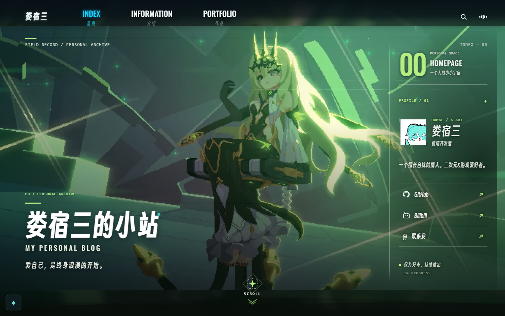
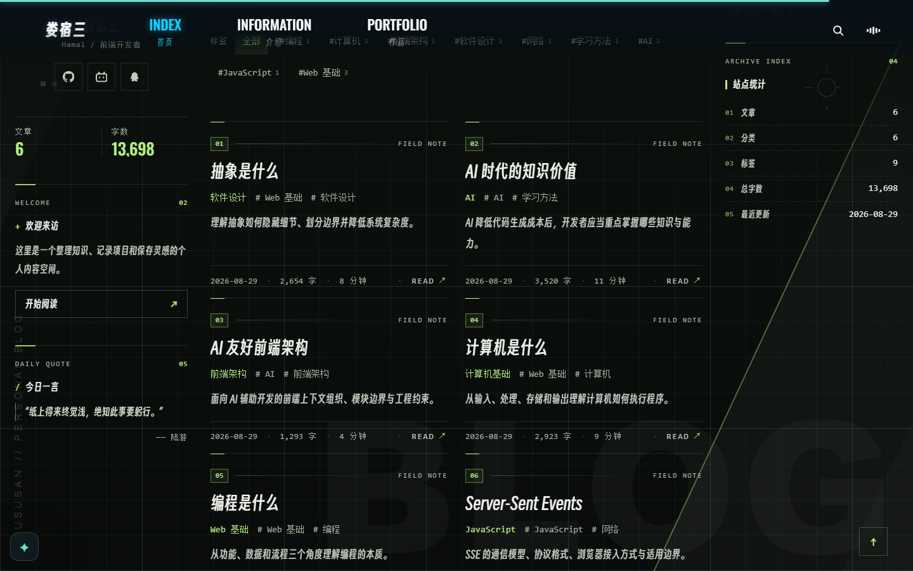
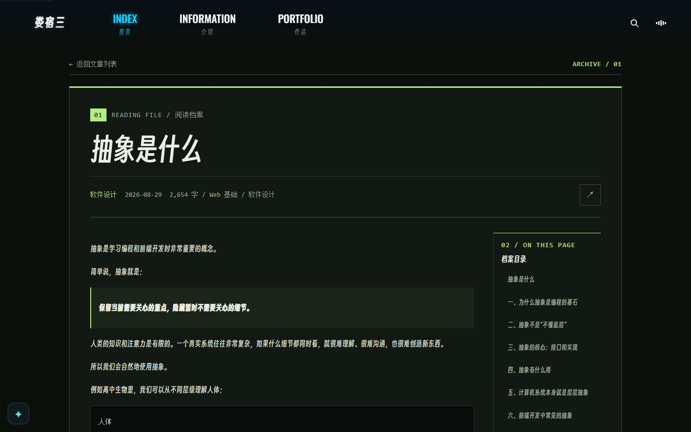
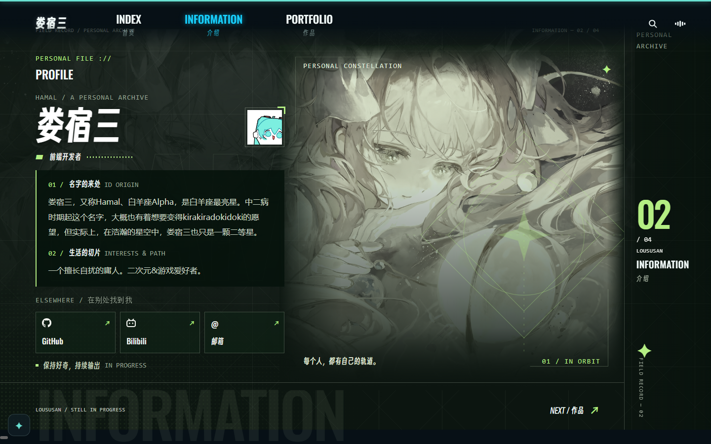
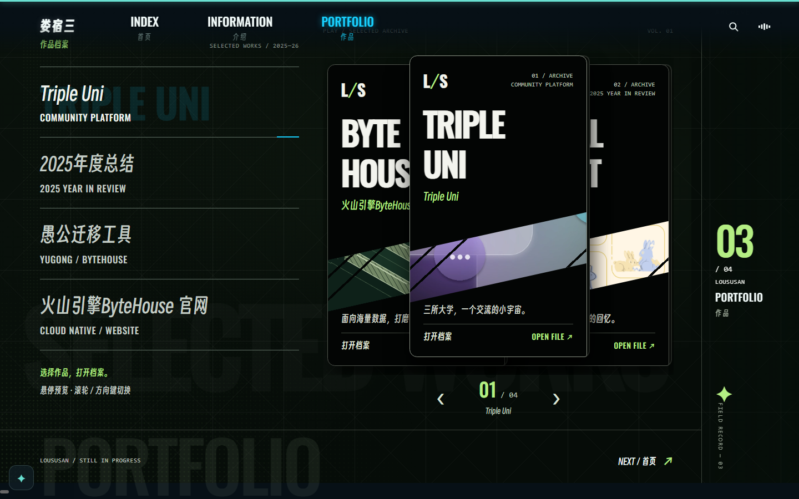

# 博客宫殿总图 · 60 桩

> 配套：[README.md](./README.md)（方法、路线、训练协议）

## 一、站点勘察（实拍）

下面是我按真实路由跑出来的五屏（1440×900，本地 dev server 截图），桩位全部落在这些画面里。

### 1. 首页首屏 —— `#/Home`

| 视觉锚点 | 位置 | 可挂什么 |
| --- | --- | --- |
| 顶栏毛玻璃 + 青色细线 | 全宽 fixed | 层叠上下文、`backdrop-filter`、定位 |
| `INDEX / INFORMATION / PORTFOLIO` 三项等距 | 顶栏中部 | flex 主轴/交叉轴 |
| 右上搜索 ⌕ 与音量 ◫ | 顶栏右侧 | 防抖、性能指标 |
| `00 / PERSONAL ARCHIVE` + 巨字「娄宿三的小站」 | 左下 | HTML 语义 / 文档结构 |
| 引言「爱自己，是终身浪漫的开始。」 | 左下 | 引用类型 / 内存 |
| 绿发发光立绘（背景、人物、光效、粒子分层） | 中央 | 层叠上下文、合成层 |
| 底部菱形 `SCROLL` + 下箭头 | 正下方 | 居中布局、动画 |
| 右上 `00 HOMEPAGE / 一个人的小小宇宙` | 右上 | 编号桩 |
| 右侧 PROFILE 卡（头像 + 三行社交 + 状态） | 右侧 | this / 原型 / 继承 |
| 左下青色小星挂件（Live2D） | 左下角 | Web Worker / 离屏渲染 |

### 2. 首页第二屏 —— `NOTES & THOUGHTS`

| 视觉锚点 | 位置 | 可挂什么 |
| --- | --- | --- |
| `01 / KNOWLEDGE ARCHIVE` 编号块 | 左上 | 桩号 |
| 巨字 `NOTES & THOUGHTS.`（白 / 灰 / 白 / 绿方块） | 上半屏 | var / let / const |
| 「把好奇写成记录。」引文 + 竖线 | 右侧 | 文本排版 |
| `LOUSUSAN / FIELD NOTES ↓` 分隔线 | 中段 | 切片 |
| 左栏 PROFILE 卡 + `6 / 13,698` 绿色数字 | 左栏 | 数据类型、精度 |
| 左栏 WELCOME + 「开始阅读 ↗」 | 左栏 | 事件委托 |
| 左栏 DAILY QUOTE 今日一言（陆游） | 左栏 | 引用类型 |
| `■ KNOWLEDGE BASE / 01 文章与思考` | 中栏 | 模块化 |
| 搜索框「搜索标题、摘要或标签」 | 中栏 | 作用域链 |
| 归档 6 / 分类 6 / 标签 9 + 胶囊标签行 | 中栏 | 深浅拷贝 |
| 六张 `FIELD NOTE` 卡（01–06） | 中栏 | 六大 JS 考点 |
| 右栏 `SYSTEM TIME` 时钟 + 日期 | 右栏 | 事件循环 |
| 右栏 `ARCHIVE INDEX` 五条统计 | 右栏 | 性能指标 / 存储 |
| 右下 ↑ 回到顶部 | 右下 | 垃圾回收 |
| 左边缘竖排 `LOUSUSAN / PERSONAL BLOG` | 左缘 | 边注 |

### 3. 文章页 —— `#/Post/:slug`

| 视觉锚点 | 位置 | 可挂什么 |
| --- | --- | --- |
| 顶部青色阅读进度线 | 页首 | 回流 vs 重绘 |
| `← 返回文章列表` + `ARCHIVE / 01` | 顶部 | history / BOM |
| `01 READING FILE / 阅读档案` | 正文首 | 渲染流水线 |
| 巨型标题 | 正文 | 阻塞渲染 |
| meta 行（日期 / 字数 / 分类 / 分享） | 标题下 | 存储方案 |
| 左侧竖线引用块 | 正文 | BFC / margin 塌陷 |
| 右栏 `02 / ON THIS PAGE` 目录 | 右侧 | DOM 树 |
| 底部相关文章 | 页尾 | 冒泡 / 委托 |

### 4. 介绍页 —— `#/Information`

| 视觉锚点 | 位置 | 可挂什么 |
| --- | --- | --- |
| `PERSONAL FILE ://` + `PROFILE` | 左上 | 构造函数 |
| 巨字「娄宿三」+ `▰ 前端开发者` | 左栏 | 实例 / 类 |
| `01 / 名字的来处 ID ORIGIN` | 左栏 | Object.prototype |
| `02 / 生活的切片` | 左栏 | 继承 |
| `ELSEWHERE` 三个链接块 | 左栏 | 三种设计模式 |
| `保持好奇，持续输出 IN PROGRESS` | 左栏底 | instanceof |
| `PERSONAL CONSTELLATION` 星图（菱形 + 圆 + 十字虚线 + 中心星） | 右半屏 | 原型链 |
| 「每个人，都有自己的轨道。」 | 星图下 | `__proto__` 归属 |
| 竖排 `02 / 04 LOU SUSAN INFORMATION` | 右缘 | 页码桩 |
| 底部巨型 `INFORMATION` 水印 + `NEXT / 作品` | 底部 | MVC / MVVM |

### 5. 作品页 —— `#/Portfolio`

| 视觉锚点 | 位置 | 可挂什么 |
| --- | --- | --- |
| `PLAY / SELECTED ARCHIVE` + `VOL.01` | 顶部 | 路由 / 版本 |
| 左目录四行（Triple Uni / 年度总结 / 愚公 / ByteHouse） | 左栏 | 受控组件、状态提升 |
| 当前项青色下划线滑动 | 左栏 | 过渡动画 |
| 中间三张叠卡（`L/S` 封面 → 大英文标题 → 图片条 → 摘要 → OPEN FILE） | 中央 | 虚拟 DOM / Fiber |
| 左右 `‹ ›` 切换 | 卡下 | Diff / key |
| `01 / 04` 计数 | 卡下 | setState 批处理 |
| 竖排 `03 / 04 PORTFOLIO` | 右缘 | 桩号 |
| 底部提示「选择作品，打开档案。」+ `NEXT / 首页` | 底部 | 组件懒加载 |

---

## 二、宫殿设定

**一句话**：本站已经自称档案馆，我们只把它"实体化"成一座八层的楼，每层一个卷宗（卷宗号就是页面上的编号）。

- 楼名：**娄宿三档案馆**（`FIELD RECORD / PERSONAL ARCHIVE`）
- 唯一合法路线：**B1 门厅 → 1F 大厅 → 2F 档案室 → 3F 阅览室 → 4F 观测台 → 5F 陈列室 → 6F 工坊 → 天台**
- 每层 5–8 个桩，全站 60 桩，编号 P01–P60 永不复用。
- 走的时候**只看画面，不想文字**；出楼之后再复述文字。

| 层 | 卷宗 | 八股域 | 桩号 | 为什么放这层 |
| --- | --- | --- | --- | --- |
| B1 门厅 | 00 入场 | 网络请求全流程 | P01–P07 | 加载遮罩本来就是"请求还没回来" |
| 1F 大厅 | 01 地基 | HTML / CSS | P08–P15 | 页面骨架与外观 |
| 2F 档案室 | 02 检索 | JS 核心 | P16–P23 | 档案卡片 = 语言机制 |
| 3F 阅览室 | 03 取件 | 浏览器 | P24–P31 | 阅读就是渲染 |
| 4F 观测台 | 04 血脉 | 原型 / 继承 / 模式 | P32–P39 | 星图天生是链 |
| 5F 陈列室 | 05 复刻 | React | P40–P47 | 卡册 = 复用与调度 |
| 6F 工坊 | 06 装配 | 工程化 | P48–P53 | 编辑器 = 编译 |
| 天台 | 07 边角 | 性能 / 安全 / 杂 | P54–P60 | 边角料放边角 |

---

## 三、60 桩地图

### B1 门厅 · 卷宗 00「入场」（网络）

| 桩 | 锚点 | 装置画面 | 题目 |
| --- | --- | --- | --- |
| P01 | 黑屏 + 少女吃葱加载图 | 七道门依次打开：地址栏 → DNS 电话簿 → TCP 握手 → TLS 换锁 → HTTP 递信 → 解析拆箱 → 装修出图 | 从 URL 输入到页面显示 |
| P02 | 加载的两条超时（字体 2s、视频 6s） | 门上的沙漏，沙漏翻两次；过期就换新货 | 强缓存 vs 协商缓存 |
| P03 | 门框上的青色细线 | 线上挂了三次握手、四次挥手的人偶 | TCP 三次握手 / 四次挥手 |
| P04 | 门锁 / 门禁 | 锁是绿的（HTTPS）；证书挂在锁孔上 | HTTPS / TLS 握手 / 中间人 |
| P05 | 门牌号 200 / 301 / 404 | 一排门牌，只有 200 是绿灯 | HTTP 状态码 |
| P06 | 门厅接待台的信封 | 信封三层：起始行、头、体 | HTTP 报文 / 方法 / RESTful |
| P07 | 快递箱分片 | 三个箱子：1.1（排队）、2（多路复用）、3（QUIC 走 UDP） | HTTP/1.1 vs 2 vs 3 |

### 1F 大厅 · 卷宗 01「地基」（HTML / CSS）

| 桩 | 锚点 | 装置画面 | 题目 |
| --- | --- | --- | --- |
| P08 | 门匾「娄宿三的小站」 | 匾后藏着一份文档骨架（html/head/body），写着语义标签 | HTML 语义化 / 文档结构 / SEO |
| P09 | 发光立绘分层（背景、人物、光、粒子） | 四层玻璃板叠起来，最上层压住下层 | 层叠上下文 / z-index / 定位 |
| P10 | 毛玻璃导航条 | 一块磨砂玻璃挂在门楣，透过它看见模糊的天 | `backdrop-filter` / 半透明 / fixed |
| P11 | 三个导航项等距 | 三个牌子被一根橡皮筋拉成等距 | flex：主轴 / 交叉轴 / `justify-content` |
| P12 | 菱形 SCROLL（永远正中） | 菱形无论怎么拉窗都钉在中央 | 水平垂直居中 N 种方法 |
| P13 | 左文字块 + 右 profile 卡（不对称两栏） | 左手一块铁板固定，右手一张卡随窗伸缩 | 左固定右自适应 / BFC 两栏 |
| P14 | 底部波浪 | 一条会呼吸的波浪线，从右往左推 | CSS 动画 / `transform` / 性能 |
| P15 | 圆形头像 | 一个方盒被砂轮磨成圆；外面一圈留白 | 盒子模型 / `border-radius` |

### 2F 档案室 · 卷宗 02「检索」（JS 核心）

| 桩 | 锚点 | 装置画面 | 题目 |
| --- | --- | --- | --- |
| P16 | 巨字 `NOTES & THOUGHTS.`（白 / 灰 / 白 / 绿方块） | 三块词牌 + 一块焊死的绿砖 | var / let / const / TDZ |
| P17 | 左栏 `6 / 13,698` 绿色数字 | 计数器末尾多出一串 `.0000000000000004` | 数据类型 / 0.1+0.2 |
| P18 | 胶囊标签行（#编程 1 …） | 复制胶囊：壳新液旧 / 壳液全新 | 深拷贝 vs 浅拷贝 |
| P19 | 六张 `FIELD NOTE` 卡（01–06） | 六个抽屉，各蹦一只 JS 小怪兽 | 闭包 / 原型 / this / new / call-apply-bind / 继承 |
| P20 | 搜索框 | 光标顺着越来越大的抽屉往外找 | 作用域链 / 变量提升 |
| P21 | 「开始阅读 ↗」按钮 | 所有卡片的线都汇到一个总闸 | 事件冒泡 / 委托 / 捕获 |
| P22 | DAILY QUOTE（陆游诗句） | 诗句装在玻璃框里，搬家只搬门牌号 | 引用类型 / 栈与堆 |
| P23 | 右下 ↑ 回到顶部 | 垃圾车按"可达"清扫，被线拴住的留下 | 垃圾回收 / 内存泄漏 |

### 3F 阅览室 · 卷宗 03「取件」（浏览器）

| 桩 | 锚点 | 装置画面 | 题目 |
| --- | --- | --- | --- |
| P24 | `01 READING FILE` 标签 | 七道工序传送带：DOM → CSSOM → RenderTree → Layout → Paint → Composite | 浏览器渲染原理 |
| P25 | 巨型标题 | 一块巨石压住传送带（script 阻塞） | CSS / JS 阻塞渲染 |
| P26 | meta 行（日期 / 字数 / 分类） | 四个抽屉：cookie / localStorage / sessionStorage / IndexedDB | 前端存储方案 |
| P27 | 顶部阅读进度线 | 进度线变长时只重刷颜色，不动版面 | 回流 vs 重绘 |
| P28 | 右栏 `ON THIS PAGE` 目录 | 目录就是一棵树，节点可增删改 | DOM 树 / 节点操作 |
| P29 | 左侧竖线引用块 | 引用块四周有一圈看不见的墙（BFC），墙内不漏 | BFC / margin 塌陷 / 清除浮动 |
| P30 | 相关文章 | 手指点一张卡，气泡一路冒到屋顶 | 事件模型 / 委托 |
| P31 | 左上 `← 返回文章列表` | 后退时书页自己翻回去 | history / BOM |

### 4F 观测台 · 卷宗 04「血脉」（原型 / 模式）

| 桩 | 锚点 | 装置画面 | 题目 |
| --- | --- | --- | --- |
| P32 | 星图中心四角星 | 万物之源：`Object.prototype`，一切连线最终指向它 | 原型链终点 |
| P33 | 内 / 外两层菱形框 | 构造函数在里、实例在外，`prototype` 与 `__proto__` 对望 | prototype / `__proto__` |
| P34 | 十字虚线（横竖贯穿） | 找不到就沿虚线往上翻一层 | 属性查找机制 |
| P35 | 星图四个角点 | 四种继承各占一角 | 原型链 / 借用构造 / 组合 / 寄生组合 |
| P36 | 「每个人，都有自己的轨道。」 | 一颗星顺着轨道判定"你在不在我链上" | instanceof / 类型判断 |
| P37 | 竖排 `02 / 04` 页码 | 页码翻动 = 设计模式目录 | 单例 / 工厂 / 观察者 / 发布订阅 |
| P38 | 底部巨字 `INFORMATION` 水印 | 水印拆成 Model–View–ViewModel 三块 | MVC / MVVM |
| P39 | `ELSEWHERE` 三个链接块 | GitHub = 观察者，Bilibili = 发布订阅，邮箱 = 代理 | 三种模式对照 |

### 5F 陈列室 · 卷宗 05「复刻」（React）

| 桩 | 锚点 | 装置画面 | 题目 |
| --- | --- | --- | --- |
| P40 | 三张叠卡（当前卡在最前） | 双缓存：前台一张、后台一张，来回换 | Fiber / 双缓存树 |
| P41 | 左右 `‹ ›` 切换 | 换卡时只挪动"有 key 的那几张" | Diff / key |
| P42 | 每张卡的 `L/S` 封面 | 封面是"虚拟"的，真卡在抽屉里 | JSX / 虚拟 DOM |
| P43 | 卡片上的图片条 | 一条图被裁成三份塞进三张卡 | props / 组件复用 |
| P44 | `打开档案 OPEN FILE ↗` | 门后那条路按需才铺（懒加载） | 路由 / React.lazy |
| P45 | `01 / 04` 计数 | 连按三次箭头，数字只跳一次 | setState 批处理 / 异步 |
| P46 | 左侧四行目录 + 滑动下划线 | 点哪行哪行亮，兄弟组件跟着变 | 受控组件 / 状态提升 |
| P47 | 悬停预览 | 鼠标悬停的瞬间，副作用只跑一次 | Hooks：useEffect / useMemo / useCallback |

### 6F 工坊 · 卷宗 06「装配」（工程化）

| 桩 | 锚点 | 装置画面 | 题目 |
| --- | --- | --- | --- |
| P48 | 左侧文件树 | 一个个盒子按规范互相引用 | 模块化：CommonJS / ESM / AMD |
| P49 | 编辑区（Markdown 源码） | 源码先变成语法树，再被改写，再生成 | AST / Babel 三阶段 |
| P50 | 右侧预览（实时出图） | 传送带：入口 → loader 加工 → plugin 插手 → 出口 | webpack 构建流程 |
| P51 | 工具栏（公式 / 图片 / 发布） | 每个按钮都是一个"钩子"，到点才触发 | plugin / 生命周期 |
| P52 | 状态栏（字数 / 保存） | 改一行，只有那一块热了 | HMR / 热更新 |
| P53 | 发布面板 | 打包时把没用的枝条抖掉 | Tree Shaking / 产物体积 |

### 天台 · 卷宗 07「边角」（性能 / 安全 / 杂）

| 桩 | 锚点 | 装置画面 | 题目 |
| --- | --- | --- | --- |
| P54 | 搜索弹层 | 每敲一键都有人举手，等到停手才允许回答 | 防抖 / 节流 / 请求去重 |
| P55 | 音量按钮 | 四根刻度：FCP / LCP / CLS / INP | 性能指标 |
| P56 | Live2D 小挂件 | 挂件被搬到隔壁房间自己动（主线程不卡） | Web Worker / 离屏渲染 |
| P57 | 彩蛋提示 | 有人在留言板塞了一段 `<script>`，被贴上封条 | XSS / CSRF |
| P58 | 404 页 | 三个门：CORS / JSONP / 代理，只有代理能进 | 跨域方案 |
| P59 | 环绕粒子 | 只渲染眼前这一屏的信封 | 虚拟列表 / 长列表 |
| P60 | 星空背景 | 星点自己会亮（服务端推），不用反复问 | SSE / WebSocket |

> 桩号只增不改。调整顺序可以，但**不要重编号**——编号一旦漂移，整座宫殿的检索链就断了。

---

## 四、示范房间：2F 档案室（P16–P23）

这是全站最值钱的一间：JS 八股的大头都在这儿。走的时候从楼梯口进来，沿"左栏 → 中栏 → 右栏"扫一遍，正好是一条弧线。

### P16 三块词牌 —— var / let / const

**画面**：你抬头，三块词牌悬在门口。左边 `NOTES` 是白漆的，你伸手一擦就能改字；中间 `&` 是灰的，能改但牌子上有条"只能挂一次"的封条；右边 `THOUGHTS` 是白漆，末尾吊着一块**焊死的绿砖**，你一动它就报警（`TypeError`）。`THOUGHTS` 前面还有一块空位，牌子上写着"暂未挂出"。

**要点**：
- `var`：函数作用域、变量提升、可重复声明、挂 `window`。
- `let`：块级作用域、暂时性死区（TDZ）、不可重复声明。
- `const`：块级 + 必须初始化 + 引用不可变（对象内部可改）。

**口诀**：**白灰白，绿砖锁死**。

**追问**：TDZ 具体从哪一刻开始？`const` 声明的对象能不能改属性？循环里 `var` 和 `let` 的闭包差异？

### P17 绿色计数器 —— 数据类型与精度

**画面**：左栏一块牌子写着 `6` 和 `13,698`，全绿。你走近发现最后一位在抖，仔细看是 `.0000000000000004`——`0.1 + 0.2` 的结果拖着一条尾巴。牌子背面有 7 个小格（`undefined / null / boolean / number / string / symbol / bigint`）和一个大抽屉（对象）。

**要点**：7 种原始类型 + 引用类型；`typeof null === 'object'`；`NaN !== NaN`；浮点数按 IEEE 754 存，`0.1` 无法精确表示。

**口诀**：**七原一对象，浮点不靠谱**。

**追问**：`typeof` 和 `instanceof` 的区别？`BigInt` 解决什么？`Number.EPSILON` 怎么用？

### P18 胶囊标签 —— 深浅拷贝

**画面**：一排绿色胶囊（`#编程 1`、`#JavaScript 1`……）。你捏起一颗 `#JavaScript`，它复制成两颗——**壳是新的，里面的药水还是同一管**（浅拷贝）。旁边一颗重灌的胶囊，壳和药液都是新的（深拷贝）。柜子深处躺着一颗"循环引用"炸弹，`JSON` 一碰就炸。

**要点**：浅拷贝（`Object.assign`、展开、`slice`）只复制第一层；深拷贝（递归、`structuredClone`、`JSON`）复制到底；`JSON` 会丢函数/undefined/`Symbol`、坏日期、炸循环引用。

**口诀**：**壳新液旧是浅，壳液全新是深**。

**追问**：手写深拷贝怎么处理循环引用（`WeakMap`）？`structuredClone` 不能复制什么？

### P19 六张 FIELD NOTE 卡 —— 六大考点

**画面**：中栏六张卡，编号 01–06。你拉开每张，蹦出一只怪兽：

1. **01 闭包**：抽屉里伸出一只手，死死抓着外面的一支笔不放（函数 + 词法环境）。
2. **02 原型**：卡片背面贴着一张族谱，找不到的东西顺着 `__proto__` 往上翻。
3. **03 this**：抽屉里有面镜子，照出"谁来开的门"——`obj.fn()` 是 obj，`fn()` 是 window/undefined，箭头函数照不出自己。
4. **04 new**：抽屉里一张四步说明书——建对象 → 挂原型 → 绑 this → 返回。
5. **05 call / apply / bind**：三兄弟并排。call 递散装（`a, b`），apply 递整箱（`[a, b]`），bind 先锁死再慢慢交货。
6. **06 继承**：抽屉是俄罗斯套娃，最稳的是"寄生组合"。

**口诀**：**手、谱、镜、造、三兄弟、套娃**。

**追问**：闭包为什么会内存泄漏？原型链终点是什么？箭头函数的 `this` 在哪一刻定死？`new` 里构造函数返回对象会怎样？

### P20 搜索框 —— 作用域链

**画面**：你在搜索框敲一个变量名。光标变成一根线，从最小的抽屉（当前块）往外掀：块级 → 函数 → 全局 → 没找到，弹出"未定义"。

**要点**：词法作用域在**定义时**确定；作用域链逐层向外查找；`var` 提升到函数顶、函数声明整体提升；`let/const` 有 TDZ。

**口诀**：**从里往外，逐层掀盖**。

**追问**：`with` / `eval` 为什么破坏优化？闭包里的变量存在哪？

### P21 「开始阅读」按钮 —— 事件模型

**画面**：欢迎卡上的按钮拴着几十根线，全部汇到最外层的一个总闸。你点任何一张卡，气泡从卡一路往上冒，冒到总闸时，总闸看 `e.target` 决定是谁。

**要点**：捕获（外→内）→ 目标 → 冒泡（内→外）；`addEventListener(type, fn, true)` 走捕获；委托 = 绑父级 + 判断 `target`；`stopPropagation` 与 `preventDefault` 不是一回事。

**口诀**：**一闸管全家，冒泡往上爬**。

**追问**：`passive: true` 解决什么？React 17 之前的事件委托挂在 `document`，之后挂在哪？

### P22 今日一言 —— 引用类型

**画面**：陆游那句诗装在一个玻璃框里，框外写着门牌号。你把框搬到隔壁房间，诗没变，变的只是门牌号（引用赋值 = 复制地址）。隔壁还有个"深拷贝"工人，照着框重做了一个一模一样的。

**要点**：栈存基本类型与引用地址，堆存对象实体；赋值复制的是地址；比较 `===` 比的是地址。

**口诀**：**栈存号，堆存房**。

**追问**：为什么 `[] === []` 是 false？闭包变量在栈还是堆？

### P23 回到顶部 —— 垃圾回收

**画面**：按一下 ↑，页面上一堆没人引用的卡片被垃圾车扫走（标记清除）。但有几张被看不见的线拴着——全局变量、没清的定时器、闭包里跑不掉的引用——垃圾车绕过去，它们永远留在楼上。

**要点**：V8 用标记清除 + 分代（新生代 Scavenge / 老生代标记整理）；可达性判断从根出发；常见泄漏：全局变量、未清理定时器/监听、闭包持有大对象、脱离文档的 DOM 引用。

**口诀**：**可达就留，不可达就清**。

**追问**：`WeakMap` 为什么能帮忙？`requestAnimationFrame` 里持有 DOM 会泄漏吗？

---

## 五、下一步

1. 先确认这 60 桩的**分派**你认不认（哪一桩你觉得别扭，我们就换锚点，不硬凑）。
2. 从 **2F 档案室**开始正式练：我出画面，你复述，我抽查。
3. 2F 过关后按顺序：B1 门厅（网络）→ 1F 大厅（HTML/CSS）→ 3F 阅览室（浏览器）→ 4F 观测台（原型）→ 5F 陈列室（React）→ 6F 工坊（工程化）→ 天台（杂项）。
4. 每间房过关后，把"裂缝清单"记到本目录的 `cracks.md`（还没建，等第一轮跑完再开）。
